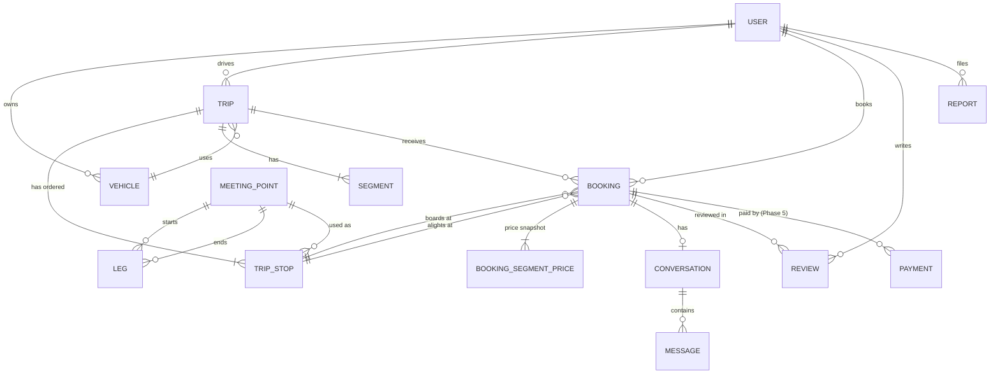
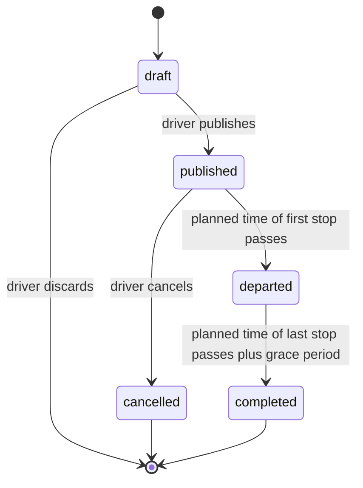

# Domain model

**Owner:** Martin · **Last reviewed:** 2026-11-13 · **Status:** Proposed

The core entities, their relationships and invariants. Names match the
[glossary](../glossary.md). Business rules are in
[pricing and seats](../product/pricing-and-seats.md).

## Entity relationships

## Entities

### User

| Field | Notes |
| ----- | ----- |
| `id` | UUID v7 |
| `phone` | E.164, verified; unique |
| `email` | Optional, verified if present |
| `first_name`, `photo`, `bio` | Public profile; last name is never shown publicly |
| `languages` | Languages spoken, shown on profile |
| `locale` | App language |
| `verification` | Set of: `phone`, `email`, `audkenni` |
| `licence_declared_at` | When the user declared they hold a valid driving licence (needed to publish trips) |
| `roles` | `member`, `operator`; admin access needs `operator` |
| `status` | `active`, `suspended`, `deleted` |
| `created_at`, `deleted_at` | Deletion anonymises; see [privacy](../compliance/privacy-gdpr.md) |

### Vehicle

`id`, `owner_id`, `make`, `model`, `colour` (shown on trips to everyone),
`registration` (optional until the trip departs; shown only to booked
passengers), `status`. Who owns the car
in real life does not matter; the user is responsible for being allowed to
use it ([spec 3](../specs/2026-11-13-post-a-trip.md#32-cars)).

### MeetingPoint

See [meeting points](../product/meeting-points.md#data-kept-for-each-meeting-point)
and [spec 2](../specs/2026-11-13-meeting-points.md#6-data-and-api).
Location stored as PostGIS `geography(Point, 4326)`. `status` is `draft`,
`active`, `paused`, `retiring` or `retired`. `search_text` holds the
normalised names and aliases with a trigram index. Photos are
`MeetingPointPhoto` records.

### Place

Towns, villages and landmarks that are not meeting points, used by place
search to find the nearest meeting points: `name`, `aliases`, `location`,
`kind`, `region`, `search_text`.

### MeetingPointIssue

A user's report of a problem with a meeting point: `user_id` (removed when
resolved), `meeting_point_id`, `reason`, `note`, `status`, `resolution`.

### Leg

`from_meeting_point_id`, `to_meeting_point_id`, `distance_m`, `duration_s`,
`computed_at`, `source` (routing engine and data version). Directional:
A→B and B→A are separate legs because routes can differ. Computed for every
ordered pair of active meeting points connected by road.

### Trip

| Field | Notes |
| ----- | ----- |
| `id` | UUID v7 |
| `driver_id`, `vehicle_id` | |
| `capacity` | Seats offered, 1 to `max_capacity` (8) |
| `booking_mode` | `instant` or `approval` |
| `price_level` | Percentage of the suggested prices, 0 (free) up to the cap ([ADR 0012](../decisions/0012-trip-price-level.md)) |
| `status` | `draft`, `published`, `departed`, `completed`, `cancelled` |
| `preferences` | Luggage, pets, smoking, etc. |
| `notes` | Free text from the driver |
| `published_at`, `cancelled_at`, `cancel_reason` | |

### TripStop

`id`, `trip_id`, `meeting_point_id`, `position` (0-based, contiguous),
`planned_at` (timestamptz). Unique (`trip_id`, `position`).

### Segment

`trip_id`, `index` (0 … stops − 2), `from_stop_id`, `to_stop_id`, `price`
(integer, minor units), `currency`, `distance_m`, `occupancy` (maintained in
the booking transaction, checked by `CHECK (occupancy <= capacity)` through a
trigger or a denormalised capacity column).

### Booking

| Field | Notes |
| ----- | ----- |
| `id` | UUID v7 |
| `trip_id`, `passenger_id` | |
| `from_stop_id`, `to_stop_id` | Stop IDs, not positions |
| `seats` | ≥ 1 |
| `status` | `requested`, `accepted`, `declined`, `expired`, `cancelled`, `completed`, `no_show` |
| `total_price`, `currency` | Snapshot at booking time |
| `requested_at`, `decided_at`, `expires_at` | |
| `cancelled_by`, `cancel_reason`, `cancelled_at` | Reasons include `weather`, `road_closed` |

### BookingSegmentPrice

The per-segment price snapshot of a booking: `booking_id`, `segment_index`,
`price`. Keeps receipts and disputes exact even if the trip changes later.

### Conversation and Message

One conversation per booking, between the driver and that passenger. Messages
have `sender_id`, `body`, `sent_at`, `read_at`. Retained per the
[privacy](../compliance/privacy-gdpr.md#retention) schedule.

### Review

`booking_id`, `author_id`, `subject_id`, `role` (`as_driver` or
`as_passenger`), `rating` (1–5), `comment`, `created_at`, `revealed_at`.

### Report

`reporter_id`, `subject_user_id` or `subject_trip_id`, `category`,
`description`, `status`, `resolution`, `handled_by`, timestamps. Every action
on a report is written to the audit log.

### Payment (Phase 5)

`booking_id`, `provider`, `provider_ref`, `amount`, `fee`, `currency`,
`status`, plus `Payout` and `Refund` records. Designed in Phase 5.

### Supporting records

- `AuditLog`: who did what to which record, when, from where. Append-only.
- `Setting`: operator configuration (rates, timeouts) with change history.
- `NotificationPreference`, `PushToken`, `Block`.
- `WeatherWarning`, `RoadCondition`: cached external data with validity times.

## Invariants

Enforced in the domain package and, where possible, in the database too.

1. A trip has at least two stops; positions are contiguous from 0.
2. Planned times strictly increase along a trip's stops.
3. A meeting point appears at most once in a trip.
4. A booking's boarding stop comes before its alighting stop on the same trip.
5. For every segment, occupancy never exceeds the trip's capacity.
6. A booking's total price equals seats times the sum of its segment price
   snapshot.
7. A user cannot book their own trip.
8. Reviews exist only for completed bookings, one per author per booking.
9. A trip with active bookings cannot be deleted, only cancelled.

## Trip lifecycle

The booking lifecycle is in
[pricing and seats](../product/pricing-and-seats.md#booking-lifecycle).

## Domain events

Modules communicate changes through events written in the same transaction (an
outbox table) and processed by the worker:

`TripPublished`, `TripChanged`, `TripCancelled`, `BookingRequested`,
`BookingAccepted`, `BookingDeclined`, `BookingExpired`, `BookingCancelled`,
`PassengerNoShow`, `TripCompleted`, `ReviewSubmitted`, `ReportFiled`,
`WeatherWarningMatched`, `RoadClosureMatched`.

Notifications, review reminders and analytics subscribe to these events, so
the booking code never calls the notification code directly.
