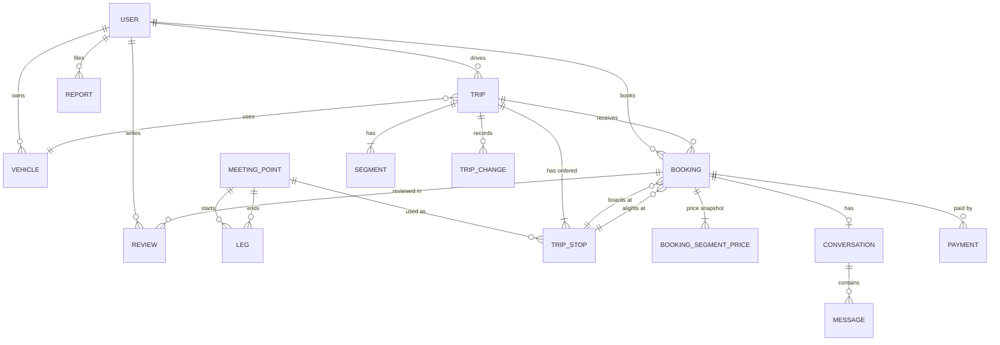
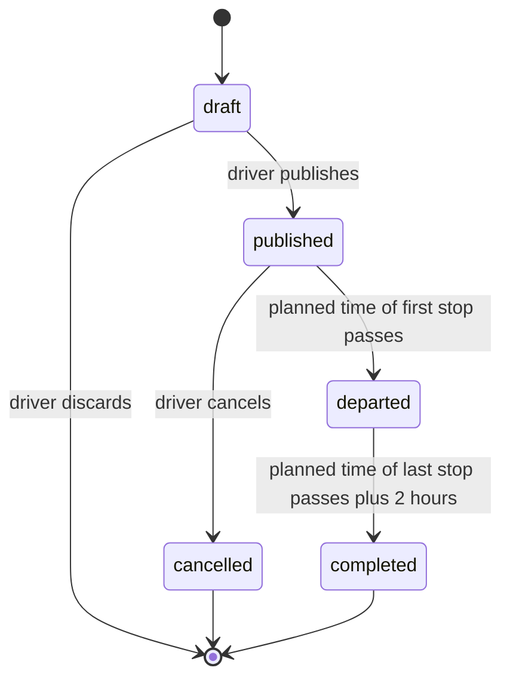

# Domain model

**Owner:** Martin · **Last reviewed:** 2026-11-13 · **Status:** Proposed

The core entities, their relationships and invariants. Names match the
[glossary](../glossary.md). Business rules are in
[pricing and seats](../product/pricing-and-seats.md).

## Entity relationships

## Entities

### User

| Field | Notes |
| ----- | ----- |
| `id` | UUID v7 |
| `phone` | E.164, verified; unique |
| `email` | Optional, verified if present |
| `first_name`, `photo`, `bio` | Public profile; last name is never shown publicly |
| `languages` | Languages spoken, shown on profile |
| `locale` | App language |
| `verification` | Set of: `phone`, `email`, `audkenni` |
| `licence_declared_at` | When the user declared they hold a valid driving licence (needed to publish trips) |
| `women_only_since`, `women_only_withdrawn_at` | When the user opted in to women-only trips, and when the operator withdrew that access; no gender is stored ([spec 14](../specs/2026-11-13-women-only-trips.md)) |
| `roles` | `member`, `operator`; admin access needs `operator` |
| `status` | `active`, `suspended` (with `suspended_until`, empty when permanent), `deleted` (only the one shared former member, which erased accounts' trips and bookings move to) |
| `delete_after` | Set while "Delete my account" waits, 7 days; the status stays as it was, so keeping the account never lifts a suspension ([spec 11](../specs/2026-11-13-privacy-self-service.md#34-delete-my-account)) |
| `created_at`, `deleted_at` | Deletion anonymises; see [privacy](../compliance/privacy-gdpr.md) |

### Vehicle

`id`, `owner_id`, `make`, `model`, `colour` (one of a fixed list; shown on
trips to everyone), `registration` (optional until the trip departs; stored
in capitals without spaces or hyphens, 2 to 8 letters and digits; shown only
to booked passengers), `removed_at` (a removed car leaves the driver's list
and their drafts, and stays on the published trips that used it; a car no
published trip used is deleted; a car on a trip that has not ended cannot
be removed). Who owns the car in real life does not
matter; the user is responsible for being allowed to use it
([spec 3](../specs/2026-11-13-post-a-trip.md#32-cars)).

### MeetingPoint

See [meeting points](../product/meeting-points.md#data-kept-for-each-meeting-point)
and [spec 2](../specs/2026-11-13-meeting-points.md#6-data-and-api).
Location stored as PostGIS `geography(Point, 4326)`. `status` is `draft`,
`active`, `paused`, `retiring` or `retired`. `search_text` holds the
normalised names and aliases with a trigram index. Photos are
`MeetingPointPhoto` records. `sample` marks the sample points that local
and staging databases get until the real list exists (milestone 3); the app
tags them.

### Place

Towns, villages and landmarks that are not meeting points, used by place
search to find the nearest meeting points: `name`, `aliases`, `location`,
`kind` (`area`, `town`, `village` or `landmark`), `region`, `search_text`,
`sample`. Its meeting points are the active ones within `match_radius_m`, or,
for a place with `municipalities` (such as the capital area), every active
point in those municipalities.

### MeetingPointIssue

A user's report of a problem with a meeting point: `user_id` (removed when
resolved), `meeting_point_id`, `reason`, `note`, `status`, `resolution`.

### Leg

`from_meeting_point_id`, `to_meeting_point_id`, `distance_m`, `duration_s`,
`computed_at`, `source` (routing engine and data version, or the sample road
graph for the sample points). Directional:
A→B and B→A are separate legs because routes can differ. Computed for every
ordered pair of active meeting points connected by road.

### Trip

| Field | Notes |
| ----- | ----- |
| `id` | UUID v7 |
| `driver_id`, `vehicle_id` | The car may be missing while the trip is a draft |
| `capacity` | Seats offered, 1 to `max_capacity` (8) |
| `booking_mode` | `instant` or `approval` |
| `price_level` | Percentage of the suggested prices, 0 (free) up to the cap ([ADR 0012](../decisions/0012-trip-price-level.md)) |
| `status` | `draft`, `published`, `departed`, `completed`, `cancelled` |
| `luggage`, `pets`, `smoking`, `child_seat`, `chat` | The preferences, one column each with a fixed list of values |
| `note` | Free text from the driver, at most 500 characters, no contact details |
| `departs_at`, `arrives_at` | Copies of the first and last stops' planned times, for overlap checks and clean-up; empty in a draft until the departure is chosen |
| `women_only` | Shown to everyone; only women who have opted in can book it; fixed once a request or booking exists (not built yet) |
| `published_at` | |
| `completed_at` | Two hours after its last stop's planned time, when it completed on its own ([spec 8, R8.1](../specs/2026-11-13-trip-day-reviews-and-reliability.md#36-trip-completion-e4)), however late the job ran |
| `cancelled_at`, `cancel_reason`, `cancel_note`, `counts_on_reliability` | When the driver cancelled the trip, why (a fixed list), their note to everyone on it (up to 500 characters, without contact details), and whether it counts on their reliability, once for the trip ([spec 6, 3.3](../specs/2026-11-13-changes-and-cancellations.md#33-cancelling-a-trip-driver)) |
| `sample` | Sample data made by the seed for local development and staging |

### TripStop

`id`, `trip_id`, `meeting_point_id`, `position` (0-based, contiguous),
`planned_at` (timestamptz; empty in a draft until the departure is chosen),
`removed_at` (when the driver removed the stop from a published trip,
milestone 6, PR 6b). A removed stop stays for the bookings that once got
in or out there and still name it; every list of a trip's stops, search
included, leaves it out, and it keeps the position it had. Among the stops
not removed, (`trip_id`, `position`) and (`trip_id`, `meeting_point_id`)
are unique (partial unique indexes), so a removed stop can be added again.

### Segment

Made when the trip is published, split in two when a stop is added on it
(milestone 6, PR 6a), and two joined into one when the stop between them
is removed (PR 6b), taking the higher occupancy of the two. `trip_id`, `position` (0 … stops − 2),
`from_stop_id`, `to_stop_id`, `distance_m`, `duration_s`, the
`suggested_price`, `cap` and `price` at publishing (integers, whole krónur),
`currency`, `capacity` (the trip's seats, copied) and `occupancy`
(maintained in the booking transaction, held by
`CHECK (occupancy between 0 and capacity)`).

### TripChange

One row per change to a published trip, so passengers can see what changed:
`trip_id`, `kind` (`time`, `stop_added`, `stop_removed`, `seats`,
`price_level`, `car`, `booking_mode`, `details`), `before`, `after`,
`changed_at`. See [spec 6](../specs/2026-11-13-changes-and-cancellations.md#6-data-and-api).

As built (milestone 6, PR 5a): the table `trip_changes`, with `kind` one of
`departure`, `seats`, `priceLevel`, `vehicle`, `bookingMode` and `details`
(the domain's `tripChangeKinds`), `addStop` (PR 6a), `removeStop` (PR
6b), and `before` and
`after` as small flat JSON objects, such as `{ "departsAt": "…" }`, or for
the seats `{ "seats": 3, "priceLevel": 120 }` with the level they left (PR
5b). For the preferences and note, `after` says only whether the note
changed (`noteChanged`), never its text. A new car keeps the car's ID,
make, model and colour before and after, never its number plate (PR 5c). A
new stop keeps, after, its meeting point's ID, names and planned time (PR
6a); a stop removed keeps them before, with `after` empty (PR 6b). It goes
with the trip. A booking shows the moves, new cars and stops added or
removed after it was booked, and a notification about one points to its
row (`notifications.trip_change_id`), so each is told with its own times,
car or stop.

### Booking

| Field | Notes |
| ----- | ----- |
| `id` | UUID v7 |
| `trip_id`, `passenger_id` | |
| `from_stop_id`, `to_stop_id` | Stop IDs, not positions |
| `seats` | ≥ 1 |
| `status` | `requested`, `accepted` (awaiting payment), `confirmed` (paid), `declined`, `expired`, `cancelled`, `completed`, `no_show` |
| `total_price`, `currency` | Snapshot at booking time |
| `requested_at`, `decided_at`, `expires_at`, `payment_due_at` | A request's deadline (R5.5) and an accepted booking's payment deadline (rule M1) |
| `confirmed_at`, `expired_at` | When it was paid (or, when free, accepted) and when a deadline passed |
| `completed_at` | When its trip completed with it ([spec 8, R8.2](../specs/2026-11-13-trip-day-reviews-and-reliability.md#36-trip-completion-e4)): reviews count from this moment |
| `party_confirmed_at` | The passenger confirmed that everyone in a booking of more than one seat on a women-only trip can join |
| `message`, `decline_reason`, `attempt_key` | Request note, reason seen only by the operator, idempotency key ([spec 5](../specs/2026-11-13-booking-and-requests.md#6-data-and-api)) |
| `cancelled_by`, `cancel_reason`, `cancel_note`, `cancelled_at` | Reasons from a fixed list, including `weather`, `road_closed` and `plans_changed`; the note, up to 500 characters without contact details, only from a driver. A request declined because the driver cancelled the trip keeps `driver`, the trip's reason and its note |
| `refund_amount`, `counts_on_reliability` | Worked out by the domain when the booking is cancelled ([spec 6](../specs/2026-11-13-changes-and-cancellations.md#4-rules)); the refund is at most the total, and is the payment once one comes through after cancelling |
| `departs_at_when_booked` | The trip's departure when the booking was made: moved more than 30 minutes from it, the passenger may cancel for free (R6.3) |

### BookingSegmentPrice

The per-segment price snapshot of a booking: `booking_id`,
`segment_position`, `price`. Keeps receipts and disputes exact even if the trip changes later.
When a stop is added, positions after it move up with the segments, and the
price for the split segment is shared between the two new ones by their
distances, keeping the booking's total (PR 6a).

### Conversation and Message

One conversation per booking, between the driver and that passenger, with
`opened_at` (booking confirmed) and `closes_at` (7 days after the trip's
planned arrival). Messages have `sender_id` (empty for a system line), `kind`
(`text`, `quick`, `system`), `body` for a text, or `key` and `params` for a
quick message or system line, `client_id` (one message per client ID and
sender, so a retry is stored once; only a message to all passengers puts
one client ID in several conversations of a trip), `sent_at`, `read_at`.
Opened in the transaction that confirms the booking. Retained per the
[privacy](../compliance/privacy-gdpr.md#retention) schedule. See
[spec 7](../specs/2026-11-13-chat-and-notifications.md#6-data-and-api).

### Review

`booking_id`, `author_id`, `subject_id`, `role` (`as_driver` or
`as_passenger`), `rating` (1–5), `comment`, `created_at`, `revealed_at`,
`hidden_at` (moderation).

### Trip day and reliability records

Detailed in [spec 8](../specs/2026-11-13-trip-day-reviews-and-reliability.md#6-data-and-api):
`CheckIn` ("I'm here": trip stop, user, the passenger's booking, time;
never a location), `Dispute`
(a no-show or a missing driver, the other side's answer and the outcome),
`ReliabilityRecord` (one per kept or not-kept trip or booking, with whether
it counts and why not) and `UserStats` (rating and reliability totals).

### Report

`reporter_id`, `subject_user_id` or `subject_trip_id`, `category`,
`description`, `status`, `resolution`, `handled_by`, timestamps. Every action
on a report is written to the audit log. A report can also be about a
message, review or booking; safety reports are urgent. Related records, in
[spec 9](../specs/2026-11-13-safety-and-moderation.md#6-data-and-api):
`ModerationAction` (warning, hidden content, suspension, reinstatement,
operator cancellation or refund, each with a statement of reasons and an
appeal) and `OperatorNote`.

### Payment

`booking_id`, `provider`, `provider_ref`, `amount`, `fee`, `currency`,
`status`, card brand and last four digits. Payments run in the app from the
beta ([ADR 0013](../decisions/0013-in-app-payments-only.md)). Related records,
detailed in [spec 13](../specs/2026-11-13-payments.md#6-data-and-api):
`Refund`, `PayoutAccount` (provider reference and status only), `Payout`,
`Chargeback`, an append-only `LedgerEntry` for every money movement, and
`ProviderEvent` for processing webhooks exactly once.

### Supporting records

- `AuditLog`: who did what to which record, when, from where (the
  operator, their console session, an action such as
  `meeting_point.update`, the record's type and ID, the fields before and
  after, IP address and browser). Append-only: a database trigger refuses
  changes, and deleting entries younger than 3 years
  ([milestone 8 plan](../plans/2026-11-16-milestone-8-operator-console-and-meeting-points.md)).
- `OperatorSession`: a console session of an operator, separate from the
  app's sessions; ends 30 minutes after last use, 12 hours after sign-in,
  on sign-out, or when the role is removed or the account suspended
  ([ADR 0028](../decisions/0028-operator-console-web-app-and-passkeys.md)).
- `Setting`: operator configuration (rates, timeouts, switches) with a range,
  a `SettingChange` history and a `SettingsVersion` that trips and bookings
  record ([spec 10](../specs/2026-11-13-operator-settings-and-metrics.md#6-data-and-api)).
- `SearchLog` (anonymous: places, date, result count, time, platform),
  `Corridor`, `WeeklyMetric`, `Announcement`.
- Privacy records ([spec 11](../specs/2026-11-13-privacy-self-service.md#6-data-and-api)):
  `DataExport`, `ErasedAccount`, `BlockedNumber`, `PrivacyRequest`,
  `RetentionRun`, `Hold`.
- Beta records ([spec 12](../specs/2026-11-13-beta-access-and-feedback.md#6-data-and-api)):
  `WaitlistEntry`, `InviteCode` (users record the code they joined with),
  `Feedback`.
- `NotificationPreference`, `PushToken`.
- `Block`: blocker and blocked; hides both from each other ([spec 9](../specs/2026-11-13-safety-and-moderation.md#32-blocking-g2)).
- `Notification` and `NotificationDelivery`: who was told what kind of thing,
  about which booking or message, on which channel and what came of it
  (`queued`, `sending`, `sent`, `failed` or `skipped` with the reason, the
  attempts and the provider's reference), without the text; kept 90 days
  ([spec 7](../specs/2026-11-13-chat-and-notifications.md#6-data-and-api)).
  A notification's unique key, from its event and the person, makes it once.
  `OutboxEvent` (the domain events below, IDs only, kept 7 days once
  processed) and `ScheduledNotification` (one that waits for a moment, such
  as the halfway reminder of a request, unique by key) feed them.
- `WeatherWarning`, `RoadCondition`: cached external data with validity times.

## Invariants

Enforced in the domain package and, where possible, in the database too.

1. A trip has at least two stops; positions are contiguous from 0.
2. Planned times strictly increase along a trip's stops once it is
   published; a draft keeps the times the driver left until publishing
   checks them.
3. A meeting point appears at most once in a trip.
4. A booking's boarding stop comes before its alighting stop on the same trip.
5. For every segment, occupancy never exceeds the trip's capacity.
6. A booking's total price equals seats times the sum of its segment price
   snapshot.
7. A user cannot book their own trip.
8. Reviews exist only for completed bookings, one per author per booking.
9. A trip with active bookings cannot be deleted, only cancelled.
10. Only users who have opted in, and whose access is not withdrawn, can
    publish, request or book a women-only trip.

## Trip lifecycle

The booking lifecycle is in
[pricing and seats](../product/pricing-and-seats.md#booking-lifecycle).

## Domain events

Modules communicate changes through events written in the same transaction (an
outbox table) and processed by the worker:

`TripPublished`, `DepartureMoved` (one per booked passenger, with the
recorded change), `TripChanged` (a new car or stop, likewise), `TripCancelled`, `BookingRequested`,
`BookingAccepted`, `BookingConfirmed`, `BookingDeclined`, `BookingExpired`
(a request nobody answered, or an accepted booking nobody paid for),
`BookingWithdrawn`, `BookingCancelled`,
`TripDeparted`, `CheckedIn`, `PassengerNoShow`, `DriverAbsentReported`,
`DisputeAnswered`, `DisputeDecided`, `TripCompleted`, `MessageSent`, `ReviewSubmitted`, `ReviewsRevealed`, `ReportFiled`, `ReportResolved`,
`UserBlocked`, `UserSuspended`, `UserReinstated`, `ContentHidden`,
`WomenOnlyAccessWithdrawn`, `WomenOnlyAccessRestored`,
`WeatherWarningMatched`, `RoadClosureMatched`.

Notifications, review reminders and analytics subscribe to these events, so
the booking code never calls the notification code directly. Spec 5's
booking events and `MessageSent` are written to the outbox from milestone 5;
the others come with the specs that make them happen.
