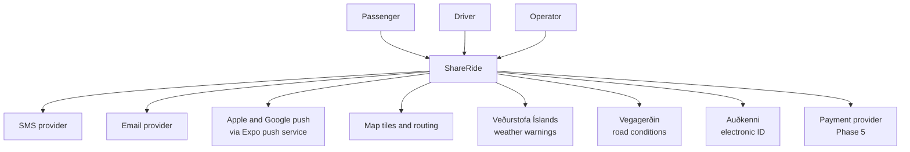
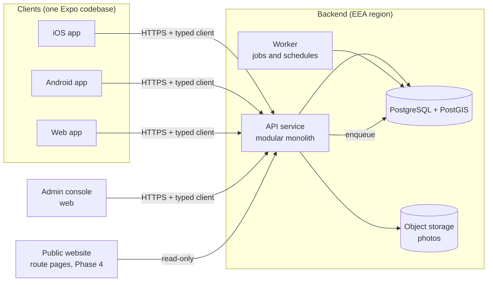
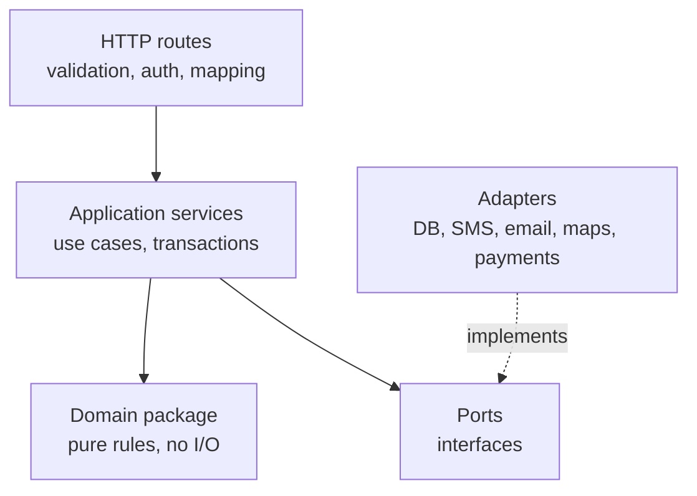
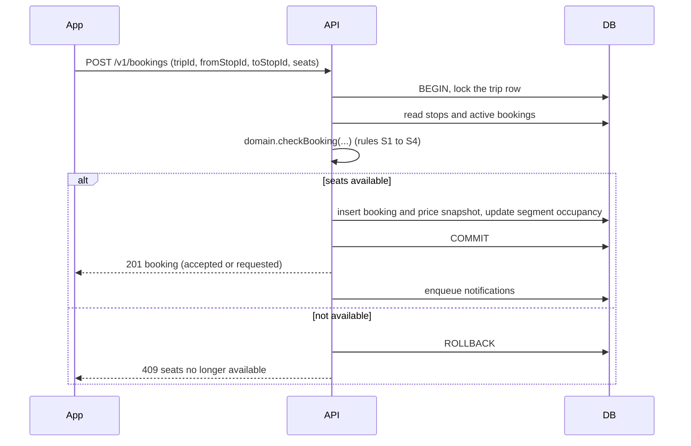

# Architecture overview

**Owner:** Martin · **Last reviewed:** 2026-11-13 · **Status:** Proposed

This describes the target architecture. Choices marked in ADRs as `Proposed`
are the working assumption until accepted.

## System context



## Containers



- **Clients:** one Expo app for iOS, Android and web
  ([ADR 0003](../decisions/0003-cross-platform-client-expo.md)). The admin
  console is a separate web app section with its own sign-in and roles.
- **API service:** a TypeScript modular monolith
  ([ADR 0004](../decisions/0004-backend-modular-monolith.md)).
- **Worker:** the same codebase started in worker mode. Runs scheduled and
  queued jobs: request expiry, reminders, trip completion, weather and road
  checks, data retention clean-up. The job queue lives in PostgreSQL (for
  example pg-boss) so there is no extra infrastructure to run.
- **Database:** PostgreSQL with PostGIS
  ([ADR 0005](../decisions/0005-postgresql-postgis.md)).
- **Object storage:** S3-compatible storage in the EEA for profile and meeting
  point photos.

## API modules

Each module owns its tables and exposes a small interface to other modules.
No module reads another module's tables directly.

| Module | Responsibility |
| ------ | -------------- |
| `users` | Accounts, profiles, vehicles, verification levels, blocking |
| `auth` | Sign-in, sessions, tokens, roles |
| `meeting-points` | Meeting points, legs, problem reports, search by name and location |
| `trips` | Creating, editing, publishing, cancelling trips; stops and segments |
| `booking` | Requests, acceptance, cancellations, no-shows, seat capacity |
| `pricing` | Suggested prices, caps, price snapshots, configuration |
| `search` | Finding trips by places, dates and available seats |
| `messaging` | Chat between driver and booked passengers |
| `notifications` | Push, email, SMS; user preferences; templates per language |
| `reviews` | Ratings and reviews, reveal rules |
| `safety` | Reports, moderation actions, audit log |
| `conditions` | Weather warnings and road closures matched to trips |
| `payments` | Payment port and provider adapters (Phase 5) |
| `admin` | Operator tools on top of the other modules |
| `privacy` | Data export, deletion, retention jobs |

## Layering inside the backend



- The **domain package** holds pricing, seat capacity, booking state
  transitions and trip-editing rules as pure functions and types. It has no
  dependencies on frameworks, databases or the network, which makes it fast to
  test and safe to share with the client (for instant price previews).
- **Application services** orchestrate a use case: load data, call the domain,
  persist inside one transaction, emit events.
- **Ports and adapters** isolate every external service, so changing an SMS or
  payment provider touches one adapter.

## Key flows

### Booking a segment range



### Search

1. Resolve the "from" and "to" inputs to candidate meeting points (by name or
   within a radius of a chosen location).
2. Find published trips on the date where a "from" candidate stop comes before
   a "to" candidate stop.
3. Keep trips with enough free seats on that range; compute the price for the
   range.
4. Rank by departure time closeness, then price, then driver reliability.

Iceland's scale (hundreds of meeting points, thousands of trips) means this is
a plain SQL query with indexes. No search engine is needed.

## Cross-cutting concerns

| Concern | Approach |
| ------- | -------- |
| API contract | Zod schemas in a shared `contracts` package generate the OpenAPI document and the typed client used by the apps |
| Authentication | See [ADR 0010](../decisions/0010-authentication-and-identity.md) |
| Authorisation | Checked in application services by role and ownership (a driver edits only their trips) |
| Realtime | Chat and booking updates over WebSocket or server-sent events from the API; push notifications when the app is closed |
| Localisation | See [ADR 0011](../decisions/0011-localization.md) |
| Observability | Structured JSON logs, OpenTelemetry traces, error tracking with an EU data region, uptime checks |
| Configuration | Environment variables validated at start-up; operator settings (rates, timeouts) in the database with an audit log |
| Feature flags | Simple database-backed flags at first |
| Rate limiting | Per IP and per user on sign-in codes, search and booking |
| Time | UTC in storage, `Atlantic/Reykjavik` for display |

## Repository layout

Created in Phase 2 when the monorepo is scaffolded
([ADR 0002](../decisions/0002-monorepo-and-typescript.md)).

```text
apps/
  mobile/          # Expo app: iOS, Android, web (passenger and driver)
  api/             # API service and worker (modular monolith)
  admin/           # Operator console (web)
  website/         # Public website and route pages (Phase 4)
packages/
  domain/          # Pure business rules: pricing, seats, booking, trips
  contracts/       # Zod schemas, OpenAPI document, generated API client
  db/              # Database schema, migrations, seed data (meeting points)
  i18n/            # Translations (is, en, later pl) and formatting helpers
  ui/              # Design tokens and shared components
  config/          # Shared TypeScript, lint and test configuration
infra/
  docker/          # Local development: PostgreSQL + PostGIS, mail catcher
  deploy/          # Deployment configuration for staging and production
docs/              # This documentation
```

## Scaling path

The modular monolith comfortably serves Iceland's population. If one module
ever needs to scale or deploy separately (for example `notifications` or
`search`), its interface already exists, so it can move to its own service
without changing the others. Read replicas and caching come before any split.
