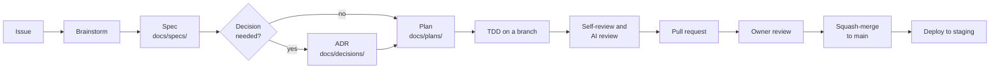

# Development workflow

**Owner:** Martin · **Last reviewed:** 2026-11-13

How a change moves from idea to production, and how Claude Code takes part.
The goal: anyone can open the repository at any time and see what was built,
why, and how it was verified.

## The loop

| Step | Who | Output | Skill or tool |
| ---- | --- | ------ | ------------- |
| Issue | Owner or Claude | GitHub issue from a template | GitHub |
| Brainstorm | Owner with Claude | Agreed design, questions answered | `superpowers:brainstorming` |
| Spec | Claude, approved by owner | `docs/specs/YYYY-MM-DD-<topic>.md` | `superpowers:brainstorming` |
| Decision | Claude, approved by owner | `docs/decisions/NNNN-<title>.md` | `write-adr` (project skill) |
| Plan | Claude | `docs/plans/YYYY-MM-DD-<topic>.md` with small tasks | `superpowers:writing-plans` |
| Build | Claude | Commits on a branch, tests first | `superpowers:test-driven-development`, `superpowers:subagent-driven-development` |
| Review | Claude, then owner | Review notes addressed | `superpowers:requesting-code-review`, `pr-review-toolkit` |
| Finish | Claude | PR opened with the template filled in | `superpowers:finishing-a-development-branch` |

Small changes (typos, copy edits, one-line fixes, dependency bumps) skip the
spec and plan, but still go through a PR.

## Specs

A spec is the agreed design for one feature. It answers: the problem, the
users affected, the behaviour (including edge cases and error states), the
screens, the data and API changes, the rules from
[pricing and seats](../product/pricing-and-seats.md) that apply, privacy
impact, and how we will test it. Specs are approved by the owner before the
plan is written.

## Plans

A plan turns a spec into tasks small enough to finish and verify in a few
minutes each, with exact file paths, the test to write first, and the command
that proves it passes. Plans let a fresh Claude session (or a person) pick up
work without the original conversation.

## Branches and pull requests

See [CONTRIBUTING.md](../../CONTRIBUTING.md). In short: short-lived branches,
Conventional Commits, one concern per PR, squash-merge, `main` always green.

## Working with Claude Code

- Start sessions from the repository root so `CLAUDE.md` loads.
- Ask for the brainstorm explicitly on anything new ("Let's brainstorm the
  booking cancellation flow").
- Use git worktrees (`superpowers:using-git-worktrees`) when running more than
  one task in parallel.
- When Claude makes a decision you want to keep, ask it to record it: in an
  ADR, a spec, or `CLAUDE.md` if it is a working rule.
- Run `/revise-claude-md` (claude-md-management plugin) at the end of a long
  session to capture lessons in `CLAUDE.md`.
- Never let a session push to `main`; review every PR yourself.

## Reviewing as the owner

A PR is ready for you when CI is green and the template is filled in. Review in
this order:

1. Read the linked spec and ADRs. Does the PR match them?
2. Read the tests. Do they describe the behaviour you want?
3. Try it: preview build, staging, or screenshots for UI.
4. Skim the code for anything surprising.
5. Merge, or comment and ask Claude to address the feedback.

## Keeping the project reviewable over time

- `docs/strategy/roadmap.md` is ticked as PRs merge.
- `docs/strategy/open-questions.md` lists everything undecided.
- `CHANGELOG.md` records notable changes per release.
- Every quarter: re-read the ADRs and mark any that no longer hold as
  deprecated or superseded; update "Last reviewed" dates on docs you checked.
