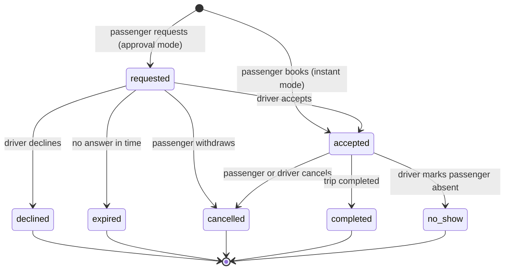

# Pricing and seats

**Owner:** Martin · **Last reviewed:** 2026-11-13 · **Status:** Accepted
([ADR 0006](../decisions/0006-meeting-points-and-segment-pricing.md), with the
driver's price control replaced by [ADR 0012](../decisions/0012-trip-price-level.md));
configuration values are still to be set

These are the business rules for prices, seat capacity, bookings and
cancellations. They are the source of truth for the domain package. If code and
this document disagree, one of them is a bug: fix it or update this file in the
same PR.

## Concepts

- A **trip** has an ordered list of **stops**. Each stop is a meeting point
  with a planned time. A trip has at least two stops.
- A **segment** is the stretch between two consecutive stops. A trip with
  `n` stops has `n − 1` segments.
- A **booking** covers a contiguous range of segments, from a **boarding stop**
  to an **alighting stop** later on the same trip, for one or more seats.
- **Capacity** is the number of seats the driver offers on the trip.

```text
Stops:      A ────────── B ──────────── C ─────────── D
Segments:      seg 0        seg 1          seg 2
Booking:          [ boards at B ......... alights at D ]  covers seg 1 and seg 2
```

Bookings reference stops by their **stop ID**, not by position, so that adding
a stop to a trip does not change the meaning of existing bookings.

## Prices

### Rule P1: price of a booking

The price of a booking is the number of seats multiplied by the sum of the
segment prices it covers:

```text
price = seats × (p[from] + p[from+1] + … + p[to−1])
```

Each segment price `p[k]` is a whole number of krónur per seat. Money is stored
as an integer plus a currency code (see [conventions](../engineering/conventions.md#money)).

### Rule P2: suggested segment price

When a driver builds a trip, the app works out a suggested price for every
segment:

```text
suggested[k] = round_to_step(distance_km[k] × suggested_rate)
```

- `distance_km[k]` is the road distance between the two meeting points, taken
  from the precomputed meeting-point distance table
  ([ADR 0009](../decisions/0009-maps-and-routing.md)).
- `suggested_rate` is in ISK per km per passenger, set centrally by the
  operator.
- `round_to_step` rounds to the nearest price step (default 100 kr). Halves
  round up.

### Rule P3: price limits (cost-sharing cap)

To stay a cost-sharing service and not a taxi service (see
[legal and regulatory](../compliance/legal-and-regulatory.md)), every segment
price stays within limits:

```text
0 ≤ p[k] ≤ cap[k]
cap[k] = round_to_step(distance_km[k] × reference_cost_per_km / (capacity + 1))
```

The idea: a full car must not earn the driver more than the cost of driving.
The driver counts as one of the people sharing the cost, hence `capacity + 1`.
`reference_cost_per_km` is set centrally, for example from the official
mileage allowance for government employees (akstursgjald) or a fuel and wear
estimate. **The formula and its inputs are to be confirmed by the legal
opinion before the beta.**

### Rule P4: the driver's price level

The driver does not edit segment prices one by one
([ADR 0012](../decisions/0012-trip-price-level.md)). They choose one **price
level** `L` for the whole trip, a percentage of the suggested prices:

```text
p[k]  = min(cap[k], round_to_step(distance_km[k] × suggested_rate × L))
L_max = highest step of L at or below
        reference_cost_per_km / ((capacity + 1) × suggested_rate)
```

- `L` goes from 0% (a free ride) to `L_max` in steps of `price_level_step`
  (default 10%). The default is the level of the driver's previous trip, or
  100% (the suggested prices) on their first trip.
- Because the suggestion and the cap are both proportional to distance, `L_max`
  is the same for every segment. The `min` with `cap[k]` only absorbs
  rounding.
- Offering more seats lowers `L_max`. If the chosen level is above the new
  `L_max`, it is lowered to it and the driver is told.
- A price level change applies to new bookings only. Every booking stores a
  snapshot of the segment prices it was made at.
- Lowering the level is always allowed. Raising it is allowed up to `L_max`.

### Rule P5: service fee (Phase 5)

When in-app payments arrive, a passenger service fee is added on top of the
booking price and shown separately. Formula and amount are decided then
(open question Q5). The driver's share is never reduced by the fee.

### Worked example

The reference values below are placeholders for illustration only.

A driver posts Reykjavík (A) → Borgarnes (B) → Blönduós (C) → Akureyri (D) with
3 seats. Suggested rate: 15 kr per km per passenger. Step: 100 kr.

| Segment | Distance (approx.) | Suggested price |
| ------- | ------------------ | --------------- |
| A → B   | 74 km    | 1 100 kr        |
| B → C   | 171 km   | 2 600 kr        |
| C → D   | 143 km   | 2 100 kr        |

A passenger from Reykjavík to Akureyri pays 5 800 kr. A passenger from Borgarnes
to Akureyri pays 2 600 + 2 100 = 4 700 kr. Two seats from Reykjavík to Blönduós
cost 2 × (1 100 + 2 600) = 7 400 kr.

If the driver sets the price level to 80%:

| Segment | Calculation | Price |
| ------- | ----------- | ----- |
| A → B   | 74 × 15 × 0.8 = 888    | 900 kr   |
| B → C   | 171 × 15 × 0.8 = 2 052 | 2 100 kr |
| C → D   | 143 × 15 × 0.8 = 1 716 | 1 700 kr |

The whole route then costs 4 700 kr. At 0% every segment is free.

## Seats

### Rule S1: occupancy

The occupancy of segment `k` is the total number of seats held by bookings
that cover `k` and whose status holds seats (`requested` or `accepted`).

### Rule S2: the capacity invariant

For every segment `k` of every trip: `occupancy(k) ≤ capacity`.

This must hold at all times, including under concurrent bookings. The API
checks it inside a database transaction that locks the trip, and the database
enforces it as a constraint as a second line of defence
([ADR 0006](../decisions/0006-meeting-points-and-segment-pricing.md)).

### Rule S3: availability for a range

```text
available(from, to) = capacity − max(occupancy(k) for k in from … to−1)
```

A booking for `n` seats on that range is possible only if `n ≤ available`.

### Rule S4: who can book

A booking request is valid only if all of these hold:

- the trip is `published` and not departed or cancelled
- the boarding stop comes before the alighting stop on the trip
- the request arrives before the booking cut-off (default: 15 minutes before
  the planned time at the boarding stop)
- the passenger is not the driver and neither has blocked the other
- `seats ≥ 1` and `seats ≤ available(from, to)`

### Rule S5: capacity changes

A driver may reduce capacity only down to the highest current occupancy on any
segment.

### Worked example

Same trip, capacity 3.

| Step | Booking request | Occupancy before (A→B, B→C, C→D) | Result |
| ---- | --------------- | -------------------------------- | ------ |
| 1 | P1: A → D, 1 seat | 0, 0, 0 | Accepted |
| 2 | P2: A → B, 2 seats | 1, 1, 1 | Accepted (A→B now full) |
| 3 | P3: B → C, 2 seats | 3, 1, 1 | Accepted |
| 4 | P4: B → D, 1 seat | 3, 3, 1 | Rejected: B→C is full |
| 5 | P5: C → D, 2 seats | 3, 3, 1 | Accepted |

After step 5 the car is full on every segment: three seats have carried seven
passengers on different parts of the trip.

## Booking modes

- **Instant:** a valid request is accepted immediately.
- **Approval:** the request holds the seats while the driver decides. It
  expires if the driver does not answer within 12 hours, or by 2 hours before
  departure from the boarding stop, whichever is earlier. Expired requests free
  their seats.

The driver chooses the mode per trip. Default during the beta: approval
(decided 2026-11-13).

## Booking lifecycle



A cancellation records who cancelled, when, and the reason (including
`weather` and `road_closed`).

## Trip changes after bookings exist

| Change by driver | Allowed? | Effect on booked passengers |
| ---------------- | -------- | --------------------------- |
| Departure time moves 30 minutes or less | Yes | Notified |
| Departure time moves more than 30 minutes | Yes | Notified; may cancel without it counting against them |
| Add a stop | Yes | Notified; their price stays as booked |
| Remove a stop no booking uses | Yes | Notified |
| Remove a stop a booking uses | No | The driver must contact the passenger, who cancels or the driver cancels that booking |
| Lower the capacity | Down to the highest occupancy | None |
| Change the price level | Yes, from 0% to `L_max` | None; bookings keep their price snapshot |
| Cancel the trip | Yes, with a reason | Every booking is cancelled and the passengers are notified |

## Cancellations and reliability

During the beta no money moves through the app, so the policy is about trust:

- Cancellations and no-shows are counted on each profile and shown as a
  reliability figure.
- Cancellations with reason `weather` or `road_closed` do not count when an
  official warning or closure applied to the route at the time.
- A pattern of late cancellations or no-shows leads to a warning, then a
  suspension, decided in the admin console.

The money-based refund policy for Phase 5 is drafted with the payment provider
choice (see [ADR 0008](../decisions/0008-payments-phased.md)).

## Configuration values

Set centrally by the operator; changes are logged.

| Setting | Default | Notes |
| ------- | ------- | ----- |
| `suggested_rate` | to decide in Phase 1 | ISK per km per passenger |
| `reference_cost_per_km` | to decide in Phase 1 | Basis of the price cap |
| `price_step` | 100 kr | Rounding step for suggested prices and caps |
| `price_level_step` | 10% | Steps of the driver's price level |
| `booking_cutoff` | 15 minutes | Before the planned time at the boarding stop |
| `request_expiry` | 12 hours | Approval mode; also never later than 2 hours before boarding |
| `major_time_change` | 30 minutes | Above this, passengers may cancel without penalty |
| `max_capacity` | the vehicle's passenger seats (all seats minus the driver's) | Driver may offer fewer |
