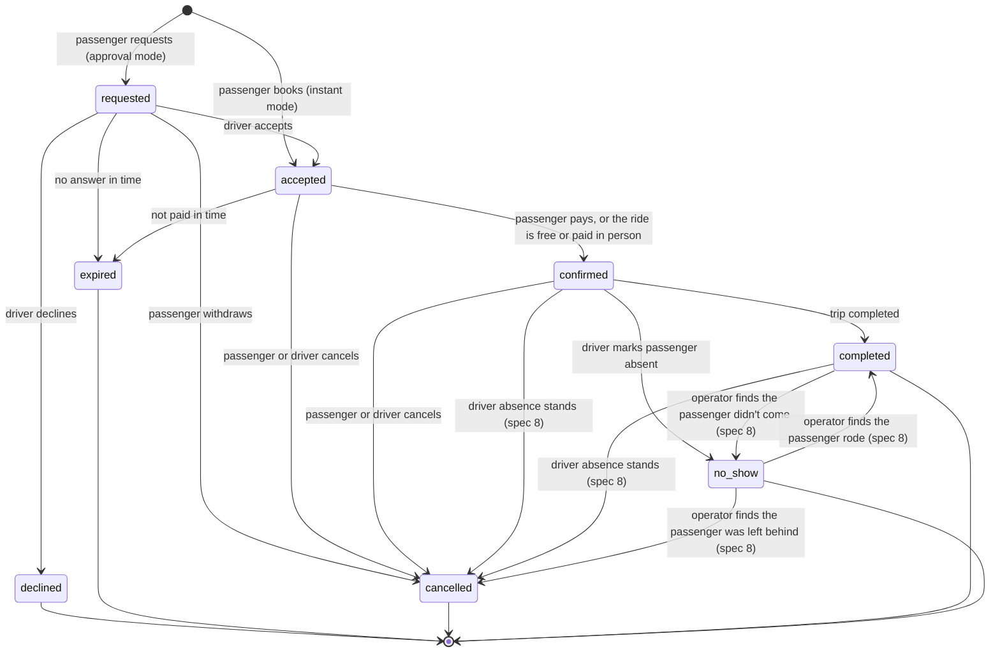

# Pricing and seats

**Owner:** Martin · **Last reviewed:** 2026-11-22 · **Status:** Accepted
([ADR 0006](../decisions/0006-meeting-points-and-segment-pricing.md), with the
driver's price control replaced by [ADR 0012](../decisions/0012-trip-price-level.md),
payments by [ADR 0013](../decisions/0013-in-app-payments-only.md), paying
the driver in person until then by
[ADR 0038](../decisions/0038-pay-the-driver-in-person-until-card-payments.md),
and the trip limit added by [ADR 0030](../decisions/0030-limit-what-a-whole-trip-brings-the-driver.md));
configuration values are still to be set

These are the business rules for prices, seat capacity, bookings and
cancellations. They are the source of truth for the domain package. If code and
this document disagree, one of them is a bug: fix it or update this file in the
same PR.

## Concepts

- A **trip** has an ordered list of **stops**. Each stop is a meeting point
  with a planned time. A trip has at least two stops.
- A **segment** is the stretch between two consecutive stops. A trip with
  `n` stops has `n − 1` segments.
- A **booking** covers a contiguous range of segments, from a **boarding stop**
  to an **alighting stop** later on the same trip, for one or more seats.
- **Capacity** is the number of seats the driver offers on the trip.

```text
Stops:      A ────────── B ──────────── C ─────────── D
Segments:      seg 0        seg 1          seg 2
Booking:          [ boards at B ......... alights at D ]  covers seg 1 and seg 2
```

Bookings reference stops by their **stop ID**, not by position, so that adding
a stop to a trip does not change the meaning of existing bookings.

## Prices

### Rule P1: price of a booking

The price of a booking is the number of seats multiplied by the sum of the
segment prices it covers:

```text
price = seats × (p[from] + p[from+1] + … + p[to−1])
```

Each segment price `p[k]` is a whole number of krónur per seat. Money is stored
as an integer plus a currency code (see [conventions](../engineering/conventions.md#money)).

### Rule P2: suggested segment price

When a driver builds a trip, the app works out a suggested price for every
segment:

```text
suggested[k] = round_to_step(distance_km[k] × suggested_rate)
```

- `distance_km[k]` is the road distance between the two meeting points, taken
  from the precomputed meeting-point distance table
  ([ADR 0009](../decisions/0009-maps-and-routing.md)).
- `suggested_rate` is in ISK per km per passenger, set centrally by the
  operator.
- `round_to_step` rounds to the nearest price step (default 100 kr). Halves
  round up.

### Rule P3: price limits (cost-sharing cap)

To stay a cost-sharing service and not a taxi service (see
[legal and regulatory](../compliance/legal-and-regulatory.md)), every segment
price stays within limits:

```text
0 ≤ p[k] ≤ cap[k]
cap[k] = round_to_step(distance_km[k] × reference_cost_per_km / (capacity + 1))
```

The idea: a full car must not earn the driver more than the cost of driving.
The driver counts as one of the people sharing the cost, hence `capacity + 1`.
`reference_cost_per_km` is set centrally from the official mileage allowance
for government employees (akstursgjald): 150 kr per km to start, the rate for
the first 10 000 km from 1 June 2026 (decided 2026-11-13). **The formula and its inputs are to be confirmed by the legal
opinion before the beta.**

**The trip limit.** The cap per seat keeps a full car within the cost only
while nothing changes after people book. A whole trip is limited too
([ADR 0030](../decisions/0030-limit-what-a-whole-trip-brings-the-driver.md),
[spec 17](../specs/2026-11-17-trip-earnings-limit.md); accepted and built
2026-11-17, the payout hold with payouts in milestone 15):

```text
trip_limit = Σ_k capacity × cap[k]
takings    = Σ (total price − refund) of the trip's bookings that are
             requested, accepted, confirmed, completed or no_show, or
             cancelled after they were confirmed
```

- `trip_limit` is what a full car pays at the caps, with the capacity the
  trip has now. It is built from the rounded caps, so rounding follows A39.
- `takings` is everything the trip's bookings pay, or will pay, the driver,
  at the prices they were made at. Money the driver keeps after a no-show or
  a late cancellation counts (rule M2); a refund does not. Declined and
  expired bookings, and requests withdrawn or bookings cancelled before
  they were paid, count nothing. A booking paid to the driver in person
  (rule M6) that is cancelled or a no-show counts nothing either, as no
  money changed hands.
- The passenger service fee (rule P5) is not part of `takings`.
- A booking is valid only if `takings` stays at or below `trip_limit` after
  it (checked with the seats, rule S2). Rule P4 sets the level so that this
  holds; the check is the second line of defence.
- Nothing is ever taken back: bookings keep their price whatever changes.

### Rule P4: the driver's price level

The driver does not edit segment prices one by one
([ADR 0012](../decisions/0012-trip-price-level.md)). They choose one **price
level** `L` for the whole trip, a percentage of the suggested prices:

```text
p[k]  = min(cap[k], round_to_step(distance_km[k] × suggested_rate × L))
L_cap = highest step of L at or below
        reference_cost_per_km / ((capacity + 1) × suggested_rate)
L_max = highest step of L at or below L_cap with
        takings + Σ_k (capacity − occupancy(k)) × p[k](L) ≤ trip_limit
```

- `L` goes from 0% (a free ride) to `L_max` in steps of `price_level_step`
  (default 10%). The default is the level of the driver's previous trip, or
  100% (the suggested prices) on their first trip.
- Because the suggestion and the cap are both proportional to distance, `L_cap`
  is the same for every segment. The `min` with `cap[k]` only absorbs
  rounding.
- `L_max` is the highest level at which a full car still fits in the trip
  limit, counting what is already booked. With no bookings, or bookings made
  with the seats the trip has now, it equals `L_cap`.
- Offering more seats lowers `L_max`; so can a no-show or a late
  cancellation, whose seat is free again while its money stays counted, a
  stop added or removed, whose stretches' prices round on their own, and a
  booking made before the level was raised that leaves (spec 17). If the
  chosen level is above the new `L_max`, it is lowered to it for new
  bookings; a change the driver makes says so before saving. If nothing
  fits, `L_max` is 0% and the seats left are free.
- A price level change applies to new bookings only. Every booking stores a
  snapshot of the segment prices it was made at.
- Lowering the level is always allowed. Raising it is allowed up to `L_max`.

### Rule P5: service fee

From public launch, a passenger service fee is added on top of the booking
price and shown separately; the beta has none. The amount is decided before
launch from beta data ([ADR 0014](../decisions/0014-passenger-service-fee-from-launch.md)).
The driver's share is never reduced by the fee, and a full refund includes
it.

### Worked example

The suggested rate below is the starting value (decided 2026-11-13);
distances are approximate.

A driver posts Reykjavík (A) → Borgarnes (B) → Blönduós (C) → Akureyri (D) with
3 seats. Suggested rate: 15 kr per km per passenger. Step: 100 kr.

| Segment | Distance (approx.) | Suggested price |
| ------- | ------------------ | --------------- |
| A → B   | 74 km    | 1 100 kr        |
| B → C   | 171 km   | 2 600 kr        |
| C → D   | 143 km   | 2 100 kr        |

A passenger from Reykjavík to Akureyri pays 5 800 kr. A passenger from Borgarnes
to Akureyri pays 2 600 + 2 100 = 4 700 kr. Two seats from Reykjavík to Blönduós
cost 2 × (1 100 + 2 600) = 7 400 kr.

If the driver sets the price level to 80%:

| Segment | Calculation | Price |
| ------- | ----------- | ----- |
| A → B   | 74 × 15 × 0.8 = 888    | 900 kr   |
| B → C   | 171 × 15 × 0.8 = 2 052 | 2 100 kr |
| C → D   | 143 × 15 × 0.8 = 1 716 | 1 700 kr |

The whole route then costs 4 700 kr. At 0% every segment is free.

The trip limit with 3 seats is 3 × (2 800 + 6 400 + 5 400) = 43 800 kr,
three quarters of the 58 200 kr that 388 km cost at 150 kr per km. Suppose
the driver first offers 1 seat at its highest level (500%, 29 100 kr for the
whole route), it is booked, and they then offer 3 seats. Without the trip
limit the two new seats would cost 14 600 kr each, 58 300 kr in all. With
it, 43 800 − 29 100 = 14 700 kr is left for two seats, so `L_max` is 120%
and each new seat costs 7 000 kr for the whole route: 43 100 kr in all
([spec 17](../specs/2026-11-17-trip-earnings-limit.md#6-recommendation)).

## Seats

### Rule S1: occupancy

The occupancy of segment `k` is the total number of seats held by bookings
that cover `k` and whose status holds seats (`requested`, `accepted` or
`confirmed`).

### Rule S2: the capacity invariant

For every segment `k` of every trip: `occupancy(k) ≤ capacity`.

This must hold at all times, including under concurrent bookings. The API
checks it inside a database transaction that locks the trip, and the database
enforces it as a constraint as a second line of defence
([ADR 0006](../decisions/0006-meeting-points-and-segment-pricing.md)).

### Rule S3: availability for a range

```text
available(from, to) = capacity − max(occupancy(k) for k in from … to−1)
```

A booking for `n` seats on that range is possible only if `n ≤ available`.

### Rule S4: who can book

A booking request is valid only if all of these hold:

- the trip is `published`, or under way (`departed`): once it has left its
  first stop, a later stop can still be booked until its own cut-off
  (Martin, 2026-11-16, A45)
- the boarding stop comes before the alighting stop on the trip
- the request arrives before the booking cut-off (default: 15 minutes before
  the planned time at the boarding stop)
- the passenger is not the driver and neither has blocked the other
- `seats ≥ 1` and `seats ≤ available(from, to)`

### Rule S5: capacity changes

A driver may reduce capacity only down to the highest current occupancy on any
segment.

### Worked example

Same trip, capacity 3.

| Step | Booking request | Occupancy before (A→B, B→C, C→D) | Result |
| ---- | --------------- | -------------------------------- | ------ |
| 1 | P1: A → D, 1 seat | 0, 0, 0 | Accepted |
| 2 | P2: A → B, 2 seats | 1, 1, 1 | Accepted (A→B now full) |
| 3 | P3: B → C, 2 seats | 3, 1, 1 | Accepted |
| 4 | P4: B → D, 1 seat | 3, 3, 1 | Rejected: B→C is full |
| 5 | P5: C → D, 2 seats | 3, 3, 1 | Accepted |

After step 5 the car is full on every segment: three seats have carried seven
passengers on different parts of the trip.

## Booking modes

- **Instant:** a valid request is accepted immediately, and the passenger pays
  at once (or, paid in person, rule M6, it is confirmed at once).
- **Approval:** the request holds the seats while the driver decides. It
  expires if the driver does not answer within 12 hours, or by 2 hours before
  departure from the boarding stop, whichever is earlier. A request made less
  than 2 hours 30 minutes before boarding expires at the booking cut-off
  instead. Expired requests free their seats. When the driver accepts, the
  passenger pays.

In both modes a booking is confirmed only once it is paid (rule M1), or as
soon as it is accepted when it is paid to the driver in person (rule M6).

The driver chooses the mode per trip. Default during the beta: approval
(decided 2026-11-13).

## Booking lifecycle



A no-show or a driver absence can be contested, and the operator decides
([spec 8, 3.5](../specs/2026-11-13-trip-day-reviews-and-reliability.md#35-when-the-two-sides-disagree)).
A contested no-show found wrong ends in one of two ways ([spec 8](../specs/2026-11-13-trip-day-reviews-and-reliability.md#decisions),
decision 4): the passenger rode, so the booking completes and the driver
is paid; or the passenger was left behind, which is treated as a driver
absence. A driver absence that stands cancels the booking as if by the
driver, with a full refund that counts on the driver. One found wrong says
what happened instead ([spec 8](../specs/2026-11-13-trip-day-reviews-and-reliability.md#decisions), decision 5): the passenger rode,
so the booking goes on and completes with the trip, or at once if the trip
completed while the report was open; or the passenger didn't come, which
is their no-show, from confirmed or completed.

A cancellation records who cancelled, when, and the reason (including
`weather` and `road_closed`).

## Payment and refunds

All payments go through the app
([ADR 0013](../decisions/0013-in-app-payments-only.md)). Passengers never pay
drivers in cash or by direct transfer for a PuffinRide booking, except while
the operator lets them pay the driver in person until payments in the app
work (rule M6,
[ADR 0038](../decisions/0038-pay-the-driver-in-person-until-card-payments.md)).
Rules M1 to M5 are about bookings paid in the app.

### Rule M1: paying

- When a booking is accepted, the passenger pays its price (rule P1, from the
  booking's price snapshot) in the app.
- The payment window is 30 minutes from acceptance, and never later than the
  booking cut-off. The seats stay held meanwhile. An unpaid booking expires and
  frees its seats.
- A paid booking is `confirmed`. A free booking (price 0) is confirmed at once.
- A licensed payment provider holds the money until it is paid out to the
  driver. Card details never reach PuffinRide's servers.

### Rule M2: refunds

- The passenger cancels up to 15 minutes before the planned time at their
  boarding stop: **full refund**.
- The driver cancels the booking or the trip: **full refund**, always.
- The departure moves by more than 30 minutes and the passenger cancels:
  **full refund**.
- The passenger cancels later than 15 minutes before boarding, or is marked a
  no-show: **no refund**; the driver is paid (decided 2026-11-13). Weather and
  road closures are handled as cancellations by the driver.
- Refunds go back to the original payment method.

### Rule M3: payouts to drivers

The driver is paid automatically 24 hours after the trip completes, unless a
passenger has reported a problem with it, to the bank account they set up with
the payment provider (decided 2026-11-13). A reported problem holds that
booking's payout until the operator resolves it. A trip whose takings are
above its trip limit (rule P3) is held whole and the operator alerted; this
should never happen and would mean a bug (spec 17).

### Rule M4: card fees

In the beta, PuffinRide pays the payment provider's fees; passengers pay the
booking price and nothing more, and drivers receive the full price (decided
2026-11-13). From public launch a passenger service fee is added (rule P5,
[ADR 0014](../decisions/0014-passenger-service-fee-from-launch.md)).

### Rule M5: chargebacks

If a passenger's bank reverses a payment after the driver was paid and the
chargeback is lost, the amount is taken from the driver's next payouts when the
trip did not happen because of the driver. Otherwise PuffinRide carries the loss
in the beta (decided 2026-11-13; reviewed before launch).

### Rule M6: paying the driver in person (until milestone 15)

While the operator's switch `pay_in_person` is on
([ADR 0038](../decisions/0038-pay-the-driver-in-person-until-card-payments.md)),
new bookings are paid to the driver in person, not in the app:

- The passenger pays the booking's price (rule P1, from its price snapshot)
  to the driver when they get in, in cash or by bank transfer, as the two
  agree. Never more than that price. PuffinRide holds no money.
- The booking is confirmed when it is accepted: at once in instant mode,
  when the driver accepts in approval mode. There is no payment window and
  no payment step.
- Cancelling refunds nothing, as nothing was paid in the app. A passenger
  who cancels later than 15 minutes before boarding, or does not come, owes
  the driver nothing. Reliability counts it as usual.
- The price cap and the trip limit (rules P3 and P4) apply unchanged; such
  a booking counts nothing towards the takings once it is cancelled or a
  no-show.
- No service fee (rule P5) and no card fees (rule M4). No payouts (M3) or
  chargebacks (M5).
- Every booking stores how it is paid, `in_app` or `in_person`, fixed when
  it is made. Turning the switch on or off never changes a booking already
  made.
- Milestone 15 removes the switch once payments in the app work.

## Trip changes after bookings exist

| Change by driver | Allowed? | Effect on booked passengers |
| ---------------- | -------- | --------------------------- |
| Departure time moves 30 minutes or less | Yes | Notified |
| Departure time moves more than 30 minutes | Yes, up to 2 hours | Notified; may cancel with a full refund, without it counting against them |
| Departure time moves more than 2 hours | No | The driver cancels the trip (full refunds) and posts a new one (decided 2026-11-13) |
| Add a stop | Yes | Notified; their price stays as booked |
| Remove a stop no booking uses | Yes | Notified |
| Remove a stop a booking uses | No | The driver must contact the passenger, who cancels or the driver cancels that booking (full refund) |
| Lower the capacity | Down to the highest occupancy | None |
| Raise the capacity | Yes, up to 8 | None; the price level for new bookings may fall (trip limit, rule P4) |
| Change the price level | Yes, from 0% to `L_max` | None; bookings keep their price snapshot |
| Cancel the trip | Yes, with a reason | Every booking is cancelled with a full refund and the passengers are notified |

## Cancellations and reliability

Refunds follow rule M2. Reliability adds a trust signal on top:

- Cancellations and no-shows are counted on each profile and shown as a
  reliability figure.
- Cancellations with reason `weather` or `road_closed` do not count when an
  official warning or closure applied to the route at the time. In the beta
  the reason is trusted as given and the operator can overrule a clearly
  wrong one; automatic checks come later (decided 2026-11-13).
- A passenger's cancellation counts only when it is made less than 24 hours
  before boarding, and never after the driver moved the departure by more
  than 30 minutes. No-shows always count (decided 2026-11-13).
- The figure is the share of trips and bookings kept out of those that
  count, over the last 12 months and across both roles, shown once 5 count
  ([spec 8](../specs/2026-11-13-trip-day-reviews-and-reliability.md#38-reliability-g3)).
- A driver can mark a no-show 10 minutes after the planned time at the
  passenger's stop; either side can contest a no-show or a missing driver
  within 24 hours, and the operator decides.
- Anyone below 80% is on the operator's watch list. A pattern of late
  cancellations or no-shows leads to a warning, then a suspension, decided by
  the operator; nothing is automatic.

## Configuration values

Set centrally by the operator; changes are logged. From milestone 11 the
operator changes `suggested_rate`, `reference_cost_per_km`, `price_step`,
`price_level_step` and `max_capacity` on the console's Settings page,
inside the ranges of
[ADR 0032](../decisions/0032-operator-settings-list-ranges-and-versions.md).
A published trip keeps the price values it was published under; the seat
limit applies at once and leaves published trips their seats. The same
page has `booking_cutoff`, `request_expiry`, `payment_window`,
`free_cancellation_until`, `major_time_change`, `max_time_change` and
`reliability_cancellation_window`: a booking keeps the cancellation values
it was made under, and the others apply from the change on. The terms of
service state these numbers, so new terms go out with a change. The last
five, `no_show_wait`, `trip_completion_delay`, `reliability_period`,
`reliability_min_count` and `reliability_watch_level`, apply at once to
every trip and every person's figure. The switch `pay_in_person` (rule M6)
applies to bookings made from the change on.

| Setting | Default | Notes |
| ------- | ------- | ----- |
| `suggested_rate` | 15 kr | ISK per km per passenger (decided 2026-11-13; to be confirmed by the legal opinion) |
| `reference_cost_per_km` | 150 kr | Basis of the price cap: the state mileage allowance, first 10 000 km, from 1 June 2026 (decided 2026-11-13; to be confirmed by the legal opinion) |
| `price_step` | 100 kr | Rounding step for suggested prices and caps |
| `price_level_step` | 10% | Steps of the driver's price level |
| `payment_window` | 30 minutes | Time to pay after acceptance; never past the booking cut-off |
| `free_cancellation_until` | 15 minutes | Before the planned time at the boarding stop; full refund until then |
| `payout_delay` | 24 hours | After trip completion |
| `booking_cutoff` | 15 minutes | Before the planned time at the boarding stop |
| `request_expiry` | 12 hours | Approval mode; also never later than 2 hours before boarding |
| `major_time_change` | 30 minutes | Above this, passengers may cancel without penalty |
| `max_time_change` | 2 hours | Largest departure move once a trip has bookings |
| `reliability_cancellation_window` | 24 hours | Before boarding; a passenger's cancellation counts on reliability only inside it |
| `no_show_wait` | 10 minutes | After the planned time at the passenger's stop |
| `trip_completion_delay` | 2 hours | After the planned time at the last stop |
| `reliability_period` | 12 months | Window of the reliability figure |
| `reliability_min_count` | 5 | Counted trips and bookings before the figure is shown |
| `reliability_watch_level` | 80% | Below this, the operator is alerted |
| `max_capacity` | 8 | Most seats a driver can offer; matching the car is the driver's responsibility |
| `pay_in_person` | Off | On: new bookings are paid to the driver in person (rule M6, [ADR 0038](../decisions/0038-pay-the-driver-in-person-until-card-payments.md)); removed in milestone 15 |
