# Spec 15: Visual design system

**Owner:** Martin · **Date:** 2026-11-13 · **Status:** Approved (2026-11-13)

Amended by [spec 16](2026-11-15-one-home-and-simpler-flows.md): the menu's
`TabBar` and `TopBar`, the `Logo` beside the name, and the `Row` part.

Covers the brand direction (colours, type, tone of voice) and the first
screen designs from the [roadmap](../strategy/roadmap.md), Phase 1. Related:
[ADR 0017](../decisions/0017-visual-design-system.md) (accepted),
[ADR 0003](../decisions/0003-cross-platform-client-expo.md) (Expo),
[ADR 0011](../decisions/0011-localization.md) (Icelandic and English),
[conventions: accessibility](../engineering/conventions.md#accessibility),
[spec 1](2026-11-13-sign-in-and-profile.md) (sign-in screens),
[spec 3](2026-11-13-post-a-trip.md) (post a trip),
[spec 4](2026-11-13-search-and-trip-details.md) (search and trip details),
[spec 5](2026-11-13-booking-and-requests.md) (booking),
[spec 14](2026-11-13-women-only-trips.md) (women-only tag).

The screens below were drawn on a design canvas and reviewed there by Martin.
This spec is the source of truth for the build; the canvas is a sketch.

## 1. Problem and goal

The app has a neutral placeholder look. Before more screens are built, every
screen needs to share one look that fits ShareRide: friendly enough that a
stranger feels at ease getting into someone's car, and clear enough that
prices, times and seats are never misread.

Goal: one small set of colours, type, sizes and parts, with every colour pair
checked for contrast, that the app uses on iOS, Android and the web, in light
and dark mode, in Icelandic and English.

## 2. User stories

- As a passenger, I see at a glance how many seats are free on my part of the
  trip and where I would sit, so the trip feels real before I book.
- As a driver, posting a trip feels quick and friendly, and the price limit
  feels fair rather than like a telling-off.
- As someone with low vision, I can read every text, see every control's
  edge and always see where the keyboard focus is.
- As someone who reads in Icelandic, long Icelandic words fit without being
  cut off.
- As someone who uses dark mode at night, the app is easy on the eyes and
  still clear.

## 3. Direction

### 3.1 Where it comes from

Martin's reference is the style of the puzzle game *Is This Seat Taken?*
(Poti Poti Studio, 2025): people drawn as simple coloured shapes with faces,
a small soft palette, chunky rounded parts and a cosy but very clear feel. We
take those traits and make them ours. We never copy the game's characters,
name, art or layouts.

What makes it ours:

- **The seat is the hero.** A top-down view of the car shows the seats on
  your part of the trip: free, taken, yours, not offered.
- **Colours from Iceland:** moss, glacier, lupine, basalt, the low sun and
  crowberries, on a cool frost background.
- **Our own people:** a pebble, a mountain and a dome with a face. In winter
  some wear a knitted hat.
- **Trip preferences as small "need" icons**, like luggage, pets, chat and
  smoking.

### 3.2 Principles

1. **Cosy, clear, a full car.** Warm and friendly, never cute at the expense
   of clarity.
2. **Playful around the edges, plain where trust matters.** Shape people
   appear in seat views, empty screens, confirmations and onboarding. Prices,
   times, payment, safety and real profile photos are always plain.
3. **Chunky and touchable.** Rounded parts with a solid bottom edge, so it is
   obvious what can be pressed. Nothing smaller than 44 by 44 points to tap.
4. **Never colour alone.** Every state also has a shape, icon, pattern or
   word.
5. **Icelandic first-class.** Layouts are checked with Icelandic texts, which
   are often longer.

## 4. Rules

### 4.1 Colour

Hex values for light and dark mode. Contrast ratios were checked with the
WCAG 2.2 formula; text needs 4.5:1, control edges and focus rings 3:1.

| Token | Light | Dark | Used for | Contrast (light / dark) |
| ----- | ----- | ---- | -------- | ----------------------- |
| `background` | `#EEF3F4` frost | `#121A1E` | Screen background | |
| `surface` | `#FFFFFF` | `#1B252B` | Cards, bars, inputs | |
| `text` | `#1F2A30` basalt | `#ECF2F4` | Text | 13.1 on background, 14.7 on surface / 15.6, 13.8 |
| `textMuted` | `#56636B` slate | `#A6B4BB` | Secondary text | 5.5, 6.2 / 8.3, 7.3 |
| `primary` | `#2F6B4F` moss | `#7CC49E` | Main buttons, selected states, links | 5.6, 6.3 / 8.6, 7.6 |
| `onPrimary` | `#FFFFFF` | `#0C2117` | Text and icons on `primary` | 6.3 / 8.2 |
| `primaryEdge` | `#1F4A36` | `#4E8E6C` | Bottom edge of primary buttons, checked boxes | decorative |
| `primaryHover` | `#285C44` | `#8FD0AC` | A primary button under the pointer (spec 18, 3.4) | `onPrimary` on it 7.8 / 9.5 |
| `primarySoft` | `#E2EFE7` | `#203A2D` | Selected chips, "Get in" tags, your seat; a row, a chip or a secondary button under the pointer | `primary` on it 5.3 / 6.0; `text` 12.4 / 10.9; `textMuted` 5.2 / 5.8 |
| `border` | `#DCE5E8` | `#2C3940` | Dividers and decorative lines only | decorative |
| `control` | `#7F8C93` | `#6E7D85` | Edges of inputs, checkboxes, radios, switches when off, seat outlines | 3.5 on surface, 3.1 on background / 3.7, 4.1 |
| `edge` | `#D2DDE1` | `#0B1013` | Solid bottom edge of cards and secondary buttons | decorative |
| `focus` | `#1F5F8B` | `#8FCBE6` | Keyboard focus ring | 6.1, 6.8 / 9.9, 8.8 |
| `error` | `#B3261E` | `#FFB4AB` | Error text and error field edges | 5.8, 6.5 / 10.4, 9.2 |
| `onError` | `#FFFFFF` | `#3B0905` | Text on an `error` fill (delete actions) | 6.5 / 10.1 |
| `errorSoft` | `#FCE8E6` | `#3B1A17` | Error notice background | `text` on it 12.5 / 13.8 |
| `infoSoft` | `#E1EDF6` | `#16303F` | Info notice background | `text` on it 12.3 / 12.2 |

`background`, `surface`, `text`, `textMuted`, `primary`, `onPrimary`,
`border`, `focus` and `error` keep the names the app already uses, so screens
need no changes. `border` used to outline inputs; that job moves to
`control`, because `border` is too light to show a control's edge (WCAG
1.4.11).

Tags (text on a tinted fill, all at least 5.3:1):

| Tag | Light | Dark | Example |
| --- | ----- | ---- | ------- |
| Positive | `primary` on `primarySoft` | same | "Get in", "Instant booking", "Suggested price" |
| Warning | `#8A4B00` on `#FFF3DC` | `#F2C46B` on `#2E2614` | "New driver", "Leaves in 30 min" |
| Info | `#1F5F8B` on `#E1EDF6` | `#8FCBE6` on `#16303F` | "Request to book" |
| Women only | `#6B3FA0` on `#F1EAFB` | `#CDB6F2` on `#2E2340` | "Women only" (spec 14) |

Rating star: `#B97F0F` light, `#E9B44C` dark, always next to the number.

The main colour was chosen from three options drawn side by side: moss green
(chosen), glacier blue `#1F5F8B` and lupine `#5A4BB5`.

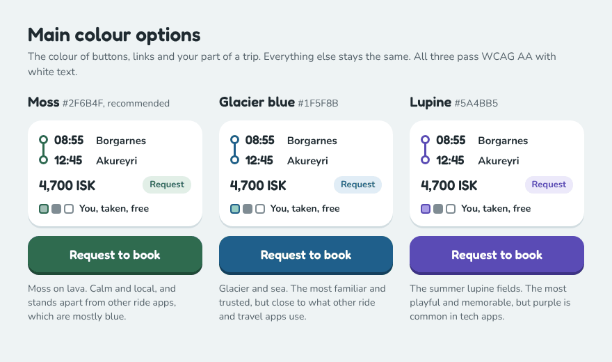

### 4.2 People and illustration colours

Only for shape people, need icons and drawings; never for text and never the
only way to show meaning. Faces are drawn in `text` light (`#1F2A30`) in both
modes.

| Name | Hex | | Name | Hex |
| ---- | --- | - | ---- | --- |
| Glacier | `#8FCBE6` | | Crowberry | `#F08C9C` |
| Lupine | `#A99BEB` | | Moss light | `#9ED0A0` |
| Sun | `#F4C04E` | | Wool (hats, scarves) | `#EADFCB` |

The car, seen from above: body `#D5E1E5`, glass `#A9C4CE`, cabin `#F5F8F9`
in light mode; `#34454E`, `#557784` and `#24323A` in dark mode. Inside it,
seats `#C9D5DA`, people on taken seats `#8E9CA3`, the steering wheel
`#5B6B73` and the wheels `#1F2A30`; in dark mode `#3E525C`, `#7F8C93`,
`#9AA8AE` and `#0B1013`.

Our map of Iceland ([ADR 0024](../decisions/0024-own-simple-map-of-iceland.md)):
sea `#D7E9F0`, land `#F4F1EA` with its coast `#B9CBD3`, glaciers `#FFFFFF`,
main roads `#C6CED2` and the Ring Road `#9AA9B0` in light mode; `#142630`,
`#24323A`, `#3E525C`, `#3A4C55`, `#3E525C` and `#6E7D85` in dark mode.
Meeting points are `primary` dots with a `surface` outline; a chosen one is
larger, in a soft `primary` halo. A route is a `primary` line on a `surface`
casing; the rest of a passenger's trip is a dashed `control` line, with its
stops as small `control` dots. The map sits in a card's frame.

### 4.3 Type

Two free fonts (SIL Open Font License), both with every Icelandic letter
(á ð é í ó ú ý þ æ ö, the capitals and „ “):

- **Fredoka** SemiBold (600) for titles, times, prices and buttons; Medium
  (500) for secondary times.
- **Nunito** Regular (400), SemiBold (600) and Bold (700) for everything you
  read.

| Token | Font | Size / line height | Used for |
| ----- | ---- | ------------------ | -------- |
| `display` | Fredoka 600 | 48 / 52 | The price on the price step |
| `title` | Fredoka 600 | 28 / 34 | Screen titles |
| `heading` | Fredoka 600 | 19 / 24 | Card and section headings |
| `figure` | Fredoka 600 | 22 / 28 | Times and prices in lists and bars |
| `figureSmall` | Fredoka 500 | 16 / 22 | Secondary times |
| `button` | Fredoka 600 | 18 / 22 | Button labels (19 / 22 on the main action) |
| `body` | Nunito 400 | 17 / 24 | Text |
| `bodyStrong` | Nunito 700 | 17 / 24 | Place names, names, emphasis |
| `label` | Nunito 700 | 15 / 20 | Field labels, chips, small buttons |
| `small` | Nunito 400 | 15 / 20 | Help text, meeting point names, notes |
| `caption` | Nunito 700 | 13 / 18 | Tags, "Step 3 of 5", legends |

- Use sentence case everywhere; no capitals for labels.
- Text scales with the phone's text size. Layouts wrap rather than cut text
  at 200%. Only text inside drawings (the "You" flag on the seat view) may
  cap its scaling, at 1.3.
- Numbers in prices and times use the formats in
  [`packages/i18n`](../../packages/i18n/src/format.ts): "4.700 kr." in
  Icelandic, "4,700 ISK" in English.

### 4.4 Spacing, corners, edges and sizes

| Group | Tokens |
| ----- | ------ |
| Spacing | `xs` 4, `sm` 8, `ms` 12, `md` 16, `lg` 24, `xl` 32, `xxl` 48 |
| Corners | `seat` 4 (seat legend), `checkbox` 9, `tag` 12, `control` 16 (buttons, inputs, notices), `card` 22, `pill` 999 (chips, need bubbles, icon buttons) |
| Bottom edges | `card` 3 (`edge` colour), `buttonPrimary` 4 (`primaryEdge`), `buttonSecondary` 3 (`edge`) |
| Sizes | `minTouchTarget` 44, `buttonHeight` 48, `mainButtonHeight` 56, `inputHeight` 52, `chipHeight` 40, `iconButton` 44, `checkbox` 26, `row` 56, `maxContentWidth` 480; `controlOutline` 2 (inputs, tick boxes, chips); on wide screens `pageMaxWidth` 1144, `sideColumnWidth` 400, `gridCardMinWidth` 320, `halfMinWidth` 280, `listPaneWidth` 360 (section 4.8) |

- `ms` 12 is new; the other spacing names are unchanged.
- Screen padding is `md`; gaps between cards are `md`; inside a card, `ms`
  between rows.
- The **chunky edge** is a solid bottom border (`borderBottomWidth`), not a
  shadow, so it looks the same on iOS, Android and the web. When pressed,
  the part moves down by its edge and the edge disappears.
- Parts drawn smaller than 44 (chips at 40, small buttons at 40) get
  `hitSlop` so the area you can tap is at least 44 by 44.

### 4.5 Icons

[Lucide](https://lucide.dev) icons (ISC licence), 2.4 stroke, 22 points in
buttons and 14 to 18 inside need bubbles and ticks (`iconSizes`: `button`
22, `inline` 18, `tick` 16), in the colour of the text next to them. An icon on its own (an icon button) always has an accessible
name. Shape people and the car are our own drawings.

### 4.6 Motion

- Press feedback is instant: the part moves down by its edge.
- Under a pointer a part changes colour at once and nothing moves (spec 18,
  3.4).
- Choosing a seat count "pops" the seat in the seat view (scale 0.9 to 1,
  150 ms). Screens otherwise use the platform's own transitions.
- With reduce motion turned on, the pop is skipped and nothing else moves.
- Nothing moves on its own: no looping animations.

### 4.7 Dark mode

The app follows the phone's setting (light or dark). Dark mode uses the dark
column of every table above; the shape people keep their colours. Martin's
review board shows the trip details in Icelandic and dark mode.

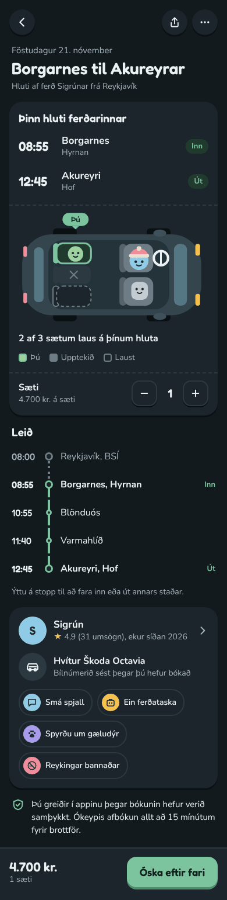

### 4.8 Wide screens

- Content sits in one column at most 480 wide, centred.
- From 900 wide, the menu is the `TopBar` above every screen instead of the
  `TabBar` (spec 16, 3.1). What the bar holds is at most 1144 wide in the
  middle, so the logo and the language line up with the edges of a page
  (spec 18, 3.3).
- From 900 wide, a screen with more to show than one column holds is a
  **page** at most 1144 wide (`pageMaxWidth`: the column, a `lg` gap and the
  640 of a map beside it), laid out with `Columns` or a `Grid` (section 5.2;
  spec 18, 3.2). There is one breakpoint, 900; under it every screen is the
  column.
- On the web, a wide screen and the top bar keep room for a scrollbar at
  both sides (`scrollbar-gutter: stable both-edges`), so the page stays in
  the middle of the window, under what the bar holds, whether or not it
  scrolls and at every width.
- Under a pointer, parts that can be pressed show it (sections 5.1 and 5.2;
  spec 18, 3.4). Phones have no pointer, and nothing is reached only by
  pointing. A chip or a secondary button tinted `primarySoft` keeps its
  `control` outline: 3:1 or more against the surface around it, which marks
  the part, and 2.9:1 against the tint inside.
- From 900 wide, trip details, Check and pay and a request are pages of two
  columns: the price and the main action are at the top of the side column,
  and there is no bottom bar (spec 18, 3.7 and 3.8). The panel 320 wide
  beside the column, which trip details had before, is gone.
- From 900 wide, search results put the map beside the list, as meeting
  points do, with the trip the pointer or the keyboard came to last; the
  chips wrap instead of scrolling sideways (spec 18, 3.6).
- From 900 wide, meeting points put the map beside the list, at most 640
  wide (spec 2, 3.1). On the web it stays in view while the list scrolls,
  and scrolls on its own when it is taller than the window.

### 4.9 Logo and app icon

Logo A, "A shared ride" (decision 11): the car from above, front up. The
driver sits front left in a crowberry knitted hat, because Iceland drives on
the right, and you sit in the back, in moss. The two empty seats say there is
room.

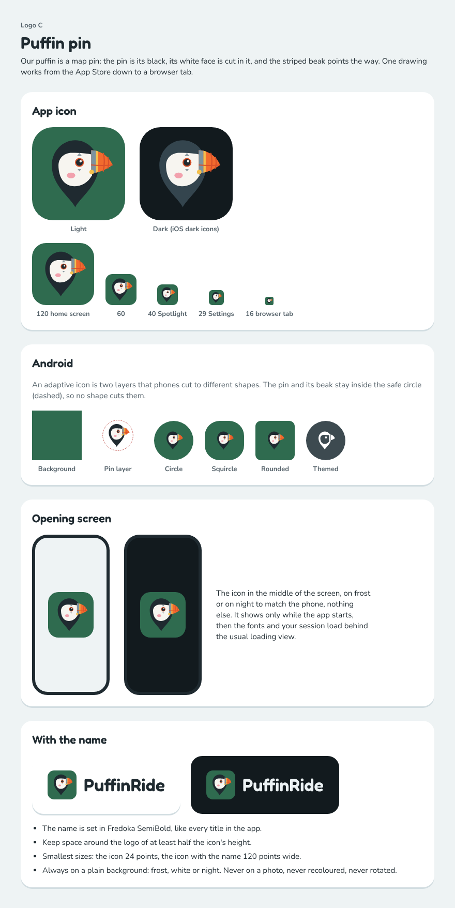

- **Drawings:** `apps/mobile/assets/logo/*.svg` are the source.
  `node scripts/export-icons.ts` (in `apps/mobile`) exports the pictures in
  `apps/mobile/assets` from them; commit a drawing and its picture together.
  A test checks each picture's size, background and use in `app.json`.
- **App icon:** the car at 90% of the square on `primary` moss, filling the
  square; phones round the corners. iOS also gets a dark icon (the car in
  night colours on dark `background`) and a tinted icon (the car's outline,
  windscreen and people in light grey on black, which iOS colours).
- **Android:** an adaptive icon. The background is `primary` moss; the car
  layer is see-through with the car at 58%, inside the safe circle (66 of
  108), so no shape the phone cuts reaches it. The themed icon (Android 13
  and later) is the same outline in one colour.
- **Opening screen:** the icon with rounded corners in the middle of
  `background` (frost, or night in dark mode), 144 points wide on both
  platforms, and nothing else. Its picture (1152 pixels, enough for the
  sharpest Android screens) is twice the icon's size with see-through
  edges, so Android's round mask never cuts the corners. It shows only
  while the app starts; the fonts and your session then load behind the
  usual loading view.
- **Browser tab:** the icon with rounded corners, 48 pixels.
- **With the name:** the icon, then "ShareRide" in Fredoka SemiBold in
  `text`, at 0.6 of the icon's height, with a gap of a quarter of the
  icon's height. A new name later only changes the word.
- **Rules:** keep space around the logo of at least half the icon's height.
  Smallest sizes: the icon 24 points, the icon with the name 120 points wide.
  Always on a plain background (frost, white or night); never on a photo,
  never recoloured, rotated or stretched.
- Expo Go shows its own icon. The app icon and the opening screen show only
  in a build of the app (`npx expo run:android`, or a store build).

## 5. Parts and screens

### 5.1 Parts the app already has

Names and props stay as they are in `apps/mobile/src/components`, so screens
and tests need no edits. Only the look changes.

| Part | Look |
| ---- | ---- |
| `Button` `primary` | `primary` fill, `onPrimary` label in `button`, corner `control`, 4 bottom edge in `primaryEdge`, height 48 (56 for the main action in a bottom bar). Every button fits its label, with `lg` padding each side, and sits in the middle of the column. Under the pointer the fill is `primaryHover` |
| `Button` `secondary` | `surface` fill, 2 `control` outline, `text` label, 3 bottom edge in `edge`. Under the pointer the fill is `primarySoft` |
| `Button` `text` | No fill, `primary` label in `label`, at least 44 high. Under the pointer the label is underlined |
| `Button` `busy` | A small spinner before the label, which stays; it can't be pressed again; `accessibilityState.busy` |
| `Button` `disabled` | `border` fill, `textMuted` label, no edge; never shown with opacity alone. A disabled or busy button shows nothing under the pointer |
| `TextField` | `label` above in `text`; input height 52, `surface`, 2 `control` outline, corner `control`; the outline turns `primary` while you type in it; `help` below in `small` `textMuted`; with `error`, the outline and message turn `error` and the message starts with an alert icon |
| `TimeField` | A time of day, chosen and not typed: looks like `TextField`, with the time in `bodyStrong` (or "Choose a time" in `textMuted`) and a chevron at the end; pressing it opens a wheel under it and turns the outline `primary`. The wheel sits in a box with a 2 `border` outline and corner `control`: hours 00 to 23 and minutes in 5-minute steps, side by side with a colon, in `figure`, rows 44 high (taller, and the wheels wider, as the phone's text size grows), five rows showing, the chosen row in `text` on a `primarySoft` band across both wheels and the others in `textMuted`, then a `secondary` Done button. The wheels stop on a row; tapping a row chooses it; they do not go round. Phones read each wheel as one adjustable element (swipe up or down), the web as a spin button (arrow keys, Home, End). Done, a second press on the field, Escape and Android's back close it; one wheel is open at a time |
| `Checkbox` | 26 square, corner 9, 2 `control` outline; checked: `primary` fill, `onPrimary` tick, 2 `primaryEdge` bottom edge; the whole row is pressable |
| `Chip` | 40 high, corner `pill`, `surface`, 2 `control` outline, `label` text; selected: `primarySoft` fill, `primary` outline and a tick before the label; one that opens choices under it, such as "Sort: Earliest", has a chevron after the label, down or up (spec 16, 3.8); a label in another language, such as "Íslenska", carries its language (`lang`). Under the pointer a chip that is not selected is filled `primarySoft` and keeps its `control` outline |
| `Notice` | Corner `control`, an icon then the message in `body`; `error` on `errorSoft` with an alert icon, `info` on `infoSoft` with an info icon |
| `TextLink` | `primary`, Nunito 700, always underlined (moss on basalt text is only 2.3:1, so the underline is what marks a link), centred; in a settings row it starts at the left with the row's text (`align="start"`) |
| `BackButton` | 44 round, `surface`, 3 `edge` bottom edge, chevron icon; accessible name "Back"; `primarySoft` under the pointer, as every `IconButton` |
| `Loading` | A `primary` spinner centred on `background` |
| `Screen` | `background`, safe area, `md` padding, column at most 480 wide. With `width="page"`, from 900 wide the content is a page at most 1144 wide instead (section 4.8); a bottom bar keeps the column |
| `Title` | `title`, `text`, role header, centred |
| `Body` | `body`, `textMuted` (the intro or help line under a title), centred; long text such as a legal document starts at the left |
| `LanguageSwitch` | A `text` button with the other language's name |
| `TabBar` | The menu on a phone's main screens (spec 16): `surface`, a 2 `border` line on top, room for the home indicator; five places, each an icon (22) over its name in `caption`, at least 56 high; the chosen one in `primary` with a `primarySoft` pill (56 wide) behind its icon, the others in `textMuted`. Phones read it as tabs with the chosen one selected; the web as the main navigation, with links and the current page marked |
| `TopBar` | The menu from 900 wide, above every screen: `surface`, a 2 `border` line under it; the `Logo` (36) and "ShareRide" in `heading` at the left, together a link to Find named "ShareRide, to the front page"; the five places in `label` (the chosen one `primary` and underlined, at least 44 high; one under the pointer `primary`), then the `LanguageSwitch`. All of it in a row at most 1144 wide in the middle, with `md` padding at each side, as a page has (spec 18, 3.3) |
| `CountBadge` | The unread count on Messages (spec 7, 3.1, item 9): `onPrimary` figures in `caption` on a `primary` pill, at least 20 (`sizes.badge`) wide and high, with a 2 `surface` ring; up to 9, then "9+"; nothing at zero. On the tab bar it sits on the icon's top corner, in the top bar after the name. Screen readers skip it: the place's name says the count ("Messages, 3 unread") |
| `Logo` | The app icon in small: logo A on `primary`, corners rounded like an app icon, the same in both modes; hidden from screen readers, since the name sits beside it |

**Focus:** every pressable part shows a 3 wide `focus` ring with a 2 gap
around its shape when reached by keyboard (web, and keyboards on phones).
A tap or click never shows it. Text fields show focus with their own
`primary` outline instead.

**Alignment:** screens centre their titles, intro text, buttons and links.
Fields with their labels, tick boxes, lists and long text start at the left,
because centred lines are hard to read and to scan in a form.

### 5.2 Parts for the posting and booking screens

Built when the screens that need them are built.

| Part | What it is |
| ---- | ---------- |
| `Card` | `surface`, corner `card`, 3 `edge` bottom edge, `md` padding. Under the pointer, the edge of a card that can be pressed turns `primary`; its fill stays, so a tag or an avatar on a tint of its own keeps its shape (spec 18, 3.4). With `fill`, a card takes the height of its place, so cards side by side in a `Grid` end level. A `marked` card keeps the `primary` edge: it is the one shown elsewhere, as on the map beside search results (spec 18, 3.6) |
| `Columns` | On a page (section 4.8): a main column that takes the room left and a side column 400 wide (`sideColumnWidth`) with a `lg` gap, each with `md` between its parts. The side column sits at the right, or at the left (`sideAt="start"`), and on the web stays in view while the main column scrolls. Whichever side it is on, a screen reader and the keyboard come to the main column first. Under 900 wide the two stack, main first, and a screen with nothing for the side leaves it out. The main column keeps its place in the tree at every width, so what its parts hold (a payment that is open, a question being answered) stays when the window crosses 900: a screen whose main column holds such parts passes the side only on a wide screen and shows those parts in their phone places otherwise (spec 18, 3.9) |
| `Grid` | Cards in equal columns with `md` gaps: as many as fit at 320 wide or more each (`gridCardMinWidth`), by the room the grid has and not by the window or the text size; one column on a phone. A child that shows nothing takes no cell. Also for two cards that belong together in a main column, such as the driver and where to stand on a booking (spec 18, 3.9) |
| `Halves` | Two parts of one card side by side, as wide as each other, with a `lg` gap, such as Get in and Get out on trip details. Where the card has no room for two parts 280 wide (`halfMinWidth`), the second goes under the first, `ms` apart. The room decides, not the window |
| `PageColumn` | On a page, a column 480 wide (`maxContentWidth`) at the left, with `md` between its parts: for a notice and its Try again when a two-column screen cannot be loaded, so the page and Back stay where they are |
| `Panes` | Messages on a wide screen (spec 18, 3.11): one card across the page, as tall as the window allows, with the list in a pane 360 wide (`listPaneWidth`) at the left and what is open (a `Pane`) in the rest, a `border` line between them. Each pane scrolls on its own. A `Pane` has a header and a footer on `surface` that stay, with a `border` line, and between them what scrolls, on `background`. A row of the list fills the pane's width, with a `border` line under it; under the pointer it is tinted `primarySoft`, and the open one keeps the tint and has a `primary` edge at its left. Phones show the list and what is open as screens of their own |
| `Tag` | `caption` text on a tinted fill, corner `tag` (section 4.1) |
| `IconButton` | 44 round, like `BackButton`, for share and more; `primarySoft` under the pointer unless it is disabled |
| `Stepper` | Minus and plus as 48 square secondary buttons, the value in `figure` between them; accessible names "One seat fewer" and "One seat more"; adjustable role with a value. With the `caption` prop, as in the search row, its label is a line in `caption` `textMuted` |
| `Switch` | Off: `control` track outline; on: `primary` track; label to the left |
| `RadioCard` | A card with a radio, a title and a line of help; selected: `primary` 2 outline |
| `TickList` | Rows with a tick box: done is a filled `primary` box with a tick, not done is an empty `control` box with an action button |
| `StepProgress` | "Step 3 of 5" in `caption` above five bars 8 high; done bars `primary`, others `border` |
| `TripSoFar` | Beside a posting step on a wide screen (spec 18, 3.13): a `Card` headed "Your trip so far", with a row each for the route, the day and times, the price, and the seats and booking. A row is its name in `label`, `textMuted`, over one or two lines in `body`, `text`; a step still to come is "Step 3" in `body`, `textMuted`. Each row has one spoken label, with a word where the screen has an arrow: "Route: Mjódd bus terminal to N1 Selfoss, 2 stops on the way" |
| `BottomBar` | `surface`, 2 `border` top line, price on the left, main button on the right; respects the safe area |
| `NeedBubble` | A pill with a coloured round icon and a word, for trip preferences |
| `RouteLine` | Times, a line with stops, place in `bodyStrong` and meeting point in `small`; the part you ride is solid `primary`, the rest dotted `control` |
| `PriceLevel` | The price level control of spec 3, as on the price step below: a track in 10% steps with the suggested level marked, a shape person as the handle, and minus and plus buttons; adjustable role whose value reads the level and the whole-route price |
| `SeatView` | The top-down car (section 5.3) |
| `Avatar` | The real profile photo, round; without a photo, the first letter on a people colour. Never a shape person |
| `Row` | A row that opens a screen, in a `Card`: the title on the left in `bodyStrong`, a value such as "Confirmed" in `small` `textMuted`, then a chevron in `textMuted`; at least `row` 56 high; tinted `primarySoft` while pressed (spec 16, 3.4) and under the pointer |
| `PlaceDropdown` | From or To while it is being chosen: its caption and dot stay, a text field with a 2 `primary` outline takes the place of the value, with Close as a small X (18) in `textMuted` inside its end, 44 square to press; what the search finds is listed under it in a box with a 2 `border` outline and corner `control`, as rows with the name in `bodyStrong` and the type and place in `small`, tinted `primarySoft` while pressed or under the pointer. Towns and areas come first, then meeting points, each under a heading in `caption` `textMuted`; a sample point has no tag on its row, and one "Sample meeting points" tag sits under the list (spec 16, 3.8). The swap button waits until it closes |
| Search row | The search on a page (spec 18, 3.5), in one `Card`: From, the swap button and To side by side, then the date, the seats `Stepper` and the main button. Each part is a line in `caption` `textMuted` (From and To with their dot) over a control 48 high, so the values, the buttons and the main button stand on one line. From, To and the date show their value in a field (`SearchField`): a box with `control` corners and `md` inside, filled with `background`, a shade off the card's `surface` (1.1:1, a hint and not an outline; the caption and the value say what the part is), and tinted `primarySoft` under the pointer; `textMuted` on it is 5.5:1 in light and 8.3:1 in dark, and 5.2:1 or more on the tint. The parts stand `md` apart, the swap button `sm` from the two fields it swaps. From and To take the room left and never go under 240 each; the date, the seats and the button keep their size, stay together and move as one to a second line, at the right, when the row is too narrow. From or To being chosen is the `PlaceDropdown` in its own part of the row, and the date opens "Any day", a radio like the days, and the `Calendar` under its button; the card grows downwards and nothing else moves. The date button reads "Date: Any day" and says whether it is open; Escape or Android's back closes the calendar, and focus goes back to the button |
| `FindMap` | Beside the rides leaving soon on a wide Find (spec 18, 3.5): `IcelandMap` whole, with every meeting point a `muted` dot, and one ride on it: its two ends `chosen` and its road a `part` line. Under it "See the meeting points" as a text button, its label under the map's left edge. The ride is the first, or the one whose card the pointer or the keyboard came to last; that card is `marked`. Nothing on the map is pressed. Its label names the ride ("The trip on a map of Iceland: Hlemmur → Keflavík Airport."); without a ride it counts the meeting points, or is "Map of Iceland" while there are none |

### 5.3 Shape people and the seat view

**Shape people** are a pebble, a mountain or a dome with two dot eyes and a
small smile, in a people colour, sometimes with a knitted hat. They appear
in the seat view, empty screens, confirmations and onboarding. They never
stand in for a real person's photo, never speak about money or safety, and
their shape or colour never says anything about a person's gender.

**The seat view** shows the car from above, front to the right, on your part
of the trip:

| Seat | How it looks | Meaning |
| ---- | ------------ | ------- |
| Driver | A shape person whose colour comes from the driver's id, so it stays the same on every trip | Always there |
| You | `primarySoft` seat, 3 `primary` outline, a moss shape person and a "You" flag | The seats you are booking |
| Taken | A grey shape with no colour and no face details beyond two dots | Booked by someone on this part |
| Free | White seat with a dashed `control` outline | Free on your part |
| Not offered | Flat grey seat with a cross | The driver doesn't offer it |

- **Positions are illustrative.** ShareRide doesn't assign seats. The app
  fills seats in a fixed order: front passenger seat, then the back seats
  from the outside in. Taken seats come first, then yours, then free ones.
- A legend under the view repeats the states in words, and a line says "2 of
  3 seats free on your part".
- The whole view is one image for screen readers, with a label that says
  the same in words, for example "Seats on your part: 3 offered. 1 is taken,
  you have 1, and 1 is free." It updates when the seat count changes.
- Cars with more than five seats show a third row; the view never shows more
  seats than the car has.

On the driver's seats step, the same view shows which seats are offered.

### 5.4 Screens

Drawn at phone size (390 wide) in English, light mode, with fictional names
and trips. They show how the parts fit together; the behaviour and texts are
in the specs named under each.

**Kit:** colours, people colours, type, shape people, seat states and parts.

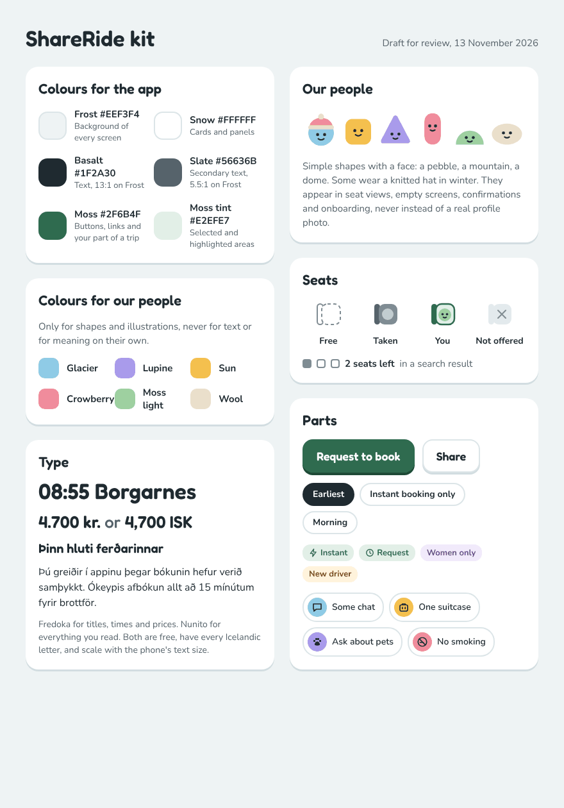

**Find and book a seat** (specs 4 and 5):

| Screen | Board |
| ------ | ----- |
| Search results: three trips on Friday, then other days | 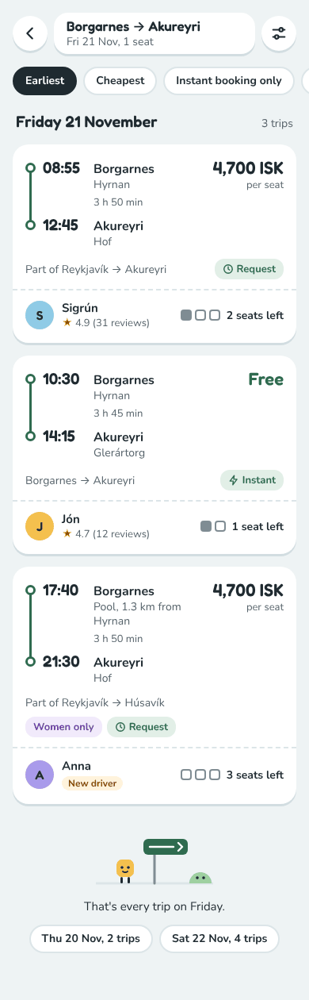 |
| Trip details: your part, the seat view, the route, the driver and car, preferences, and "Request to book" | 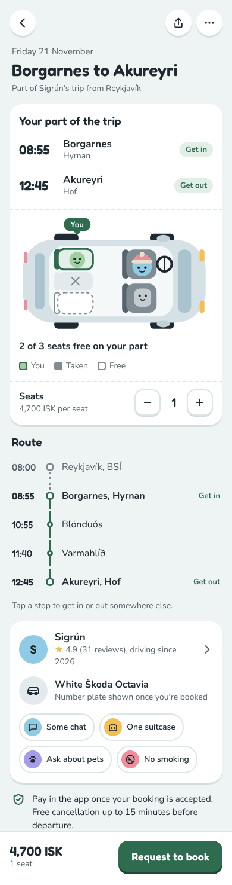 |
| Request to book: what happens next, seats, a message to the driver and the price | 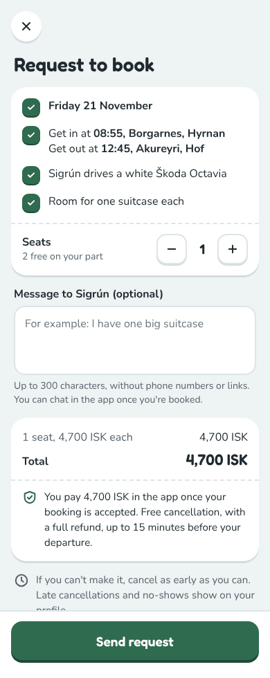 |
| Request sent: when the driver must answer and the next steps | 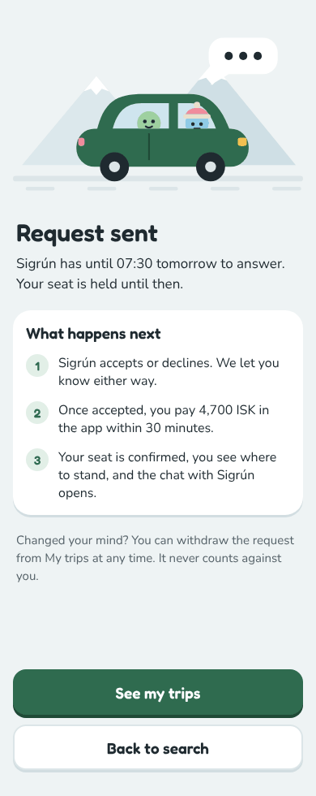 |

**Offer a ride** (spec 3). The date and time step (step 2) is not drawn yet.

| Screen | Board |
| ------ | ----- |
| Step 1, route: from, to, the map and the stops on the way, each with a switch | 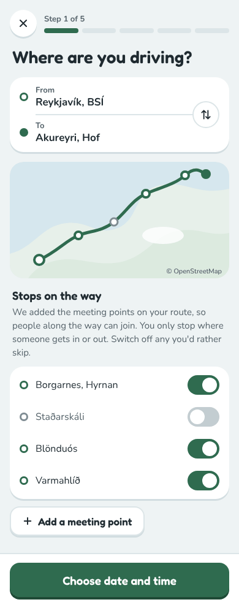 |
| Step 3, price: the whole-route price, the price level control with a shape person as the handle, minus and plus buttons, each stretch's price and why there is a limit | 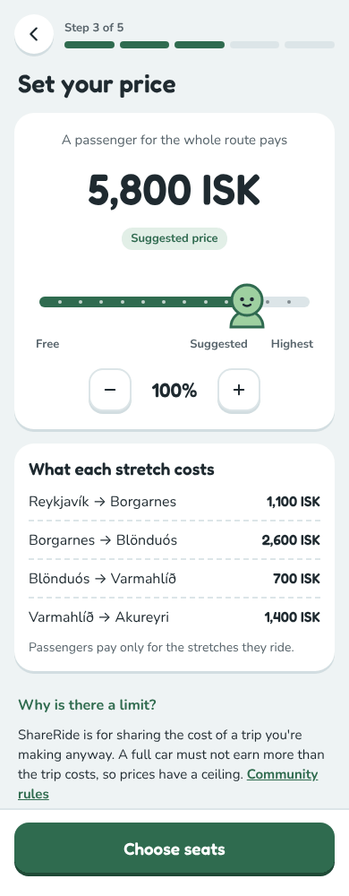 |
| Step 4, seats and preferences: the seats offered in the seat view, booking mode, preferences and a note | 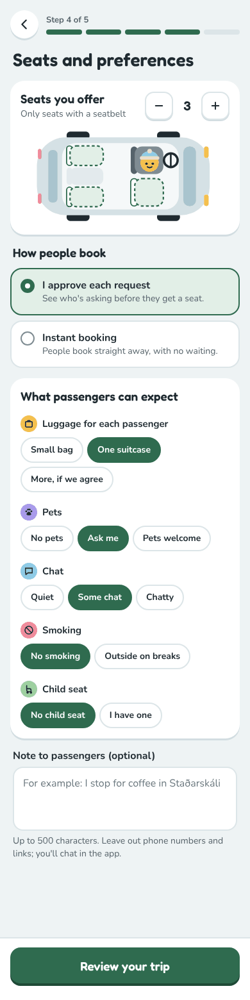 |
| Step 5, check and publish: what is still missing ("Two things before you publish", spec 16), a summary with Edit links and "Publish trip" | 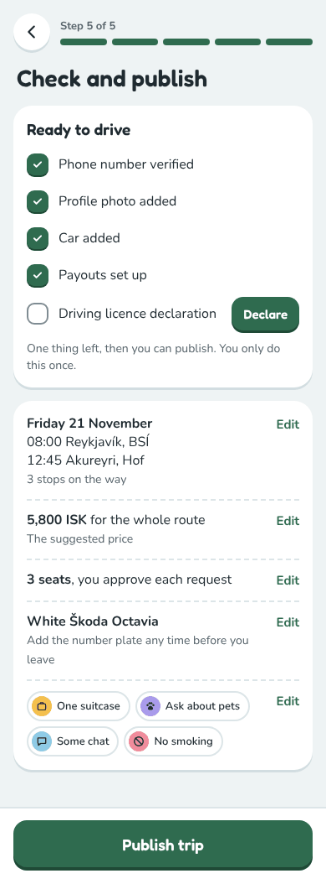 |

Some details in the drawings are older than this spec, and the tables above
win: the message box on "Request to book", the filter and preference chips
and the switches when off are drawn with the light `border` colour and must
use `control`; body text is drawn at 16 and is 17.

## 6. Implementation

- **Tokens** live in `packages/ui/src/tokens.ts`, shared by the app and the
  operator console ([ADR 0017](../decisions/0017-visual-design-system.md)),
  with the values and keys from section 4. `Palette` has every colour key.
  The type scale names the font face (`Fredoka_600SemiBold`,
  `Nunito_400Regular`, `Nunito_600SemiBold`, `Nunito_700Bold`,
  `Fredoka_500Medium`) and never sets `fontWeight`, because Android ignores
  weights for custom fonts. The app's `apps/mobile/src/theme/tokens.ts`
  passes the shared tokens on and turns each face into a font family.
- **Fonts** come from `@expo-google-fonts/fredoka` and
  `@expo-google-fonts/nunito`, loaded with `expo-font`'s `useFonts` in the
  root layout while the existing `Loading` view shows. If loading fails, the
  app goes on with the system font rather than blocking. Font files ship
  inside the app and the web build; nothing is fetched from Google at run
  time.
- **Drawings** (shape people, the car, need icons) are `react-native-svg`
  components in `apps/mobile/src/components/illustrations/`.
- **Icons** come from `lucide-react-native`.
- **App icon and opening screen:** drawings in `apps/mobile/assets/logo`,
  pictures exported by `scripts/export-icons.ts`, set in `app.json`, with
  `expo-splash-screen` for the opening screen (section 4.9).
- **Add packages** with `npx expo install expo-font react-native-svg
  @expo-google-fonts/fredoka @expo-google-fonts/nunito`, and
  `lucide-react-native` with pnpm.
- **Focus ring:** on the web, one `:focus-visible` style sheet added at
  start (`apps/mobile/src/theme/focus-ring.web.ts`), so every pressable
  part and link shows the ring for the keyboard and not for clicks or taps.
  Text fields are left out of it; their outline turns `primary` instead. On phones, keep the system's own focus highlight (Android
  keyboard navigation, iOS Full Keyboard Access).
- The first implementation PR updates tokens, fonts and the parts in section
  5.1. The parts in 5.2 come with the screens of specs 3 to 5.

## 7. Privacy and safety

- Fonts are bundled, so opening the web app sends no visitor IP address to
  Google.
- Taken seats show no names, photos or colours, and seat positions are
  illustrative, so the seat view says nothing about who is in the car or
  where they sit.
- Shape people never replace a real profile photo, which stays the way to
  recognise your driver (spec 8).
- Drawings, screenshots and tests use fictional names and trips only.
- "Women only" uses its own neutral lupine tag, not pink, and shape people
  carry no gender.

## 8. Texts and tone of voice

**Tone:** plain, warm and short, like a helpful neighbour. Say "you" and use
the driver's first name. Give times and facts, not statuses: "Sigrún has
until 07:30 tomorrow to answer", not "Your request is pending". Errors say
what happened and what to do, and never blame. No jokes about money or
safety, no exclamation marks in errors and no emoji in app texts.

New texts for the parts (first draft; Icelandic to be reviewed by a native
speaker):

| Key | English | Icelandic |
| --- | ------- | --------- |
| `seats.you` | You | Þú |
| `seats.legend.taken` | Taken | Upptekið |
| `seats.legend.free` | Free | Laust |
| `seats.freeOnPart` | `{free} of {offered} seats free on your part` | `{free} af {offered} sætum laus á þínum hluta` |
| `seats.viewLabel` | `Seats on your part: {offered} offered. {taken} taken, you have {yours}, and {free} free.` | `Sæti á þínum hluta: {offered} í boði. {taken} upptekin, þú ert með {yours} og {free} laus.` |
| `seats.fewer` | One seat fewer | Einu sæti færra |
| `seats.more` | One seat more | Einu sæti fleira |
| `steps.progress` | `Step {step} of {total}` | `Skref {step} af {total}` |
| `common.loading` | Loading | Hleð |

Counts use ICU plural forms in both languages.

## 9. Testing

- **Contrast:** a unit test computes the WCAG ratio of every pair in section
  4.1 from the tokens, for light and dark, and fails below 4.5:1 for text or
  3:1 for control edges and the focus ring.
- **Parts:** component tests keep finding parts by role and accessible name;
  new tests for the seat view's label, the stepper's value and the disabled
  and busy states.
- **Fonts:** a test that the root layout shows `Loading` until fonts are
  ready, and the app when loading fails.
- **Browser:** the Playwright tests take phone and desktop screenshots in
  light and dark mode for review in the PR.
- **Manual:** each new screen on a real iPhone and Android phone in both
  languages, with the largest text size, with VoiceOver and TalkBack, and
  with a keyboard on the web.

## 10. Out of scope

The date and time step of posting, the my-trips and manage-bookings
screens, chat, the trip day screens, the operator console's look, the public
website, sound and haptics. These get drawn when their specs are built,
following this spec.

## Decisions

Accepted by Martin on 2026-11-13 as recommended.

| # | Question | Decision |
| - | -------- | -------- |
| 1 | Which visual direction? | The style of *Is This Seat Taken?* made ours: shape people, a small soft palette from Iceland, chunky rounded parts, the seat view as the hero |
| 2 | Which main colour? | Moss green `#2F6B4F` (not glacier blue or lupine) |
| 3 | Which fonts? | Fredoka for titles, times, prices and buttons; Nunito for text |
| 4 | How playful? | As drawn: shape people in seat views, empty screens and confirmations; prices, times, payment and photos plain |

Calls made while writing this spec, accepted by Martin with the spec on
2026-11-13:

| # | Call | Why |
| - | ---- | --- |
| 5 | The focus ring is glacier blue, not the placeholder amber `#F2A900` | Amber is only 1.8:1 on frost; blue is 6.1:1 and doesn't clash with moss |
| 6 | A new `control` colour for the edges of inputs and other controls | `border` is 1.3:1, below the 3:1 that control edges need |
| 7 | Body text stays at 17, although the drawings use 16 | Nunito's lower-case letters are smaller than the system fonts' (x-height 0.48 of the size against about 0.52), so it needs 17 to read as easily |
| 8 | Lucide icons | Rounded strokes match the look, ISC licence, one package for every platform |
| 9 | Tokens stay in the app until a second client needs them | `packages/ui` with one user adds a package without a benefit yet |
| 10 | Fonts bundled, not loaded from Google | Works offline and sends no visitor data to Google |

Decided by Martin after the spec was approved:

| # | Question | Decision |
| - | -------- | -------- |
| 11 | Which logo? | A, "A shared ride": the car from above with the driver and you (chosen 2026-11-13; the refined drawing approved 2026-11-14), not B (a friend in a hat) or C (your stretch of road) |
