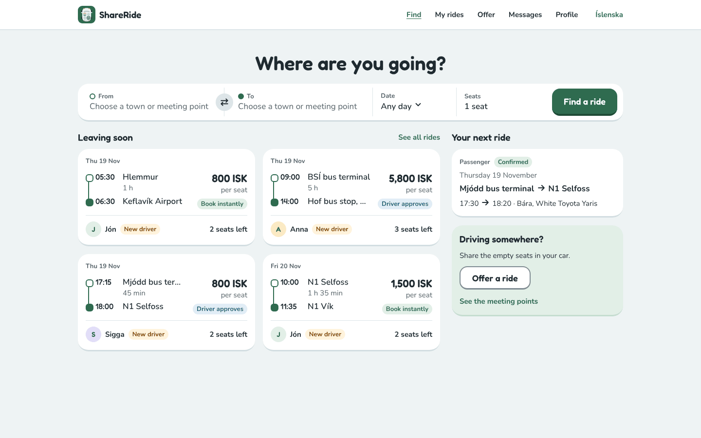
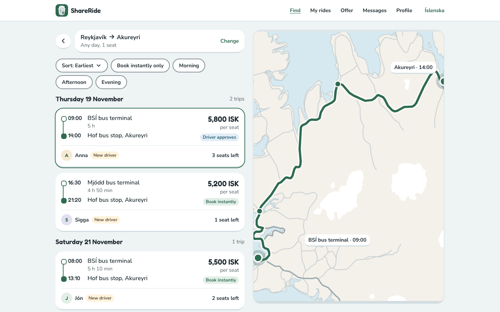
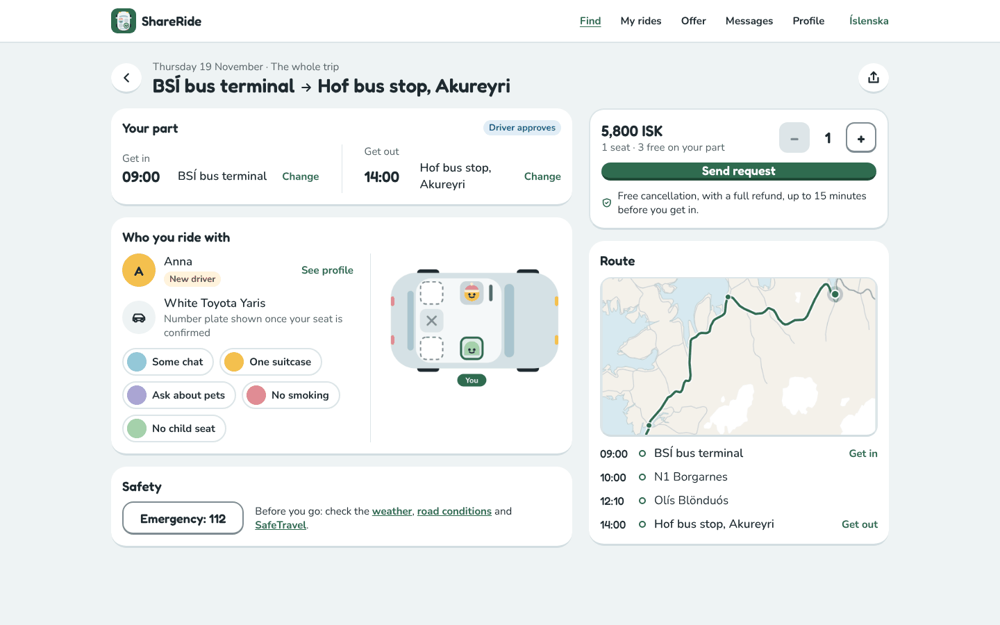
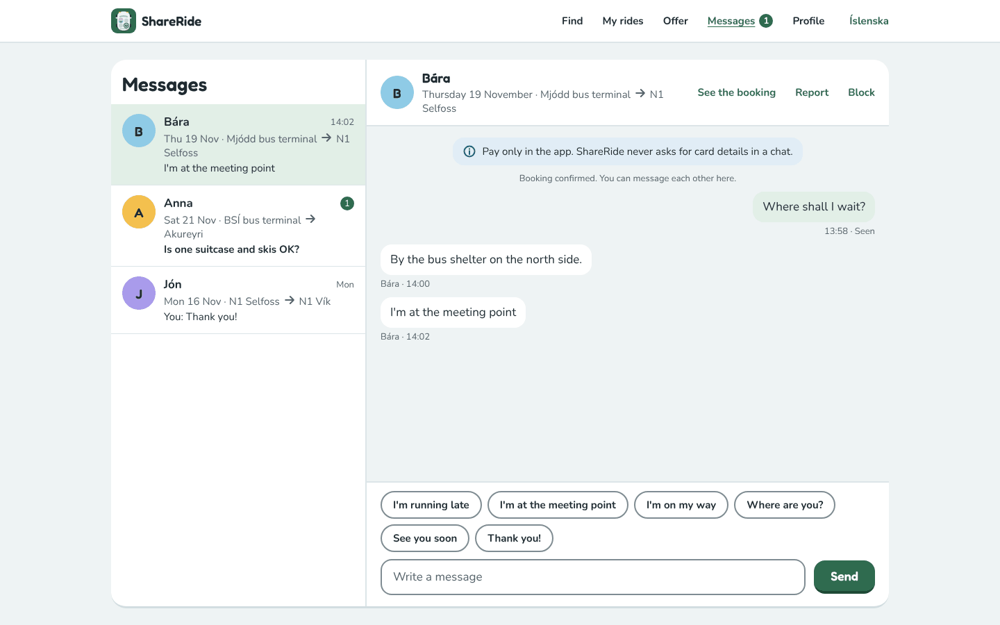
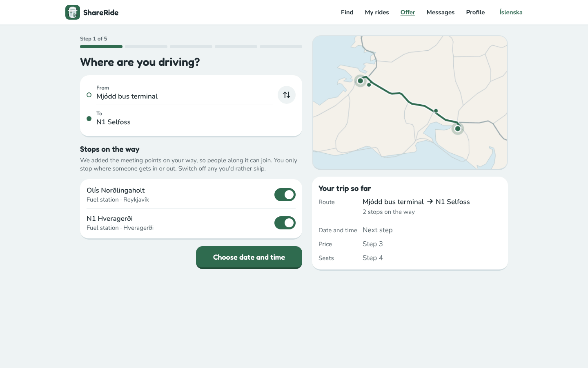

# Spec 18: The web app on a laptop

**Owner:** Martin · **Date:** 2026-11-18 · **Status:** Approved
(2026-11-18): Martin chose every main screen, as drawn (decision 1)

Amends: [spec 15](2026-11-13-visual-design-system.md) (section 4.8, wide
screens, and the `Screen`, `TopBar`, `Card`, `Row`, `Button` and `Chip`
parts), [spec 4](2026-11-13-search-and-trip-details.md) (section 5: the map
beside the results, which was specified and never built) and the screen
lists of specs 1, 3, 5, 7 and 16. No rule, price, text of a decision, API or
table changes. Phones keep every layout they have.

Source: a walk through the web build at 1440 by 900 on 2026-11-18, 57
screens, kept in the project files under `laptop-web/audit-today`.

## 1. Problem and goal

On a laptop the app is a phone screen in the middle of the window:

- Every screen is one column 480 wide. At 1440 wide, two thirds of the
  window is empty.
- Long screens scroll for no reason. Trip details is two windows tall: the
  route map and the seats are below the fold while the space beside them is
  empty.
- Find shows the search and nothing else; the rides leaving soon start below
  the fold.
- Search results have no map, although spec 4 says "on wide screens results
  and the map are side by side". The filter chips scroll sideways with 900
  points free next to them.
- The bottom bar with the main button, and the message field of a chat,
  stretch across the whole window.
- The top bar's logo sits at the window's left edge and the content in the
  middle, so the eye crosses the window on every page.
- Almost nothing reacts to the pointer: cards, rows, chips and buttons look
  the same under it.

What already works and stays: the top bar with the five places (spec 16,
3.1) and the map beside the meeting points (spec 15, 4.8). The booking
panel beside trip details becomes the first card of that screen's side
column (3.7).

Goal: on a laptop the app uses the width to show what belongs together side
by side, so that finding, comparing and booking a ride takes less scrolling
and fewer page changes. It still looks like ShareRide (spec 15), and nothing
changes on a phone.

## 2. User stories

- As a passenger on a laptop, I see the search and the rides leaving soon as
  soon as the page opens.
- As a passenger, I compare the rides found with a map of the route next to
  them.
- As a passenger, I read a trip's times, driver, seats and route on one
  screen, with the price and Book always in view.
- As a driver or passenger, I keep my list of conversations in view while I
  write in one.
- As a driver, I see my route on the map and what I have filled in so far
  while I post a trip.
- As anyone using a mouse, I can tell what can be clicked.

## 3. Behaviour

### 3.1 Approaches considered

| | Approach | Trade-off |
| - | -------- | --------- |
| A | **Wide pages under the top bar** (chosen). Each main screen gets a laptop layout of two columns or a grid, in a page 1144 wide, under the top bar we have | Uses the width where it helps; keeps the menu Martin approved in spec 16; each screen is its own small piece of work |
| B | A side menu, like a desktop app, with the content to its right | Familiar from mail and chat apps, less so from travel sites; reopens spec 16, 3.1; takes 200 points from every page for five links |
| C | Keep one column, make it wider | Quick; the map and the booking panel stay below the fold, and wide lines of text read worse |

### 3.2 Wide screens

1. "Wide" stays what it is: a window at least 900 wide (`sidePanelFrom`).
   Under that, every screen is as on a phone. A laptop window made narrow,
   or zoomed in far, gets the phone layout, which is the fallback at every
   size.
2. A **page** is at most 1144 wide (`pageMaxWidth`: the 480 column, a 24
   gap and the 640 map, as on meeting points) and sits in the middle. The
   top bar still spans the window; what is in it lines up with the page.
3. A screen is one of three kinds on a wide screen:
   - **Column:** one column 480 wide, as today. For forms and short pages:
     sign-in and sign-up, add a car, the licence, edit profile, settings and
     their sub-pages, cancel and report screens, legal documents.
   - **Two columns:** a main column that takes the room left, and a side
     column 400 wide (`sideColumnWidth`) at the right. The side column stays
     in view while the main column scrolls, and scrolls on its own when it
     is taller than the window, as the map on meeting points does.
   - **Grid:** cards in as many columns as fit at 320 or more each.
4. Between 900 and 1144 the main column gives way first; nothing is cut and
   the page never scrolls sideways.
5. Reading order for screen readers and the Tab key is the main column, then
   the side column.
6. On a screen with two columns, the title starts at the left, above the
   main column. Screens of one column keep their centred title (spec 15,
   5.1, alignment).
7. A window that crosses 900, as when its edge is dragged, lays the screen
   out anew. What the person typed, chose or opened to pay stays, and
   nothing loads again. Where the focus is, and a list opened in place
   (the stops under Change), may not stay (decision 11).
8. A two-column screen is a page from the start: while it loads, and when
   it cannot be loaded, Back is where it will be once loaded. The notice
   and Try again keep the 480 column, at the left (`PageColumn`, spec 15).

### 3.3 The top bar

1. Its content lines up with the page: logo and name at the page's left
   edge, the places and the language at its right edge.
2. The logo and name are a link to Find.
3. Nothing else changes: five places, the chosen one `primary` and
   underlined, the unread count on Messages.
4. A browser whose scrollbar takes room (Windows, Linux) would push a page
   that scrolls a little to the left of the bar. A wide screen keeps the
   same room at both sides, and so does the bar, so the bar's content stays
   over the page's edges at every width.

### 3.4 Pointer and keyboard

1. Under the pointer, a part that can be pressed shows it: the bottom edge
   of a card that opens something turns `primary` (its fill stays, because
   tags and avatars on it sit on `primarySoft` themselves and would lose
   their shape on a tinted card); a row is tinted `primarySoft`; a primary
   button turns `primaryHover`, a new colour one step from `primary`
   (darker in light mode, lighter in dark mode), with the same label
   contrast; a secondary button, a chip and an icon button are tinted
   `primarySoft`; a text button is underlined; a place in the top bar turns
   `primary`. Only on devices with a pointer; a touch shows the pressed
   look as before. A disabled or busy part shows nothing. The `control`
   outline of a tinted chip or button keeps its 3:1 against the surface
   around it, which is what marks the part; against the tint inside it is
   2.9:1.
2. Nothing is reachable only by pointing: every action is on the screen
   without hovering.
3. The keyboard focus ring stays as it is (spec 15, 5.1).

### 3.5 Find

1. The title, then the search in **one row** across the page, in one card:
   From, the swap button, To, the date, the seats and "Find a ride". Each
   is a small label over its control, and the controls stand on one line.
   From, To and the date open their choices downwards in their own part of
   the row (the place list, the calendar), so nothing beside them moves.
   From 1280 wide it is one line in both languages. In a narrower window
   the date, the seats and the button move together to a second line, at
   the right; From and To never share a line with only some of them.
2. Under it, two columns:
   - **Main:** "Leaving soon" with "See all rides" at its right, and the
     rides as a grid: two columns from about 1140 wide, one column under
     that, beside the side column. Six rides where a phone shows five, so
     two columns end level, and cards in one row are equally tall.
   - **Side:** "Your next ride" when signed in and one is coming up, then a
     card "Driving somewhere? Share the empty seats in your car." with
     "Offer a ride" and "See the meeting points".
3. With no rides leaving soon, the side column's cards sit in the middle
   under the search. While the rides load, the two columns are there, with
   "Leaving soon" and a sign that they are on their way, so the side
   column does not move when they come.

### 3.6 Search results

1. Two columns, list and map, as on meeting points: the list 480 wide, the
   map beside it, up to 640 wide, staying in view.
2. The list is as today: the search summary with Change, the chips, the days
   and their trips. The chips wrap onto a second line instead of scrolling
   sideways.
3. The map shows the part of Iceland the trips found are in, with the
   stretch of one trip drawn along the roads and its two meeting points
   standing out: the first trip found, or the trip the pointer or the
   keyboard came to last. That trip's card keeps the edge a card has under
   the pointer, so the list shows which trip the map shows. Its label for
   screen readers names that stretch. The list says everything the map
   shows.
4. The stretches and meeting points of the other trips found are on the
   map too, muted. So the map shows the same part of Iceland whichever trip
   is shown, and stays still as the pointer moves down the list.
5. The map is always there, so the list keeps its place: while the trips
   load, when nothing matches, when a filter leaves none and when the
   search fails, it shows the whole of Iceland without a trip. A list that
   moved to the middle and back would take keyboard focus from the chip
   just pressed. When only trips from nearby meeting points match, the map
   shows those.
6. Changing the search opens the form in the list column, where the summary
   was, with the map still beside it.

### 3.7 Trip details

1. Back, the day and the title across the top, with Share at the right.
2. **Main column:** "Your part" with Get in and Get out side by side; "Who
   you ride with" with the driver, car and preferences at the left and the
   seat view at the right; Safety; reporting. Each pair is two halves of
   its card (`Halves`, spec 15): where the main column has no room for
   two halves 280 wide, as in a window 900 wide, the second goes under the
   first. Change opens the stops under its own half.
3. **Side column:** the booking panel, then "Route" with the map and the
   list of stops. The panel is a card with the price and, beside it, the
   seats under a small "Seats"; under the two, how many are free and the
   price per seat; then the main button as wide as the card, with its
   lines, and the free cancellation line. A part that cannot be booked, or
   a booking already made, shows there in the button's place.
4. The seats stepper moves from "Your part" into the booking panel, next to
   the price it changes.
5. There is no bottom bar. While the trip loads, and when it cannot be
   loaded, the screen is already a page (3.2, 8).

### 3.8 Check and pay, and a request

1. **Main column:** what the person reads and fills in. What went wrong
   comes first (seats just taken, a changed price, a payment that did not
   go through). Under it one card has the tick list, the message to the
   driver (a request only) and what cancelling late means.
   While the operator has paused booking (spec 10, 3.3), the banner that
   says so comes before all of it; on a phone it stands above the title.
2. **Side column:** a card with the ride (day, times, places, driver and
   car) and the total, and under the card the main button ("Pay 5,800
   ISK", "Send request"). The payment opens in the button's place; a part
   that can no longer be booked says so there.
3. There is no bottom bar. What was typed and ticked stays when the
   window turns narrow or wide, and so does a payment that is open (3.2,
   7). When the trip cannot be loaded the screen is a page all the same
   (3.2, 8).

### 3.9 A booking

1. **Main column:** the status and what to do now, the trip day's parts,
   where to stand, the driver and car.
2. **Side column:** the ride and price, then the actions (Message, Cancel
   booking, Share trip details).

### 3.10 My rides

1. The title and the Coming up / Past choice at the left.
2. The rides as a grid, two columns from 704 wide. A ride that needs you
   comes first, as today.

### 3.11 Messages

1. One card across the page with two panes. **Left**, 360 wide: "Messages"
   and the conversations, the open one tinted `primarySoft` with a
   `primary` edge at its left. **Right:** the open conversation: Back, the
   other person's name, the day and the stretch, then Report and Block, the
   messages, and at the bottom the quick messages and the field with Send.
   Where the pane has no room for both, Report and Block go under the
   name.
2. Messages in the menu opens the list with "Choose a conversation" in the
   right pane. No conversation opens by itself, because opening one tells
   the other person their messages were seen. With no conversations, or
   when they could not be loaded, the card shows that across both panes.
3. Choosing a conversation changes the right pane and the address
   (`/messages/{booking}`), so Back and a shared link work as on a phone.
   From one conversation to another, the list stays as it is and the
   address is replaced: Back leaves the conversations, to the list or to
   the booking the chat was opened from, and does not walk through each
   one read (decision 12).
4. A chat opened from a booking or a trip shows the same two panes.
5. The card is as tall as the window allows. Each pane scrolls on its own
   and the page does not. The conversation opens at its end and follows
   it, as on a phone.
6. The list is there at once, as the menu's count last fetched it, and
   follows the open conversation: a message read there is no longer
   counted in its row, and a message sent shows as its last. An answer
   that comes back after a newer one is not kept. Like the count, the list
   keeps what it knows when asking again fails; it says the conversations
   could not be loaded only when it has none to show.
7. "Messages" is the page's title; the open person's name heads a part of
   it (an h2 on the web). Another row leaves the keyboard's focus on the
   row, so a screen reader is told what opened: "Conversation with Jón".
8. A window that turns narrow shows the conversation alone, as on a phone,
   with what it had loaded and what was being written (3.2, 7).

### 3.12 Profile

1. **Side column, here at the left:** the person: photo or initial, name,
   languages, member since, "Edit profile" and "See it as others do".
2. **Main column:** the two groups of rows (My cars, Driving licence,
   Meeting points; Settings, Terms, rules and privacy, Notices).
3. Signed out, Profile stays one centred column.

### 3.13 Offer a ride

1. **Main column,** 480 wide: the step's progress, title and fields.
2. **Side column:** on the route step, the map of the route; on every step,
   "Your trip so far" with what earlier steps set (route and stops, day and
   times, price, seats), each with the step that sets it greyed until then;
   and under it the step's main button with the lines that belong to it. On
   wide screens there is no bottom bar on these steps.
3. The same for changing a published trip, where it has steps.

### 3.14 The driver's trip

1. **Main column:** requests, then passengers.
2. **Side column:** seats on each stretch, then the actions (Message all
   passengers, Edit trip, Post again, Cancel trip).

### 3.15 What stays one column

Sign-in and sign-up, the search form at `/search`, meeting points (already
two columns), a meeting point, a public profile, cars, the licence, edit
profile, settings and privacy pages, cancel, report, block and rating
screens, notices and legal documents. They gain the lined-up top bar and
the pointer states.

## 4. Rules

No rule changes. No screen computes a price, a seat count or a deadline the
API does not give (as spec 16, 4).

## 5. Screens

Drawings of the proposed layouts, at 1440 by 900. They are sketches; the
build follows spec 15 and this spec.

| Screen | Proposed |
| ------ | -------- |
| Find, signed in |  |
| Search results |  |
| Trip details |  |
| Messages |  |
| Offer a ride, step 1 |  |

## 6. Data and API

None. Every layout shows what the screens already load. The map beside the
results draws from the meeting points in the search answer.

## 7. Privacy and safety

No personal data is added, moved or shown to anyone new. The Messages list
beside an open chat shows the same first names and previews as the list
does today, to the same person. Safety parts ("Before you go", "Pay only
in the app") keep their place in the reading order.

## 8. Texts

| Key | English | Icelandic |
| --- | ------- | --------- |
| `post.soFar` | Your trip so far | Ferðin þín hingað til |
| `post.soFarLater` | Step {step} | Skref {step} |
| `chat.choose` | Choose a conversation | Veldu spjall |
| `chat.nowOpen` | Conversation with {name} | Spjall: {name} |
| `results.mapOf` | Map of Iceland with the trip {from} → {to} | Kort af Íslandi með ferðinni {from} → {to} |
| `nav.home` | ShareRide, to the front page | ShareRide, á forsíðu |

Every other text is one the app has.

## 9. Testing

- Screen tests (Jest) render each changed screen at 1280 wide and check
  what sits in which column, and at a phone's width that nothing changed.
- Browser journeys (Playwright) already run at desktop size; they keep
  passing. A new journey checks, at 900, 1280 and 1440 wide, that no page
  scrolls sideways and that each two-column screen has its two columns.
- The look journey's screenshots gain the laptop screens, in English light
  and Icelandic dark.
- By hand: a keyboard-only pass through Find, results, a trip and Messages.

## 10. Out of scope

- The operator console (`apps/admin`), which has its own layout.
- A public marketing site, search engine pages and sharing previews.
- New features: saved searches, a map you can zoom, filters beyond the ones
  results have.
- Tablets as their own size: a tablet 900 wide or more gets these layouts,
  a narrower one the phone's.
- Keyboard shortcuts.

## Decisions

| # | Question | Decision |
| - | -------- | -------- |
| 1 | How far does the laptop layout go? | Every main screen, as drawn (approach A, sections 3.5 to 3.14). Martin, 2026-11-18, on a decision card; not chosen: passenger screens first, a lighter touch, a side menu |
| 2 | A second breakpoint? | No. 900 stays the only one; columns give way between 900 and 1144 (my call) |
| 3 | How wide is a page? | 1144, the width meeting points already use (my call) |
| 4 | Where does the main button go on two-column screens? | Into the side column, with the summary it acts on, as on trip details today; no bottom bar there (my call) |
| 5 | Titles on two-column screens | At the left, as on trip details today; one-column screens keep the centred title Martin chose on 2026-11-14 (my call) |
| 6 | What does the results map show? | One trip's stretch at a time: the first, or the one pointed at or focused last, whose card is marked. The other trips' stretches are there muted, so the map does not move between trips. With no trip to show, the map stays, as the whole of Iceland: the list never changes place (my call, 2026-11-18, after the code review) |
| 7 | Settings and forms | Stay one column 480 wide; a form gains nothing from being stretched (my call) |
| 8 | Does Messages open the newest conversation by itself? | No: opening marks its messages as seen, which only the person should do (my call) |
| 9 | A colour for a primary button under the pointer | New token `primaryHover` (#285C44 light, #8FD0AC dark), added to spec 15, 4.1 with its contrast check (my call) |
| 10 | How does a card show the pointer? | Its bottom edge turns `primary`. A tint was tried first and dropped: tags and avatars on the card sit on the same tint and lost their shape (my call, 2026-11-18) |
| 11 | What stays when a window crosses 900? | What the person typed, chose or opened to pay: that state lives above the layout, and nothing loads again. The focus and a list opened in place do not: the wide and the phone layout are different trees, and keeping those too would mean drawing every phone screen as a wide one folded up. Dragging a window across 900 in the middle of a booking is rare, and nothing is lost (my call, 2026-11-18, after the code review) |
| 12 | How does another conversation open beside the list? | In the same place. The list keeps its scroll and the keyboard's focus on the row, the address is replaced, and Back leaves the conversations. A new entry for each one would make Back walk through every conversation read (my call, 2026-11-18) |
