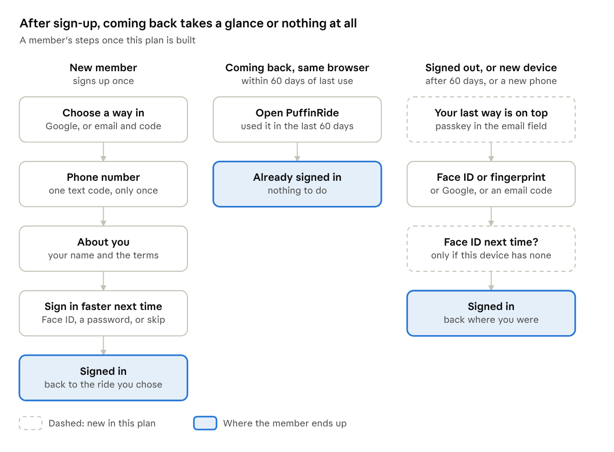

# Spec 29: Easier sign-in, with Face ID first

**Owner:** Martin · **Date:** 2026-11-25 · **Status:** Approved (2026-11-25)

This spec builds on [spec 27](2026-11-23-passwords-and-passkeys.md) and
amends its 3.1 (the sign-in screen), 3.3 (signing in with Face ID or
fingerprint) and 3.6 (removing a device), and [spec 16](2026-11-15-one-home-and-simpler-flows.md),
3.5, item 1 (the steps of signing up). It changes no rule of
[ADR 0016](../decisions/0016-own-sign-in-module.md).
[ADR 0050](../decisions/0050-passkey-saved-by-the-browser-after-a-password.md)
amends [ADR 0048](../decisions/0048-member-passkeys-on-the-device-only.md)
for 3.3 only: the browser's own save checks neither presence nor Face ID.
Related: [security](../engineering/security.md#sign-in-and-sessions),
[privacy and GDPR](../compliance/privacy-gdpr.md).

## 1. Problem and goal

Martin, 2026-11-23: "brainstorm the log-in situation and how to make it
easiest for the user. Look for an existing library and what are the
industry standards, do the research first, then make a plan and let me
approve it first."

The research and plan ([Claude Doc](https://claude.ai/artifact/A41X4xdkpNGaFc47ryXzYA))
found that our sign-in already follows today's standards (no text-message
sign-in, codes the phone fills in, NIST's password rules, passkeys) and that
no library or hosted service would make it easier for members, so we keep our
own module (ADR 0016). What still slows people down, seen on the live screen
on 2026-11-23:

- Face ID or fingerprint works only from its own button; the email field
  never offers it.
- "Sign in faster next time" is offered once, after sign-up. A member who
  skipped it, or joined before it existed, is never asked again.
- Every returning member sees the same order, whatever they used last.
- Returning members see "Step 1 of 3", meant for newcomers; the screen has
  two help lines saying the same thing; on a first visit the cookie question
  covers the form on a phone.

Across 15 large consumer services, passkey sign-ins succeed 93% of the time
against 78% for passwords and codes, and are 2.8 times faster; services that
show the passkey first get it used more
([FIDO Passkey Index, October 2026](https://fidoalliance.org/wp-content/uploads/2026/10/Passkey-Index-October-2026.pdf)).

**Goal:** a returning member gets back in with a glance or a touch, or with
the way they used last time on top. Martin approved the plan on 2026-11-25
("Approve, keep 60-day sign-in"): steps 1 to 3 below. Members still stay
signed in for 60 days after they last used PuffinRide (ADR 0016).

**Not changed:** the ways in (Google, the email code, a password, Face ID or
fingerprint), the email code as the way back in, the phone number at sign-up
(Martin, 2026-11-22 and 2026-11-25), passwords of 8 characters or more, 60
days. **Not in this spec:** the phone apps' passkeys, Google's own sheet on
Android and Sign in with Apple (with the apps' builds, as spec 27, 3.8),
Google One Tap, magic links.

## 2. User stories

- As a member on a new browser of my iPhone, I tap the email field, pick
  "PuffinRide" from the suggestions, look at the phone, and I am signed in.
- As a member who signed in with my email code, I am asked once whether to
  use Face ID next time, and I set it up with one tap and a glance.
- As a member who uses Google, I find "Continue with Google" at the top,
  marked "Last used".
- As a member who signed in with a saved password, my browser may save a
  passkey for me by itself, and next time Face ID signs me in.
- As a member who removed a device in Settings, that browser stops offering
  its passkey.

## 3. Behaviour

### 3.1 Face ID in the email field (step 1)

1. Where the browser can offer passkeys among the email field's suggestions
   (WebAuthn conditional mediation) and the server has passkeys
   (`passkeySignIn`), step 1 asks the API for sign-in options as it opens
   and hands them to the browser quietly. The email field is marked for it
   (`autocomplete="username webauthn"`).
2. Tapping or clicking the email field then lists the member's PuffinRide
   passkey beside saved emails. Picking it opens the device's own check
   (Face ID, fingerprint, Windows Hello), then signs in exactly as the
   "Face ID or fingerprint" button does (spec 27, 3.3, item 3).
3. Nothing else changes: a browser with no passkey for PuffinRide shows its
   usual suggestions, and typing an email works as before. A refused
   passkey shows the button's messages in the same place.
4. The options' challenge lasts 5 minutes; while step 1 stays open, new
   options replace them a little before then (my call: no message, so a
   suggestion picked later still works). Leaving step 1, pressing the
   button, Google or Apple, ends the quiet request first.
5. On a laptop the email field takes the focus when step 1 opens, so the
   suggestions show at once (my call: not on a phone, where the keyboard
   would cover Google and the button).
6. The "Face ID or fingerprint" button stays, for browsers without
   suggestions and for people who look for a button.

### 3.2 Face ID offered after another way in

1. After signing in with the email code, a password, Google or Apple, a
   member is asked once: **"Use Face ID or fingerprint next time?"**, with
   "Sign in with a glance or a touch on this device. Your email code always
   works too.", **"Set it up"** and **"Not now"**.
2. Only when all of these hold (R29.2): the account existed before this
   sign-in (a new account gets spec 27's "Sign in faster next time"
   instead); the browser has a built-in authenticator and the server has
   passkeys (as spec 27, 3.1, item 1); this browser is not known to have a
   passkey for PuffinRide (3.2, item 5); "Not now" was not pressed on this
   browser in the last 30 days; and nothing waits from before signing in
   (a booking, Offer, a meeting point's report form, a link from an email),
   which goes first instead, with no offer that time (my call: that is what
   the person came for).
3. "Set it up" works as in Settings (spec 27, 3.6, item 2): the fresh
   sign-in is the proof, then the device's sheet, then "Face ID or
   fingerprint is set up on this device." with "Done", and the usual email
   (R27.7). "Not now" goes on and keeps its date on this browser.
4. Closing the device's sheet keeps the screen; "This device is set up
   already" (the browser refused a second passkey) goes on after "Done".
5. A browser is known to have a passkey for PuffinRide once it signs in with
   one, sets one up, or refuses a second one as set up already. Removing
   this device's passkey in Settings forgets it.

### 3.3 A passkey saved by the browser after a password

1. After signing in with a password, where the browser can save a passkey
   by itself (WebAuthn conditional create: Chrome and Safari with their own
   password managers), the app asks it to, quietly. The browser decides:
   usually when its password manager filled the password. Not on a browser
   known to have a passkey (3.2, item 5), and not within 30 days of "Not
   now" there (my call: the person said no to Face ID on it).
2. When it saves one, the browser says so in its own way, the passkey is
   added as in Settings, the usual email goes (R27.7), and 3.2 is not
   shown. When it does not, nothing is shown and 3.2 applies as for any
   other sign-in.
3. The fresh sign-in is the proof (R27.5), and only it: the app asks for
   quiet options, which the API gives only to a session signed in less than
   10 minutes ago, and saves the answer to them without "user present" or
   "user verified", which the browser's own save never gives (ADR 0050). It
   counts towards the 10 devices (R27.8): with 10 set up, nothing happens.
4. A browser that has not decided within 3 seconds is stopped, and 3.2
   applies.

### 3.4 Telling the browser about passkeys we no longer know

1. Removing a device in Settings (spec 27, 3.6, item 5) also tells this
   browser that the passkey is gone (WebAuthn's Signal API), so a browser
   that keeps it stops offering it. Other browsers learn the same when one
   of their own sign-ins is refused (item 2).
2. When a passkey that the browser offered is no member's and no operator's
   (removed, or from an account since deleted), the API says so
   (`passkey_unknown`), the screen says the same as today ("This device's
   sign-in isn't set up for your PuffinRide account..."), and the app tells
   the browser it is gone. An operator's passkey (the console shares the
   domain) still gets `passkey_invalid` and stays with the browser.
3. Browsers without the Signal API simply keep offering it, as today.

### 3.5 The way you used last time first

1. After each sign-in, this browser keeps which way was used: Google, Apple,
   Face ID or fingerprint, a password, or the email code. Never the email
   address or anything else.
2. Step 1 then shows that way first, marked **"Last used"**: the button for
   Google, Apple or Face ID at the top; for the email code or a password,
   the email form at the top, then "or", then the buttons.
3. A browser that has kept nothing, and a kept way the screen no longer
   offers (Google switched off, a device without Face ID), show today's
   order with no mark.
4. A new account keeps the way it started with (Google, Apple or the email
   code), once sign-up is done.

### 3.6 A calmer sign-in screen

1. Step 1 shows no "Step 1 of 3": the steps appear from the phone number on
   ("Step 2 of 3"), once we know the person is new. The back arrow stays.
2. The password field's help becomes "Leave it empty and we'll email you a
   code.", and the line under the buttons, "We email you a 6-digit code.",
   goes (it said the same).
3. The cookie question waits while signing in or up (step 1, the codes, the
   phone number, About you, the Face ID offers) and appears on the next
   screen. Nothing counts visits before an answer (spec 23), so nothing
   changes about consent.

## 4. Rules

| ID    | Rule                                                                                                                                                                                                                                                  |
| ----- | ----------------------------------------------------------------------------------------------------------------------------------------------------------------------------------------------------------------------------------------------------- |
| R29.1 | Where the browser can, step 1's email field offers the member's passkey; picking it signs in as the "Face ID or fingerprint" button does.                                                                                                             |
| R29.2 | After the email code, a password, Google or Apple, an existing member is offered Face ID or fingerprint, only on a browser with a built-in authenticator, not known to have a passkey, not declined there in 30 days, and with nothing kept to open. |
| R29.3 | After a password sign-in, the app may ask the browser to save a passkey by itself; it is told by email like any other (R27.7).                                                                                                                        |
| R29.4 | A removed passkey, and one no member or operator has, is reported to the browser so it stops offering it; an operator's never is.                                                                                                                    |
| R29.5 | A browser keeps only which way it last signed in with, the ID of its own PuffinRide passkey, and when "Not now" was pressed; never an email or an account.                                                                                         |
| R29.6 | Sign-in options for passkeys: at most 60 per 10 minutes per network address (its /64 for IPv6), up from 20, as each opening of step 1 asks for them.                                                                                                 |

## 5. Data and API

One migration (0064, for 3.3): the passkey challenges' check also allows
`register_quiet`, the challenge of quiet options (ADR 0050).

| Endpoint                      | Change                                                                                                                        |
| ----------------------------- | ----------------------------------------------------------------------------------------------------------------------------- |
| `POST /auth/passkey`          | New answer `passkey_unknown` (400) for a passkey that is in neither members' nor operators' passkeys (3.4, item 2)            |
| `POST /auth/passkey/options`  | Limit 60 per 10 minutes per network address (R29.6)                                                                           |
| `GET /me/sign-in-methods`     | Each passkey gains `credentialId`, the browser's own ID for it (not secret: the browser sends it with every sign-in) (3.4)   |
| `POST /me/passkeys/options`   | Takes `quiet`: options for the browser's own save, only for a session signed in less than 10 minutes ago, else `confirm_required` (403) whatever the code (3.3) |
| `POST /me/passkeys`           | An answer to quiet options is saved without "user present" or "user verified"; any other still needs both (3.3, ADR 0050)    |

The browser's storage (`localStorage` on the website, secure storage in the
apps, through the app's preferences): `last-sign-in` (one of `google`,
`apple`, `passkey`, `password`, `email`), `passkey-here` (the browser's
own ID of the PuffinRide passkey it has, so removing that device in
Settings can forget it) and `passkey-offer-declined` (a date and time). Logs: "signed in" lines keep
their `via`; nothing new is logged in the app.

## 6. Privacy and safety

- **Nothing new reaches PuffinRide.** The three values of section 5 stay on
  the device, name no person or account, and are functional
  storage for what the person asked for, so no consent is asked (as the
  other rows of the device-storage table in privacy-gdpr.md). They go when
  the browser's site data is cleared.
- **Shared computers:** someone else on the same browser sees which way was
  used last, not by whom. Signing out keeps it (my call: it is the next
  person's sign-in that it helps).
- **Passkeys stay unphishable:** the suggestion comes from the browser and
  only for puffinride.is. The quiet request ends before any other sign-in
  starts.
- **The browser's own save** (3.3) checks no one, so it is allowed only
  with its own challenge, straight after a sign-in; a passkey made that way
  still needs Face ID, a fingerprint or the device's code at every sign-in
  (ADR 0050).
- **The Signal API never removes an operator's passkey:** only a removed
  member's passkey, or one in neither table, is reported (R29.4).
- **The higher options limit** keeps the table bounded: the hourly clean-up
  deletes expired challenges (spec 27, section 5).

## 7. Texts

English and Icelandic, in `packages/i18n` (Icelandic to be read by a native
speaker):

| Key                     | English                                                                            |
| ----------------------- | ---------------------------------------------------------------------------------- |
| `passkeyOffer.title`    | Use Face ID or fingerprint next time?                                              |
| `passkeyOffer.body`     | Sign in with a glance or a touch on this device. Your email code always works too. |
| `passkeyOffer.setUp`    | Set it up                                                                          |
| `auth.lastUsed`         | Last used                                                                          |
| `auth.passwordHelp`     | Leave it empty and we'll email you a code.                                         |

"Not now", "Done" and the device's messages are spec 27's.

## 8. Testing

- **Domain:** the offer rule (R29.2) as a pure function with its 30 days,
  and the options limit. **App units:** the order of step 1 from the kept
  way and what the screen offers.
- **API integration:** `passkey_unknown` for a passkey in neither table,
  `passkey_invalid` for an operator's; `credentialId` in Sign-in methods;
  the options limit of 60; quiet options only straight after a sign-in,
  and an answer without presence or verification saved for them only.
- **App:** step 1 starts the quiet request where the fake device supports
  it, and signs in from it; the offer after an email code, not after a
  passkey, not for a new account, not within 30 days of "Not now", not with
  a kept booking; the order and "Last used"; no progress on step 1; the
  cookie question waits on sign-in screens.
- **Browser journeys (Playwright, Chromium's virtual authenticator):** an
  existing member signs in with the email code, is offered Face ID, sets it
  up, signs out and back in from the "Last used" button; the suggestion in
  the email field where Chromium's automation can pick it.
- **Manual (Martin):** on puffinride.is, on an iPhone in Safari: tap the
  email field and pick the passkey; on a laptop, sign in with the email
  code on a new browser and see the offer. The browser's own save (3.3),
  which no automated browser does: in Chrome with Google Password Manager,
  and in Safari with iCloud Keychain (Passwords), sign in with a password
  the password manager filled; the browser says it saved a passkey, the
  "set up" email comes, the offer does not open, and the next sign-in
  works with Face ID or Touch ID.

## 9. Out of scope

The phone apps' passkeys and native sheets, and Sign in with Apple (with the
apps' builds); Google One Tap; magic links; staying signed in longer
(Martin kept 60 days); asking for the phone number later.

## Decisions

| #   | Question                                     | Decision                                                                                                                               |
| --- | -------------------------------------------- | -------------------------------------------------------------------------------------------------------------------------------------- |
| 1   | Library, hosted service, or our own module?  | Our own module (ADR 0016 stands); the research found nothing members would notice. Martin approved the plan, 2026-11-25               |
| 2   | Stay signed in longer?                       | No, 60 days as today. Martin, 2026-11-25 ("Approve, keep 60-day sign-in")                                                              |
| 3   | Phone number at sign-up or at first booking? | At sign-up, as today. Martin, 2026-11-25                                                                                               |
| 4   | Passwords of 8 or 15 characters?             | 8, as today. Martin, 2026-11-25                                                                                                        |
| 5   | How often to offer Face ID again?            | After 30 days on the same browser (my call)                                                                                            |
| 6   | Offer Face ID when a booking was waiting?    | No: the booking opens, and the offer waits for a later sign-in (my call)                                                               |
| 7   | Focus the email field on step 1?             | On a laptop only (my call: a phone's keyboard would cover the buttons)                                                                 |
| 8   | Keep the last way after signing out?         | Yes (my call: it helps the next sign-in on that browser, and says nothing about who)                                                   |
| 9   | Does "Not now" at sign-up count for 3.2?     | No: a new member's next sign-in asks once (my call: it is a different question, among a password and Face ID); leaving the offer without an answer asks again at the next sign-in, at most every 60 days |
| 10  | Let the browser save a passkey by itself after a password? | Yes, with ADR 0050 for its missing checks. Martin, 2026-11-26 ("Yes, record it in a new ADR")                             |
