# Spec 28: Share a ride on Facebook, Instagram and anywhere else

**Owner:** Martin · **Date:** 2026-11-25 · **Status:** Proposed
(2026-11-25): Martin asked for it, the design in 1.2 was put to him in the
thread, and he asked only that it use the standard way, not a new library,
and about a group of our own (3.6); the rest are working choices he can change

Features: C1 (post a trip), C5 (manage my trips), D1 (search), D2 (trip
details) ([features](../product/features.md)). Builds on the shared trip
link of [spec 4, 3.7](2026-11-13-search-and-trip-details.md#37-shared-trip-links)
and the ride's own link preview of
[spec 23, 3.10](2026-11-22-google-analytics-and-search.md#310-a-shared-rides-link-preview).
No ADR: no new service, dependency or business rule. Facebook is opened as
a plain link (3.3), and the story picture is drawn with resvg as the link
preview is ([ADR 0049](../decisions/0049-draw-link-preview-pictures-with-resvg.md)).

Amended by [spec 31](2026-11-26-one-ride-one-ticket.md) (3.4): in English
a member now reads "ride" where the texts quoted here say "trip" (which
stays in "Trip day"), and the actions are named "Find a ride", "Offer a
ride" and "Publish ride". The keys keep their names;
`packages/i18n/src/messages/en.ts` has the words as they are.

## 1. Problem and goal

Martin, 2026-11-25: "I want to include a share icon on the route cards
(small icon upper right corner?) and also prompt after creating the ride to
offer it to share it (on our and theirs groups, instagrams and their
walls)".

In Iceland, people look for and offer rides in Facebook groups. A driver
who posts a ride on PuffinRide and then also posts it in those groups
reaches more passengers, and every post brings people to PuffinRide. Today
the app has a Share button on the trip page and on the "Your trip is
published" screen, but a driver has to work out the rest alone, and a ride
card in a list cannot be shared at all.

**Goal:** a driver can put a new ride in a Facebook group, on their wall
and in an Instagram story in under a minute, and anyone can pass a ride in a
list on to a friend with one tap.

### 1.1 What Facebook and Instagram allow (checked 2026-11-25)

- No app can post into a Facebook group: Meta removed the Groups API in
  Graph API v19 (April 2024). Posting on someone's own wall from an app
  ended in 2018. So nothing posts for the driver; the driver posts.
- Facebook's share window (`facebook.com/sharer/sharer.php?u=…`) is the
  standard way: the person picks their wall, a group they are in, a
  friend's wall or Messenger, and the post shows the ride's link preview
  (spec 23, 3.10). Facebook does not let an app fill in the post's words.
- Instagram posts cannot hold a link. A story can, with a link sticker.
- Phones (and some laptop browsers) have a share window of their own (the
  Web Share API on the website), which offers every installed app:
  Facebook, Messenger, WhatsApp, Instagram, text messages, email.

These standard parts are what share buttons on other sites are made of.
Share libraries such as react-share only wrap the same links, and the app
already has the share part (`apps/mobile/src/lib/share.ts`), so no library
is added (Martin asked, 2026-11-25).

### 1.2 What was put to Martin

1. A small share icon in the top right corner of every ride card: in
   search results, on the front page, in all rides and in the driver's My
   trips. The price moves left a little to make room.
2. "Share your ride" as the main part of the "Your trip is published"
   screen: Share (the phone's window), Share on Facebook, a ready post text
   to copy, and an Instagram story picture.
3. No prices or fees in any share text (Martin's rule for marketing,
   2026-11-22), and nothing loaded from Facebook until someone taps.

## 2. User stories

- As a driver who just published a ride, I share it on Facebook, choose
  the carpool group I am in, paste the ready text and post.
- As a driver, I put my ride in my Instagram story with a picture that
  looks good, and add the link with a sticker.
- As a driver, a day later I share the same ride in another group from My
  trips or the trip's page.
- As anyone looking at rides, I send a ride to a friend from the list,
  without opening it first.
- As a driver, I see exactly what the post says before I paste it, and it
  never says my name, my car or a price.

## 3. Behaviour

### 3.1 The share icon on ride cards

1. **Where:** every ride found (`ResultTicket` since spec 31, `ResultCard`
   before it): search results, the front page's "Leaving soon", All
   rides. And the driver's cards in My trips, for a published trip that
   has not left (status `published`), until My trips went (item 5).
2. **How it looks:** a quiet icon button, drawn 36 round inside a 44
   button (the web has no `hitSlop`), the Share icon in `textMuted`, no
   fill or edge; `primarySoft` behind it under the pointer or pressed. It
   sits in the card's top right corner; the card's own content leaves it
   room, so on a result card the price stands just left of it. The pointer
   or the keyboard on it counts as on the card: the card keeps its edge,
   and the map beside search results shows its trip.
3. **It is its own button**, not part of the card: pressing it does not
   open the trip, and on the web it is a separate button after the card
   (a button inside a button cannot be reached by screen readers). Its
   name says which ride: "Share the ride Reykjavík → Akureyri".
4. **On a result card it shares at once**, exactly as the trip page's
   Share does (spec 4, 3.7): the link to the trip page for the card's part
   (its stops, not the seats), with the text "{route} on PuffinRide", in
   the phone's or browser's share window. Where there is none (most laptop
   browsers), it copies the link: the icon turns into a tick for two
   seconds and "Link copied. Paste it wherever you like." is read out.
   Where the link cannot be copied either, the card shows the link to copy
   by hand under it, as the trip page does.
5. **On a driver's card in My trips it opens Share this ride** (3.2) for
   that trip, since a driver wants the post text and the picture too.
   Since [spec 31](2026-11-26-one-ride-one-ticket.md) (3.10) My trips is
   gone, and a ride I drive is a ticket in My rides with no button of its
   own: it is shared from its page (item 6).
6. The trip page of a driver's own trip (spec 5's driver's trip) gets the
   same icon in its head, beside the trip's name, while the trip can be
   changed (before the planned departure). It is named "Share this ride"
   and opens Share this ride. Since
   [spec 31](2026-11-26-one-ride-one-ticket.md) (3.12) the icon is in the
   corner of the ride's ticket on that page, and on a phone "Share this
   ride" is also one of the ride's rows.

### 3.2 Share this ride

Put to Martin as "Share your ride"; named "Share this ride" in the app, since
"Share your ride" is already the front page's title (`home.title`, spec 16).

A panel, on the **Your trip is published** screen (spec 3, screen 10) right
after the ride's card, and on a screen of its own, **Share this ride**
(`/drive/trips/{id}/share`), opened from My trips (until spec 31) and
the driver's trip page. On the published screen it replaces the "Share the trip" button.

It shares the whole trip: the link to the trip page from the first stop to
the last, so passengers choose their part there.

From the top:

1. **Share this ride** (heading) and "Post it where people look for rides,
   such as carpool groups on Facebook."
2. **Share** (secondary button), only where the phone or browser has a
   share window: it opens it with the post text (3.4) and the link.
3. **Share on Facebook** (secondary button): opens Facebook's share window
   for the link, in a new tab on the web or the Facebook app or browser
   on a phone. Under it: "On your wall, in a group or in Messenger.
   Facebook doesn't let apps write the post, so copy the text below and
   paste it in."
4. **Text for your post**: the post text (3.4) in a box, as it will be
   pasted, with **Íslenska** and **English** chips above it to choose its
   language (the app's language until the driver picks one), then **Copy
   text**.
   Copying says "Text copied. Paste it into your post." Where the text
   cannot be copied, it says "The text couldn't be copied. Select it in the
   box to copy it.", and the words in the box can be selected by hand. The
   apps have no clipboard of their own (that needs a package, for a later
   change), so there Copy text is left out, the hint under Facebook says
   "press and hold the text below to copy it", and Share (item 2) takes
   the text to other apps.
5. **Story on Instagram** (web only for now, 3.5): a small picture of the
   story (3.5), "A picture of your ride for your story. Instagram doesn't
   take links in posts, so add the link with a link sticker.", then
   **Share picture** where the browser can share a file (it opens the share
   window with the picture, where Instagram is one of the apps),
   **Download picture** in every browser (a laptop's browser may share a
   file too, and the picture is then saved to post from a phone); and
   **Copy link** for the sticker. When the picture cannot be made, it says
   "The picture couldn't be made just now." with Try again; when it cannot
   be shared, "The picture couldn't be shared here. Download it instead."
6. **Follow PuffinRide on Facebook**, a link to PuffinRide's Facebook Page
   (3.6), opening in a new tab.

The panel is a card. Buttons sit one under the other on a phone; on a
laptop the panel keeps the published screen's narrow column (spec 18).
The panel shows only for a published trip that has not left. Since
[spec 31](2026-11-26-one-ride-one-ticket.md) (3.11) the published screen
itself opens only for such a trip: the address of one that has left opens
that trip's page, which has nothing to share. The screen of
its own has "Share this ride" as its title, the trip's card and the panel
without its heading; for any other trip it says "Only a published trip
that hasn't left can be shared." with "See the trip", a link back to it.
Since [spec 31](2026-11-26-one-ride-one-ticket.md) (3.19) the screen of its
own has its title at the left, and the trip is the ticket the driver's
ride has, with the car, in the place of the trip's card.

### 3.3 Facebook

- The button opens
  `https://www.facebook.com/sharer/sharer.php?u=<the trip link>`, nothing
  more. No Facebook script, SDK, pixel or app ID; nothing is loaded from
  Facebook before the tap, and Facebook learns only the link the person
  chose to share.
- The post's words are the person's own: the app never fills them in
  (Facebook does not allow it); the copy button and the hint make pasting
  them one tap on the web, and a press and hold in the apps.
- Pressing Facebook does not copy the text by itself: a browser may refuse
  to copy while it opens a new tab, and a separate Copy text button works
  in every browser.
- No Facebook or Instagram logos on the buttons: the words say where they
  go, and Meta's brand rules for its logos do not come into it.

### 3.4 The post text

In the chosen language, one item a line, from the trip as it is now:

| Line | English | Icelandic |
| ---- | ------- | --------- |
| What and where | Offering a ride: Reykjavík → Akureyri | Býð far: Reykjavík → Akureyri |
| When | Friday 28 November at 09:00 | Föstudagur 28. nóvember kl. 09:00 |
| Stops between, if any | Stops on the way: Borgarnes, Blönduós | Mótsstaðir á leiðinni: Borgarnes, Blönduós |
| The link | Book a seat on PuffinRide: `https://puffinride.is/trips/…` | Bókaðu sæti á PuffinRide: `https://puffinride.is/trips/…` |

- "Býð far" is how drivers start their posts in Icelandic carpool groups.
- A trip where the driver approves each booking says "Ask for a seat on
  PuffinRide" / "Óskaðu eftir sæti á PuffinRide" instead (spec 5).
- Never a name, the car, a price, a fee, payment, or how many seats are
  free (R28.2). The link's preview card shows the rest (spec 23, 3.10).
- The link has no language: Facebook shows each reader the preview in their
  own language (spec 23, 3.6).
- The share window gets the same lines, with the link given as the link,
  so apps that make a card of it do.

### 3.5 The story picture

A picture of the ride for an Instagram (or Facebook) story, 1080 × 1920,
drawn on the server like the link preview (spec 23, 3.10) and showing only
what it shows (R23.8):

- PuffinRide's icon and name at the top;
- the route in large letters, one end under the other with an arrow down
  between them, shrinking to fit, then each end on up to two lines, then
  shortened with "…";
- the day and time, and the stops on the way on up to three lines (as
  many as fit, then "and 2 more");
- the front page's Iceland scene below: the pins, and the puffin driver in
  the yellow car with "Free seats" while the trip can be booked.

Words keep out of the top 270 and the bottom 340 pixels, where Instagram
puts its own buttons. Its address is
`/v1/trips/{id}/story.png?fromStop=…&toStop=…&lang=is`, answering as the
preview's address does (404 where the preview is general), from the same
pictures kept in memory and with the same limit, but not kept by the
browser (`Cache-Control: no-cache`), so a story shared after a change
shows it; `&download=1` answers it as a file to save, named after the
route, such as `puffinride-reykjavik-akureyri.png`. Any site may show a
trip's pictures, the preview's and the story's
(`Cross-Origin-Resource-Policy: cross-origin`, every other answer of the
API keeps `same-origin`): they hold nothing about a person.

The panel fetches the picture once when it shows (giving up after 20
seconds), so that Share picture opens the share window at once (a browser
allows it only straight after the tap); the same picture is shown small
and saved by Download picture, from the page, so a failed answer never
takes the person away from it. In the apps (iOS and
Android) the section is left out until they are in the stores: sharing a
file there needs a package of its own (`expo-sharing`), for a later
change.

### 3.6 PuffinRide's own Facebook Page, and no group yet

PuffinRide has a Facebook Page
(`https://www.facebook.com/profile.php?id=61597055066444`) and no group.
Martin asked whether to make a group. Our advice, 2026-11-25: not yet. A new
group starts empty and needs someone to let members in and remove spam,
while passengers already look for rides in the big Icelandic carpool
groups; drivers reach more people there. A group can come once PuffinRide
has regular riders, with a "Post in the PuffinRide group" button then. For
now the panel links to the Page (3.2, item 6). The Page's address lives in
one place in the app (`apps/mobile/src/sharing/links.ts`), to change when
the Page gets its short name.

## 4. Rules

- **R28.1** Nothing posts for anyone: every share is the person's own
  choice in Facebook's, Instagram's or the phone's own window.
- **R28.2** What PuffinRide writes for a share (the post text, the share
  window's text, the story picture) holds the route, its meeting points,
  the day, the time and the link, and never a name, a photo, the car, a
  price, a fee, a payment or a seat count.
- **R28.3** Nothing from Facebook or Instagram is loaded or sent before the
  person taps one of their buttons; no SDK, script, pixel or tracking.
- **R28.4** Only a published trip that has not left can be shared from
  Share this ride; a result card is always for one that can be booked.

## 5. Screens

```text
Your trip is published
People can now find it and book a seat.
┌──────────────────────────────────────┐
│ Reykjavík → Akureyri                 │
│ Friday 28 November at 09:00          │
└──────────────────────────────────────┘
Share this ride
Post it where people look for rides, such as carpool groups on Facebook.
[ Share ]                          (where there is a share window)
[ Share on Facebook ]
On your wall, in a group or in Messenger. Facebook doesn't let apps
write the post, so copy the text below and paste it in.
Text for your post              (Íslenska) (English)
┌──────────────────────────────────────┐
│ Offering a ride: Reykjavík → Akureyri│
│ Friday 28 November at 09:00          │
│ Stops on the way: Borgarnes          │
│ Book a seat on PuffinRide: https://… │
└──────────────────────────────────────┘
[ Copy text ]
Story on Instagram
[picture]  A picture of your ride for your story. Instagram doesn't
           take links in posts, so add the link with a link sticker.
[ Share picture ] (where it can)   Download picture   [ Copy link ]
Follow PuffinRide on Facebook
See the trip page
[ See my trips ]
```

A result card, with the icon in its corner:

```text
┌──────────────────────────────────────────┐
│ ○ 09:00 Reykjavík        4 500 kr    [⇪] │
│ │       2 h 50 min          per seat      │
│ ● 11:50 Borgarnes                         │
│ ...                                       │
└──────────────────────────────────────────┘
```

As built (pictures from `apps/mobile/e2e/pictures.spec.ts`, and the stories
from `pnpm --filter @shareride/api story-pictures`):

| Screen | Picture |
| ------ | ------- |
| A ride found, on a phone (a ticket since spec 31) | 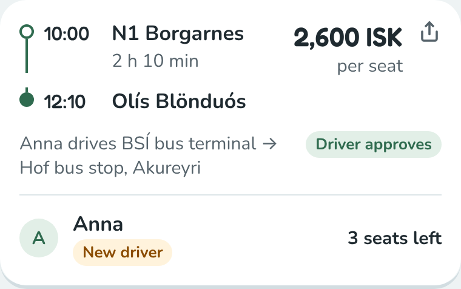 |
| The front page on a laptop | 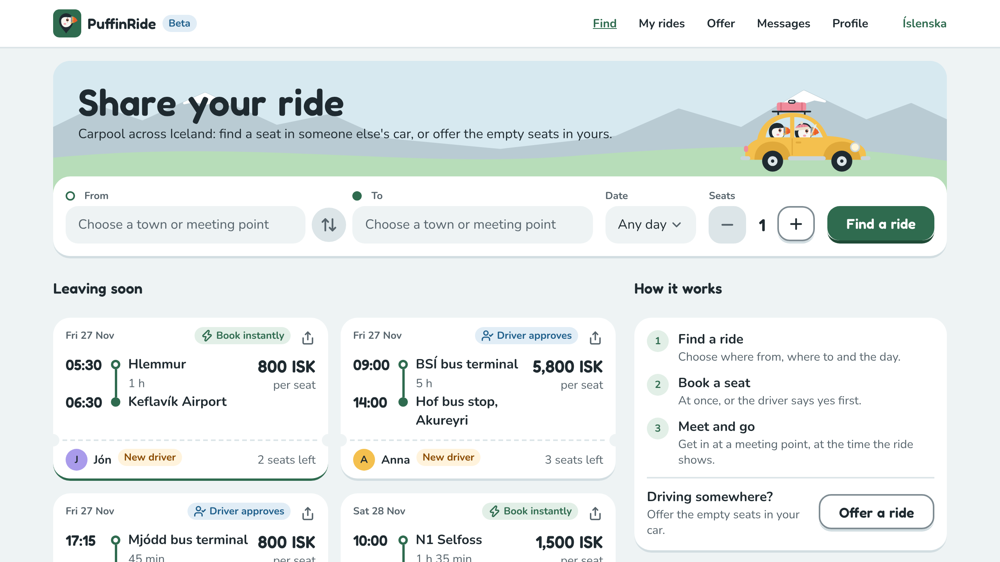 |
| A result's link copied, on a laptop | 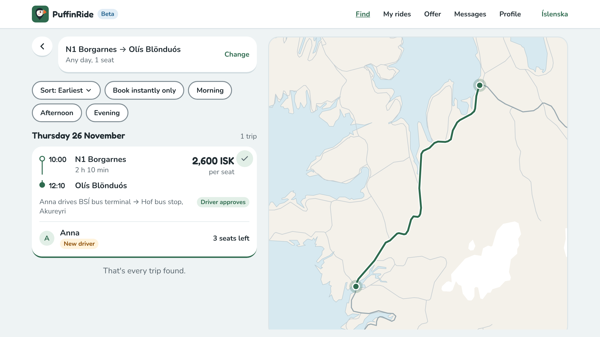 |
| Your trip is published, on a phone (no share window in that browser) | 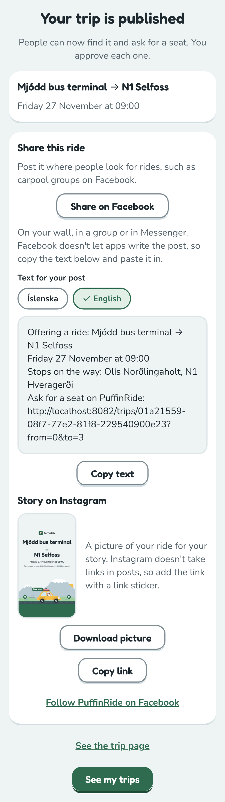 |
| Share this ride on a laptop, in Icelandic | 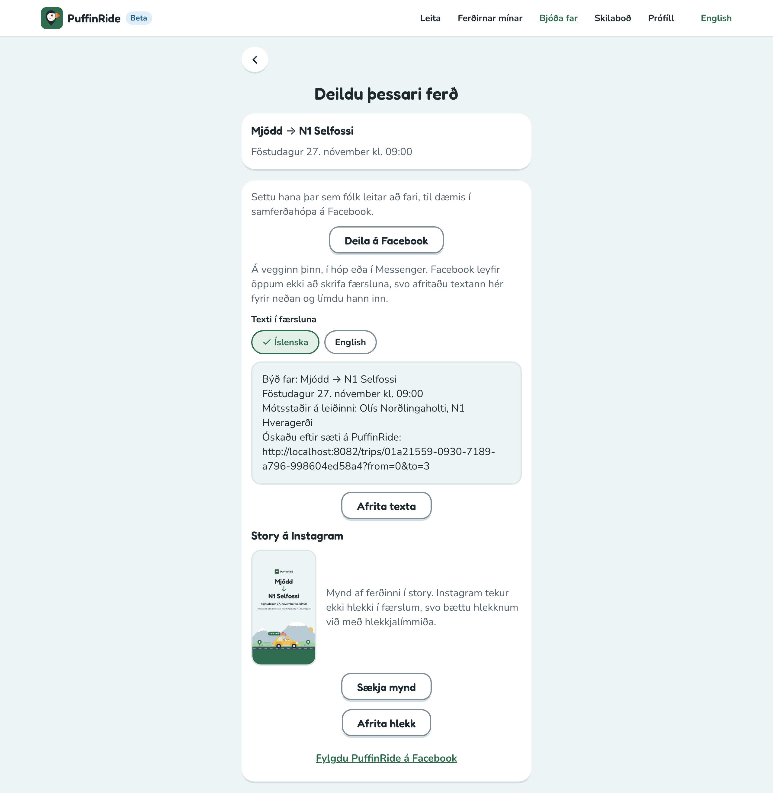 |
| The driver's ride on a phone (its ticket since spec 31) | 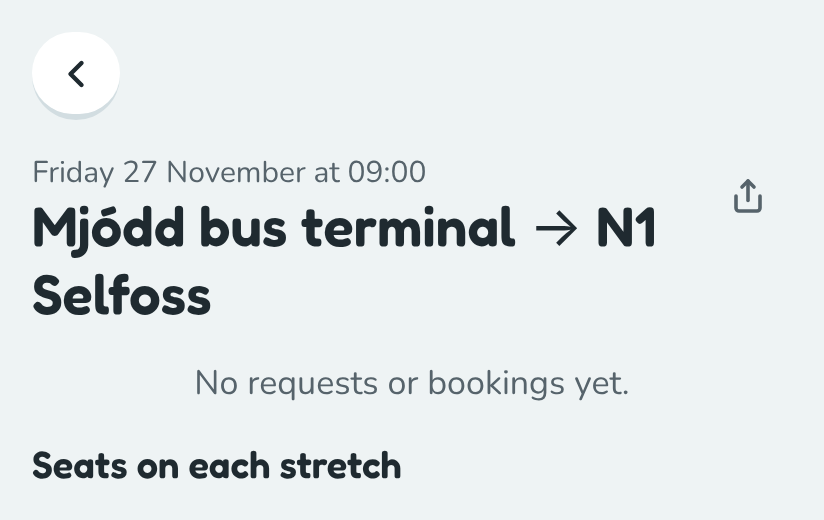 |
| The driver's ride on a laptop | 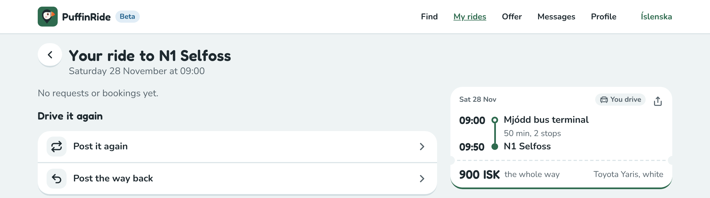 |
| Story on Instagram, in a browser that cannot share files | 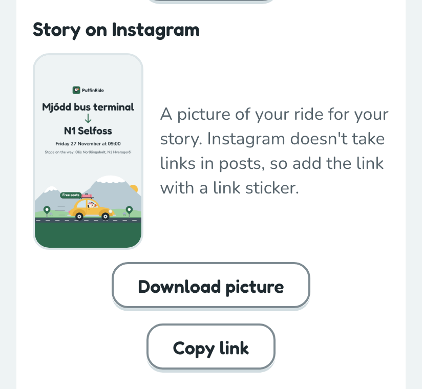 |
| A story, short trip, Icelandic | 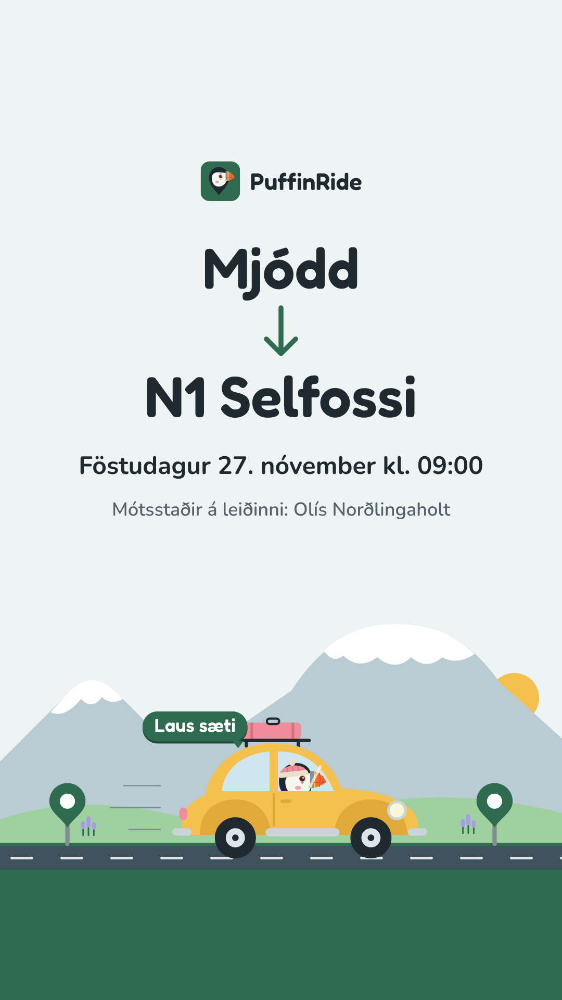 |
| A story, long names, English, full | 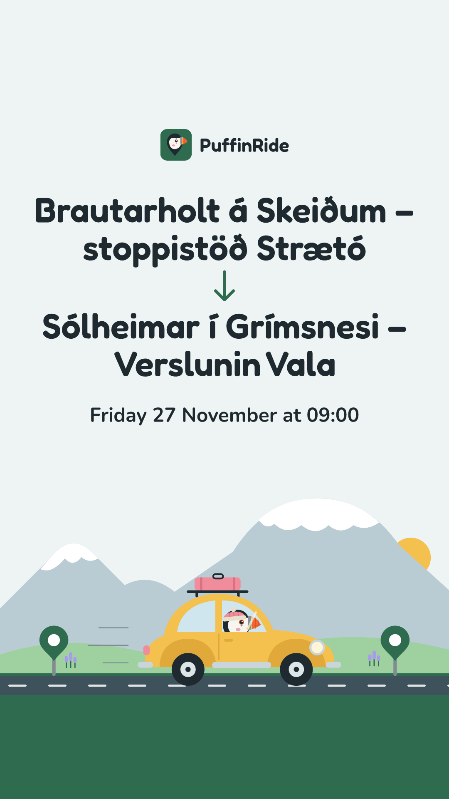 |
| A story, many stops, Icelandic | 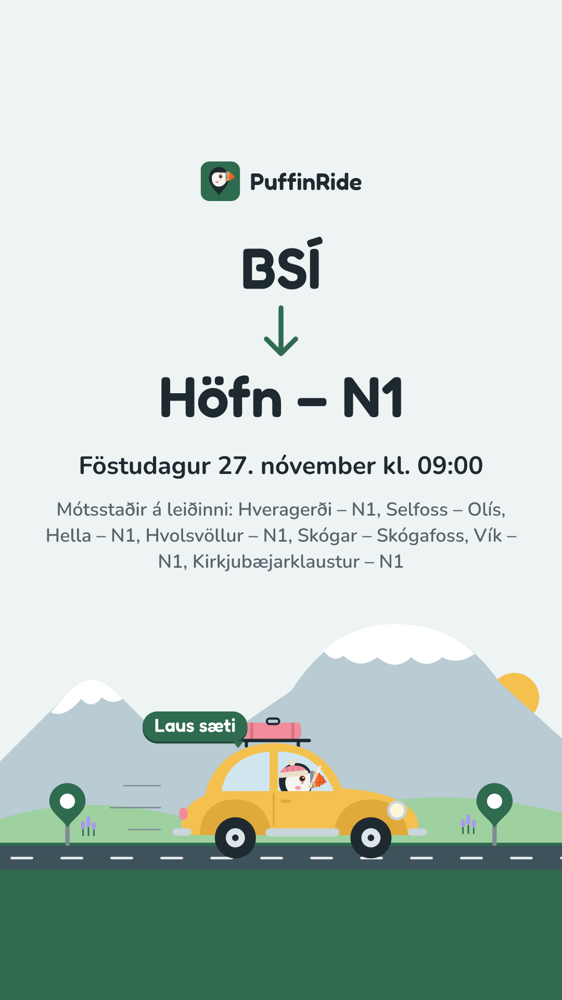 |

## 6. Data and API

- `GET /v1/trips/{id}/story.png` (3.5), a file beside `preview.png`, not in
  the OpenAPI document. No migration, nothing stored.
- In the app: `apps/mobile/src/sharing/` holds the post text, Facebook's
  link, the Page's address and the panel; `lib/share.ts` keeps sharing and
  copying, and learns to copy a text and to share a picture file.

## 7. Privacy and safety

- What is shared is public already: the trip page shows it to anyone with
  the link (spec 4, 3.7), and the link preview the same (R23.8). R28.2 keeps
  the driver's name, car and prices out of the words and the picture that
  Facebook and others keep a copy of.
- The driver's own post on Facebook carries their Facebook name: that is
  Facebook's, by the driver's choice.
- R28.3: Facebook gets only the link, from the person's own browser, after
  the tap. No new processor, no change to the privacy notice;
  [privacy](../compliance/privacy-gdpr.md) gets a line under link previews.
- No new analytics events.

## 8. Texts

| Key | English | Icelandic |
| --- | ------- | --------- |
| `shareRide.cardLabel` | Share the ride {route} | Deila ferðinni {route} |
| `shareRide.heading` | Share this ride | Deildu þessari ferð |
| `shareRide.intro` | Post it where people look for rides, such as carpool groups on Facebook. | Settu hana þar sem fólk leitar að fari, til dæmis í samferðahópa á Facebook. |
| `shareRide.share` | Share | Deila |
| `shareRide.facebook` | Share on Facebook | Deila á Facebook |
| `shareRide.facebookHint` | On your wall, in a group or in Messenger. Facebook doesn't let apps write the post, so copy the text below and paste it in. | Á vegginn þinn, í hóp eða í Messenger. Facebook leyfir öppum ekki að skrifa færsluna, svo afritaðu textann hér fyrir neðan og límdu hann inn. |
| `shareRide.facebookHintHold` | (in the apps) On your wall, in a group or in Messenger. Facebook doesn't let apps write the post, so press and hold the text below to copy it, then paste it in. | Á vegginn þinn, í hóp eða í Messenger. Facebook leyfir öppum ekki að skrifa færsluna, svo haltu fingri á textanum hér fyrir neðan til að afrita hann og límdu hann svo inn. |
| `shareRide.postText` | Text for your post | Texti í færsluna |
| `shareRide.postLanguage` | Language of the text | Tungumál textans |
| `shareRide.copyText` | Copy text | Afrita texta |
| `shareRide.textCopied` | Text copied. Paste it into your post. | Textinn var afritaður. Límdu hann í færsluna. |
| `shareRide.copyFailed` | The text couldn't be copied. Select it in the box to copy it. | Ekki tókst að afrita textann. Veldu hann í reitnum til að afrita hann. |
| `shareRide.post.offer` | Offering a ride: {route} | Býð far: {route} |
| `shareRide.post.book` | Book a seat on PuffinRide: | Bókaðu sæti á PuffinRide: |
| `shareRide.post.ask` | Ask for a seat on PuffinRide: | Óskaðu eftir sæti á PuffinRide: |
| `shareRide.story` | Story on Instagram | Story á Instagram |
| `shareRide.storyHint` | A picture of your ride for your story. Instagram doesn't take links in posts, so add the link with a link sticker. | Mynd af ferðinni í story. Instagram tekur ekki hlekki í færslum, svo bættu hlekknum við með hlekkjalímmiða. |
| `shareRide.sharePicture` | Share picture | Deila mynd |
| `shareRide.downloadPicture` | Download picture | Sækja mynd |
| `shareRide.copyLink` | Copy link | Afrita hlekk |
| `shareRide.pictureFailed` | The picture couldn't be made just now. | Ekki tókst að búa til myndina í bili. |
| `shareRide.pictureNotShared` | The picture couldn't be shared here. Download it instead. | Ekki tókst að deila myndinni hér. Sæktu hana í staðinn. |
| `shareRide.follow` | Follow PuffinRide on Facebook | Fylgdu PuffinRide á Facebook |
| `shareRide.notShareable` | Only a published trip that hasn't left can be shared. | Aðeins er hægt að deila birtri ferð sem er ekki lögð af stað. |
| `shareRide.backToTrip` | See the trip | Sjá ferðina |

The when and stops lines reuse `trip.mine.when` and `seo.tripStops`; `share.*`
is spec 9's "Share trip details", so these keys are `shareRide.*`. The
Icelandic texts want a native read, as the ads did.

## 9. Testing

- App: the post text in both languages, with and without stops, for an
  instant and an approval trip, and that it holds no "kr", fee or name;
  Facebook's address; the card's icon shares the part's link and does not
  open the trip; it copies and shows the tick without a share window; the
  driver's card and trip page open Share this ride; the panel shows Share
  only with a share window, changes the text's language, copies it, opens
  Facebook, offers Share picture where it can and Download picture on the
  web only, says when the picture cannot be made or shared, and
  links to the Page; the screen of its own refuses a trip that has left.
- API: `story.png` answers a PNG 1080 × 1920, 404 for a cancelled trip, a
  file with its name for `download=1`; long routes and many stops fit
  inside the safe area; nothing about the driver.
- Web journeys: publishing shows Share this ride and copies the text; a
  search result's icon copies its link; the laptop journey checks the
  share screen at 1280.

## 10. Out of scope

- Posting for the driver, or reading their groups (not possible, 1.1).
- A PuffinRide group (3.6), and links to other people's groups.
- The story picture in the apps (3.5), and Facebook's or Instagram's own
  logos.
- Sharing from a passenger's My rides, and counting shares.
