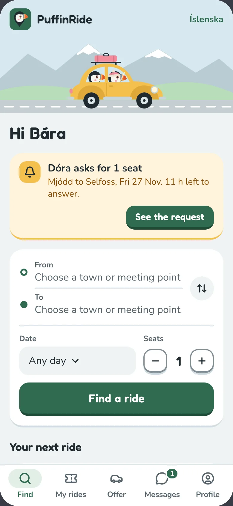
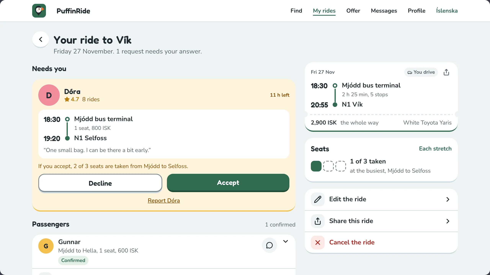

# Spec 31: One ride, one ticket: the same rules for every screen

**Owner:** Martin · **Date:** 2026-11-26 · **Status:** Approved
(2026-11-26): Martin chose "One ride, one ticket" (3.1, B) on the thread's
card, to be built flow by flow as drawn
([plan](../plans/2026-11-26-one-ride-one-ticket.md)). The other choices in
the Decisions section stay his to change

Amends, once approved: [spec 15](2026-11-13-visual-design-system.md) (new
parts, title alignment, the title font's spacing),
[spec 16](2026-11-15-one-home-and-simpler-flows.md) (3.2 Find, 3.3 My rides,
3.4 Profile, 3.6 item 4, the last posting step) and
[spec 18](2026-11-18-laptop-layout.md) (3.5 Find, 3.9 a booking, 3.10 My
rides, 3.12 Profile, 3.14 the driver's trip), and the look, not the
behaviour, of the screens of specs 3 to 9 (3.19). No ADR: no new service,
dependency or business rule. Sign-in is left to
[spec 29](2026-11-25-easier-sign-in.md).

A second reader checked this spec against the app's code on 2026-11-26.
What that settled is in decisions 9 to 16, each a working choice of
Claude's that Martin can change.

The proposal as Martin saw it, each screen as it is beside how it would
look: [proposal page](https://claude.ai/artifact/3hMRPHSfiQxqVFkhtdAQtx)
(its files: [images/one-ride-one-ticket/proposal/](images/one-ride-one-ticket/proposal/)).

## 1. Problem and goal

Martin, 2026-11-26: "go over the whole web and make it more orgnaized and
easy to use, focusing on the complex UX/UI. I beliave its in many ways
clunky and disfunctional. I think its visually unorganized and boring. I
like the style we have, but its without a greater thought. Lets make sure
we can do better"

The website was walked on 2026-11-26 as a member uses it: joining as a
driver and as a passenger, offering a ride, asking for a seat, accepting
it, chatting, the trip day and a rating, on a phone (390 by 844) and a
laptop (1280 by 720), about 300 pictures. No screen was named beforehand.

The style holds up. What is missing is a system: each screen was designed
on its own, so the same thing has a different name, shape and place from
one screen to the next.

One thing has several names and shapes:

- The menu says My rides. A second page for drivers, My trips
  (`/drive/trips`), lists the same rides as a different card. Offering is
  called "Offer a ride", "Post a trip" and "Publish trip". Finding is
  "Find", "Find a ride" and "Search".
- There are two search forms: the card on the front page and the screen at
  `/search`.
- A ride is a different card in the results, in My rides, in My trips and
  in a request.
- Profile and Settings overlap; Send feedback is on both.

Everything has the same weight:

- Nearly every block is a white card of the same kind, so nothing says
  where to look first.
- The driver's ride ends in a column of five equal buttons: Edit trip,
  Cancel trip, Share trip details, Post again, Post the return trip.
- Titles are centred on some screens and at the left on others.
- The car's yellow and the Iceland scene live only in the drawings. The
  screens themselves are moss, white and frost, which is why they read as
  dull.

What needs you is easy to miss:

- On Find and in My rides, a request waiting for the driver's answer is a
  small blue tag on a tall white card, with the button under the card. On
  Find that card lists every stretch of the route and pushes the search
  under the first screen.
- On the trip day, "I'm here" comes just under the first screen on a phone.
- A booking's title is its route; its state is a small tag and a line
  under it.
- At the top of a conversation the two most visible things are Report and
  Block.

Long screens list everything:

- The last step of offering a ride opens with three unticked boxes and
  three buttons, then lists the route twice, once as places and once with
  times.
- The driver's ride gives most of its room to one seat bar a stretch and
  little to the person asking for a seat.
- A ride's details put your part, the driver, the car, the seats and the
  route in cards of equal weight.
- Settings is one long page of text, chips, switches and cards.

**Plain defects**, fixed whatever is chosen (3.18).

**Goal:** every screen follows the same six rules, so a member learns the
website once: a ride always looks the same, the title says what is going
on, what needs them comes first, and each screen has one main thing to do.
The colours, fonts, puffins, car, scene and logo stay.

**Anti-goals:** a new look; new features; any change to how booking,
prices, seats, cancelling or sign-in work; a screen that looks tidier but
takes more presses than today for what people do most (finding, booking,
answering a request, messaging, "I'm here"); a function that is on a
screen today and on none afterwards.

## 2. User stories

- As a passenger, I open the website on the day of my ride and the first
  screen tells me when it leaves, where to stand and who to look for, with
  "I'm here" under my thumb.
- As a driver, I open the website and the first thing I see is that Dóra
  asks for a seat, with one button to answer.
- As someone looking for a ride, I compare rides that all look the same:
  the times and places down the left, the price at the right, the driver
  under the tear line.
- As a driver about to publish, I see my ride the way passengers will, and
  what is still missing as one line.
- As anyone, I know what a screen is about from its title, and I find its
  main button in the same place every time.

## 3. Behaviour

### 3.1 Approaches considered

- **A. Tidy up.** Every screen stays as it is. Fix the defects, give every
  page the same head, turn the button columns into rows. Three or four pull
  requests. The website would still feel like many separate screens, and
  still dull.
- **B. One ride, one ticket** (recommended). The six rules of 3.2 on every
  flow; the same style with the screens rearranged. About twelve pull
  requests, flow by flow, each usable on its own.
- **C. A new look.** New colours, fonts and drawings. Martin likes the
  style, and what is wrong is the order, not the style. Not recommended.

Martin chose B on the thread's decision card on 2026-11-26 (decision 1).
The rest of this spec describes B.

### 3.2 The six rules

1. **One ride, one ticket.** A ride is the same card everywhere: the day,
   the two times and places as a timetable, the price. Under a tear line it
   says what that place needs: the driver in the results, your seat in My
   rides, the request to answer for a driver.
2. **The road shows where things stand.** A booking goes Asked, Confirmed,
   Trip day, Done. Offering a ride goes Route, Time, Seats, Price, Check.
   The puffins' car stands at the step you are on.
3. **What needs you comes first, in the car's yellow.** A request to
   answer, a seat to pay for, a ride on its trip day: one yellow card with
   one button, at the top of Find and of My rides (3.3, item 3).
4. **One main button.** At the bottom of the screen on a phone, at the top
   of the side column on a laptop (R31.1). Everything else is a row with
   an icon. What cannot be undone is red and last.
5. **The title says what is going on.** "Your seat is confirmed", "Leaves
   in 10 minutes", "Your ride to Vík": once, at the left, in place of a tag
   and a line that repeat each other.
6. **Colour means something.** Moss is what you can do. Sun yellow is
   yours and now. Glacier blue is waiting and information. Red is a
   problem.

### 3.3 The parts

New parts of the design system (spec 15, section 5), light and dark. They
need no new colour value; what the colours mean changes in two places,
named in item 3.

1. **`RideTicket`** takes the place of the four ride cards (`ResultCard`,
   the My rides row, the My trips card, the stretch inside a request).
   - **Day row:** the day ("Fri 27 Nov") in `caption`, then the tags at the
     right: "Book instantly" or "Driver approves" in the results; "You
     drive" or "Passenger" on my own rides; then Share where the ride can
     be shared.
   - **Timetable:** departure time, a ring, the place; the line with the
     duration beside it ("1 h 35 min", with ", 5 stops" for a driver's
     whole route); arrival time, a filled dot, the place. Times are
     Fredoka with tabular digits and line up; a place name that wraps
     keeps its time on its first line.
   - **Price:** at the right of the timetable, with "per seat" or "1 seat"
     under it. A driver's own ride shows no price there.
   - **Tear line:** a dashed line with a notch in each edge, in the page's
     colour.
   - **Foot,** one line: in the results, the driver's picture, name, rating
     or "New driver", and the seats left; on a booking in My rides, the
     driver and the booking's state as a tag; on a ride I drive, "1 of 3
     seats taken" and what it needs ("1 request"). A ride that is mine has
     a moss bottom edge.
   - It is one link, as the cards are today. Tickets in one row of a grid
     are equally tall, with the foot at the bottom.
2. **`Road`**: a grey road with a dashed middle line, the part behind the
   car in moss, a mark at each step and the car (`PuffinsInCar`, 60 wide)
   on the step you are on, with the steps' names under it and the current
   one in the text colour. For screen readers it is one line: "Step 2 of
   4: Confirmed". It takes the place of `StepProgress` on the posting
   steps. Its marks are not links: on the last posting step the rows open
   the earlier steps (3.11).
3. **`NeedsYouCard`**: a card in `warningSoft` (the soft yellow of the
   "New driver" tag) with a bottom edge in the car's yellow (`people.sun`):
   a yellow square with an icon, one bold line saying what is asked ("Dóra
   asks for 1 seat"), one line of detail in `warning` ("Mjódd to Selfoss,
   Fri 27 Nov. 11 h left to answer."), and one button. On the
   driver's ride the same card holds the whole request, with Decline and
   Accept side by side.
   - **What needs me** is one of three things, each already known to the
     lists Find and My rides load (section 6): a ride I drive with
     requests whose deadline is still to come; a seat of mine the driver
     accepted, to pay before its deadline (both as today, spec 16, 3.3);
     and a ride on its trip day, from three hours before I get in or
     leave until it is done (spec 8, 3.1). The soonest comes first: by
     the deadline to answer or pay, or by the time to get in or leave.
   - **A rating to give is not among them** (decision 9). It is asked on
     the booking, whose title is then "How was your ride?" (3.8), and
     under Past in My rides (3.10), as well as by the email of today.
   - **The button** is filled where the card is the thing to do (Find, My
     rides, the driver's ride) and outlined on the last posting step,
     where Publish ride is the main button (R31.1).
   - **The colours** are the pair the tags use, `warningSoft` and
     `warning`, which spec 15 names for warnings. From this spec they mean
     "yours and now" (rule 6); the tokens keep their names. `people.sun`
     gains one use outside drawings, the card's bottom edge and the square
     behind its icon; it is never text and never the only sign, since the
     bold line says what is asked.
   - **Status tags follow rule 6** (decision 10). "Driver said yes: pay"
     stays amber. Declined, expired, cancelled and withdrawn, amber or
     blue today, become a quiet tag (`plain`: muted text on the page's
     colour), since nothing is asked of anyone. "Did not show up" becomes
     red (`problem`: `error` on `errorSoft`). `Tag` gains those two kinds.
4. **`ActionRows`**: a card of rows 56 high, built on today's `Row`: an
   icon in a soft square, a label, sometimes the current value in muted
   text, and a chevron. A row that cannot be undone is red, has no chevron
   and comes last. A row either opens a page (chevron), unfolds what is
   under it (a chevron pointing down), holds a switch, or only shows a
   value (no chevron, and not a button). It takes the place of columns of
   secondary buttons and of loose text links.
5. **`ScreenHead`**: Back, then the title at the left with at most one
   line under it, and at most one round icon button at the right (Share).
   (`PageHead` is already the name of the title for search engines.)
6. **Titles and figures** (Fredoka) are set without kerning and with a
   word space 0.06 em wider (3.18, item 1), on the web, where it was
   measured; the phone apps are checked when they are built (section 10).

Existing parts stay: `Card`, `Tag`, `Chip`, `BottomBar`, `SeatView`,
`TickList`, `Columns`, `Grid`, `PuffinsInCar`, `IcelandScene`, `PuffinByPin`,
`TopBar`, `TabBar`.

As built, in the web app: on a phone
([light](images/one-ride-one-ticket/built/parts-phone-light.webp),
[dark](images/one-ride-one-ticket/built/parts-phone-dark.webp)) and on a
laptop ([light](images/one-ride-one-ticket/built/parts-laptop-light.webp),
[dark](images/one-ride-one-ticket/built/parts-laptop-dark.webp)). Their
exact sizes and colours are in
[spec 15](2026-11-13-visual-design-system.md), section 5.2.

### 3.4 One name each

In English a member reads **ride** for what a driver offers and a passenger
books; "trip" stays only in "Trip day" and in the code and docs
(decision 5). The places are Find, My rides, Offer, Messages and Profile, as
today; their actions are **Find a ride**, **Offer a ride** and **Publish
ride**. "Post a trip", "Publish trip", "My trips" and "Search" (as a
button) go. Icelandic keeps "far" in "Finna far" and "Bjóða far" and "ferð"
for the ride itself.

As built: the console and the legal documents keep "trip" (section 10),
and so do three texts on the marketing pages and About, where "a trip you
are making anyway" is the drive itself. Notices, emails and text messages
say "ride", as they share their words with the app. Where "ride" alone
would read as a passenger's seat, a text says whose it is ("You're the
driver of this ride"). A booking's row reads "Share the ride's
details": "Share ride" is the product's old name, kept out of every text
(ADR 0039).

### 3.5 Find

1. Signed out, a phone's Find stays as it is (spec 16, 3.2), with the rides
   as tickets.
2. Signed in, under the scene: **"Hi Bára"** as the title, at the left.
   Then **one** of:
   - what needs me, as a `NeedsYouCard`, when something does (the
     soonest, 3.3, item 3; under it "and 2 more" opens My rides);
   - otherwise my next ride, as a ticket.
   Then the search card, then "Your next ride" as a ticket when a
   `NeedsYouCard` stands above and my next ride is another ride than the
   one it is about, then "Leaving soon".
3. The search card is the one card of spec 16, 3.2, item 3. `/search` shows
   the same card with the title "Find a ride" and the same button, "Find a
   ride"; there is one search form.
4. A driver's ticket shows the whole route as two ends with ", 5 stops";
   the seats free on each stretch are on the driver's ride (3.12), not on
   Find or My rides.

As built, on a phone
([light](images/one-ride-one-ticket/built/find-phone-light.webp),
[dark, in Icelandic](images/one-ride-one-ticket/built/find-phone-dark.webp))
and on a laptop
([light](images/one-ride-one-ticket/built/find-laptop-light.webp)). What
differs from the drawing, or was left open by it:

- My next ride has the heading "Your next ride" over its ticket in both
  places, over the search when nothing needs me and under it when
  something does.
- A ticket always says its day, in a list under a day's heading too: the
  same ticket shows on Find, where no heading says it.
- A ride found that is a part of a driver's ride says the whole ride in
  one muted line over the tear line: "Anna drives BSÍ → Akureyri".
- A ride that costs nothing says "Free", with no "per seat" under it.
- A seat of mine has no moss edge until it is confirmed (asked for, or
  accepted and not yet paid, it is not mine yet); until the driver answers,
  its foot says whose answer it waits for ("Waiting for Sigga's answer").
- What counts keeps counting: Find and My rides read the clock again every
  half minute while they are in view, and when the app or the tab comes
  back to the front. "Leaves in 40 minutes" becomes 39, and a need whose
  deadline passes leaves the screen without anything being pressed.
- With text at twice its size on a phone 360 wide, a word longer than a
  whole line of its place ("Kirkjubæjarklaustur,") is broken inside the
  word. Nothing else is, and nothing reaches past the ticket.

### 3.6 Search results

1. The head stays: Back, and the search as a card with Change.
2. One row: the sorting ("Earliest"), one **Filters** chip that opens the
   filters there are today, and the number of rides at the right.
3. Rides are tickets under a heading for each day, with the tag beside the
   day instead of in a band of its own.
4. The list ends with a card, the puffin by its pin beside "That's every
   ride found" and "All rides". The sections for other days and nearby
   meeting points stay as they are.

As built, on a phone
([light](images/one-ride-one-ticket/built/results-phone-light.webp),
[dark, in Icelandic](images/one-ride-one-ticket/built/results-phone-dark.webp))
and on a laptop
([light](images/one-ride-one-ticket/built/results-laptop-light.webp)):

- The sorting chip shows the order alone ("Earliest") and is named "Sort:
  Earliest" for a screen reader. The Filters chip says how many are on
  ("Filters: 1 on") and is then filled. One of the two is open at a time,
  under the row.
- A day's heading no longer counts its rides: the row counts them all.
  When a filter leaves none the count stays and says "0 rides", so a
  screen reader hears what the filter did.
- The end card says "That's every ride found", or "These are the first 50
  rides" when there are more than the list holds. Its second line depends
  on the search. With every ride shown: "Try another day, or see every
  ride leaving soon." for a search on one day, "You can also see every
  ride leaving soon." for any day. With the first 50: "Choose a day to see
  others." for any day, "Filter by time of day to see others." for one
  day.
- `/search` has the title at the left (`ScreenHead`) and Find a ride
  inside the card, as on Find; the bar at the bottom is gone.

### 3.7 A ride's details

1. Head: the day in small text over the title "Selfoss to Vík", Share at
   the right.
2. **Your part of the ride**, as a ticket: the two stops with Change on
   each, the booking tag, and under the tear line the seats with the
   stepper and how many are free on that part.
3. **The driver:** picture, name, rating, rides and what is checked, opening
   the profile; under a line, the car, and the preferences as today.
4. **Where you sit:** the seat picture in a card of its own, with one line
   beside it.
5. **The whole route:** the map and the stops, the ones outside my part
   muted, mine marked "Get in" and "Get out".
6. Rows: free cancellation with its time, "Weather and roads" (the Safety
   links of today), "Report this ride".
7. The bar at the bottom stays: the price for my seats and **Book** (or
   "Ask for a seat").

As built, on a phone
([light](images/one-ride-one-ticket/built/ride-phone-light.webp),
[dark, in Icelandic](images/one-ride-one-ticket/built/ride-phone-dark.webp))
and on a laptop
([light](images/one-ride-one-ticket/built/ride-laptop-light.webp)):

- The title names my part in words, "N1 Borgarnes to Olís Blönduós" (in
  Icelandic with the arrow, section 8), and follows it when I change where
  I get in or out. The line under it about the driver's whole ride is
  gone: the whole route is on the screen. Between places with long names
  on a narrow phone, Share stands over the title, which then has the whole
  width after Back: no name is broken inside a word for the button.
- The ticket's caption, "Your part of the ride", is a heading under the
  page's title. An end has Change when the ride has another stop to choose
  there; beside a long name on a narrow phone, Change stands under its
  place. Change unfolds that end's stops inside the ticket, as radio cards
  with their times, one end at a time, and focus goes to them. A choice,
  or Escape on the web, folds them, and focus goes back to Change. A part
  changed from the whole route's stops folds them too, and leaves focus
  where it is. Under the tear line a phone has the seats with "3 free on
  your part"; the price is in the bar, with what each seat costs under it
  for more than one ("2 × 2,900 ISK").
- A ride that was cancelled has no booking tag on the ticket and no row or
  line about cancelling a booking: there is no seat to book.
- The driver's card: picture, name, rating or "New driver", and the
  reliability a member sees. The whole line opens the profile and is named
  in one line for a screen reader ("See profile: Anna, 4.3 (3 ratings),
  Reliability: 91%"). A ride's details carry no number of rides and
  nothing about what is checked, and section 6 adds no data, so the card
  has neither; the profile it opens has both.
- "Where you sit" says "2 of 3 seats are free. Seats are not numbered: you
  agree in the car." in the place of the legend. The picture keeps its
  one-line description for screen readers, and is at most `carBeside`
  (176) wide, so a wide card gives its room to the words, and at least
  `carBesideLeast` (120), so the two stand side by side on a phone 360
  wide.
- "The whole route" gives no distance: a ride has none in the API. My
  stops are marked with the tags "Get in" and "Get out", and a stop still
  opens to get in or out there.
- The rows. "Free cancellation", with "Up to 15 min before", unfolds the
  whole sentence. Where the ride is paid in person (ADR 0038) the row is
  "Paying", with "Cash or bank transfer", and unfolds that sentence; a
  free ride has neither. "Weather and roads" is there for a ride that
  leaves the capital area and is not cancelled, as the Safety links were,
  and unfolds them with their line. "Report this ride" is a link, for
  someone signed in who does not drive the ride. With none of the three
  there is no card of rows.
- A row's value goes under its title where the two have no room on one
  line (spec 15, 5.2), so "Free cancellation" is never broken in two.
- The bar's button keeps its texts, "Book" and "Send request".
- On a laptop (3.16, item 6) the ticket has no foot: the seats are in the
  booking panel, beside the price they change, and the panel keeps the
  free cancellation sentence, so the rows leave it out.

### 3.8 A booked seat

1. The **title is the state**: "Request sent", "Bára said yes: pay to keep
   your seat", "Your seat is confirmed", "Leaves in 10 minutes", "How was
   your ride?", "Cancelled". One line under it says what happens next
   ("Bára said yes. See you on Friday at 18:30."). The "Confirmed" tag and
   the line with a tick go.
2. The **road**: Asked, Confirmed, Trip day, Done. A ride booked instantly
   starts at Confirmed. A cancelled or declined booking shows no road.
3. The ride as a **ticket**, with "1 seat" and the price under the tear
   line.
4. **The driver:** picture, name and rating with **Message** at the right;
   under a line the car, and the number plate once it shows.
5. **Where to stand,** once the seat is confirmed: a small map, the place,
   its description, "Open in maps".
6. A notice for paying, as today (the deadline with Pay, or the line about
   paying the driver in person).
7. Rows: Share the ride's details, Weather and roads, Report a problem,
   and **Cancel booking**, red and last.
8. Everything a booking shows today stays, in this order: reports and
   changes to the ride come directly under the title.
9. This screen is the passenger's. What a driver does with a passenger's
   booking is on the driver's ride (3.12), where cancelling it and a
   report lead back to, as today.

As built, on a phone
([light](images/one-ride-one-ticket/built/booking-phone-light.webp),
[dark, in Icelandic](images/one-ride-one-ticket/built/booking-phone-dark.webp))
and on a laptop
([light](images/one-ride-one-ticket/built/booking-laptop-light.webp)):

- The titles, and the line under each: "Request sent" with "Anna has
  until 22:00 to answer."; "Anna said yes: pay to keep your seat", or "Pay
  to keep your seat" for a ride booked instantly, which nobody said yes
  to, with "Your seat is held until 12:30."; "Your seat is confirmed" with
  "Sunday 15 November. Anna picks you up at 10:00 at Borgarnes."; the trip
  day's titles (3.9); "How was your ride?" with until when it can be
  reviewed, while it can; and how a booking ended, "Completed",
  "Declined", "Expired", "Cancelled", "Withdrawn" or "No-show", with the
  notice that says why under it, as before. When an action here changes
  the state, focus moves to the title, which says the outcome.
- The road has three steps for a ride booked instantly (Confirmed, Trip
  day, Done) and none before it is paid: nothing is confirmed yet. A
  request the driver said yes to stays at Asked until it is paid.
- The ticket is where I am, not a link: the short day, the tag
  "Passenger", my two stops and the time between them, with "1 seat" and
  the price, or "Free", under the tear line.
- The driver's card (the one of a ride's details, 3.7). **Message** is a
  link at the right of the driver once the seat is confirmed, named
  "Message Anna" for a screen reader, and goes under the driver where the
  two have no room. The number plate, once it shows, is a tag at the
  right of the car, named "Number plate AB 123"; before that a line under
  the car says when it shows. A driver who has left shows no rating.
- "Where to stand" has "Open in maps" as a link at its heading's right.
  The small map is our own map of Iceland (ADR 0024) drawn around the
  stop, `mapBeside` (104) wide: it has no streets, so it shows which part
  of the country, and "Open in maps" shows the street.
- Paying. The deadline is the line under the title and **Pay** is the
  main button in the bar, so there is no paying card; the payment opens
  in the bar, in Pay's place. The line about paying the driver in person
  is a notice under where to stand. A driver who opens a passenger's
  booking paid in person reads "Gunna pays you 2,900 ISK in cash or by
  bank transfer when they get in." there.
- The rows, each only when it has something to do: "The driver didn't
  come" (after the ride, while it can still be said, R8.5), "Share the
  ride's details", "Weather and roads" (as on a ride's details), "Report
  a problem with this ride", and red and last "Cancel booking", which
  opens its screen, or "Withdraw request". Withdrawing asks first, in the
  bar: the red row gives way to the question, focus goes to it, and
  "Keep my request" puts the row and the focus back.
- The bar holds the one main button, when there is one: Pay; "I'm here"
  (3.9); "Rate the driver", once the ride is over and while it can be
  reviewed; "Find another ride", after a booking the passenger did not
  end themselves. A confirmed seat with nothing to do has no bar.
- The prompt to turn on notifications or add an email (spec 7, 3.6.2),
  when it shows on this screen, has outlined buttons: the bar's button is
  the only filled one (R31.1).
- A driver who opens a passenger's booking reads the day over the part
  ("Sunday 15 November", "Borgarnes to Blönduós") with the status under
  them, no road, and "Message Gunna" as the first row. Nothing of the
  passenger's is offered: no Pay, no cancelling.

### 3.9 Trip day

1. The title counts down ("Leaves in 10 minutes") and then follows the
   states the trip day has today (spec 8), one title for each; the line
   under it says when and where.
2. Where to stand comes first, then the driver with the number plate as a
   tag.
3. **"I'm here"** is in a bar at the bottom of the screen, and "The driver
   didn't come" takes its place when that is offered.
4. The driver's trip day keeps its list of stops with who gets in and out
   at each; its "I'm here" moves into the bar at the bottom as well.

As built, for the passenger, on a phone
([light](images/one-ride-one-ticket/built/trip-day-phone-light.webp),
[dark, in Icelandic](images/one-ride-one-ticket/built/trip-day-phone-dark.webp))
and on a laptop
([light](images/one-ride-one-ticket/built/trip-day-laptop-light.webp)).
The driver's trip day comes with the driver's ride (3.12).

- The titles: "Leaves at 10:00" until the last hour, "Leaves in 10
  minutes" in it, counting while the page is open, and "Trip day" from
  the time to leave. Once the driver has said "I'm here" the title is
  "Anna is at the meeting point", whatever the clock says, and a screen
  reader hears it when it happens: the notice that said so is gone. The
  line under the title is "Today at 10:00 from Borgarnes." ("At 00:30 from
  Borgarnes." for a ride that leaves after midnight, opened the evening
  before).
- The order: where to stand, the driver with Message and the number
  plate, then the ticket, then the rows. The ticket stays, after what is
  needed at the meeting point, as it names where I get out.
- "I'm here" is in the bar: before it opens the bar says from when, and
  once said it says the driver was told. "The driver didn't come", when
  offered (R8.5), is a link in the bar: under "I'm here" while that can
  still be pressed, as someone waiting may do both, and the bar's main
  button once it was said or has closed. The web journey reads the first
  screen on a phone and finds the title, where to stand and "I'm here"
  inside it with no scrolling.
- Until the time to get in, the seat can still be cancelled: "Cancel
  booking" stays the last row.

### 3.10 My rides

1. Title "My rides" with **Offer a ride** as a small button at its right;
   then Coming up and Past.
2. "Needs you" and "Coming up" as today (spec 16, 3.3), each ride a
   ticket. The foot of a ride that needs me is a yellow tag saying what
   ("Answer Dóra's request", "Pay by 20:46", "Leaves in 40 minutes"), and
   the ticket opens where that is done.
3. Under Past, a finished ride whose rating can still be given has the
   yellow tag "Rate the driver" or "Rate your passenger" in its foot, and
   opens the rating (decision 9).
4. My trips (`/drive/trips`) goes; its address leads to My rides. Drafts
   are listed on Offer (3.11, item 6; spec 16, decision 6), and what led
   to My trips today (Back from a posting step opened by its address,
   and deleting a draft) leads to Offer.

As built so far (the tickets; the title's button, the rating under Past
and My trips follow with the driver's ride): a ticket of My rides holds no
button of its own. What it needs is the yellow tag in its foot, and
pressing the ticket opens where that is done. "Needs you" lists the ride
whose deadline or leaving time is soonest first, as Find does.

### 3.11 Offering a ride

1. Each step has Back and the **road** with five stops in place of "Step 5
   of 5" and the bars; the title under it at the left.
2. Steps 1 to 4 keep their fields. Step 4 says the price as kronur for the
   whole way first; the price level in per cent is the control, not the
   headline. On step 2 the time wheel for a day other than today opens at
   08:00, not at the present time (at 03:40 at night it opened at 04:00
   for a ride the next day).
3. **Check and publish:** "This is how people will see your ride." over
   the ride as a ticket. Under it one card of rows with Change, each
   opening the step it opens today: Route ("Mjódd to Vík, with 5 stops"),
   Time, Price, Seats and booking, Car, Preferences and note. The stops
   are listed once, with their times, when Time is opened; the ticket
   shows the two ends. **Delete draft** is a red row, last, and asks
   first, as today.
4. What is still missing (photo, car, licence; spec 16, 3.6, items 4 and
   5) is one `NeedsYouCard`: "One thing before your first ride. Photo and
   car are done. Your driving licence is left.", with the button for the
   next one. They are still asked here and not earlier.
5. **Publish ride** is in the bar at the bottom, as today, and waits until
   nothing is missing.
6. **Drafts** are listed on Offer, over step 1, as rows in one card, the
   one changed last first: the route and day, opening the step where it
   was left, as today. More than three fold under "Show all drafts".
   "See all drafts" and its page go with My trips (3.10).

### 3.12 The driver's ride

1. Title "Your ride to Vík"; under it what it needs ("1 request needs your
   answer") or its state.
2. The ride as a ticket, with the price for the whole way and the car
   under the tear line.
3. **Needs you:** each request as a `NeedsYouCard`: the passenger with
   rating and rides, opening the profile, the time left, the part asked for
   as a timetable with the seats and price, the message, the seats with
   this request on the fullest stretch of that part as one line ("If you
   accept, 2 of 3 seats are taken from Mjódd to Selfoss"; today it is a
   bar for each stretch, which "Each stretch" still opens), and
   **Decline** and **Accept** side by side. Decline asks why in place, as
   today. "Report Dóra" stays a quiet text link at the card's end.
4. **Passengers:** one card of rows: the picture, the name, their part
   ("Mjódd to Hella, 1 seat, 600 ISK") and the booking's tag, with a round
   **Message** button at the right once the seat is confirmed. Pressing a
   row unfolds it in place (decision 11): See profile, Cancel booking (red
   and last, while it can be cancelled) and Report. Once the ride is done
   the rating shows under the row without unfolding, as today. The card's
   last row is "Message all passengers".
5. **Seats:** one line, "1 of 3 taken at the busiest, Mjódd to Selfoss",
   with "Each stretch" opening the bars of today.
6. **Rows:** Edit the ride, Share this ride, Post it again, Post the way
   back, and Cancel the ride, red and last.

### 3.13 Messages

1. A conversation's top: Back, the picture, the name with "Driver, White
   Toyota Yaris" or "Passenger" under it, and a menu button that holds
   Report and Block. Under it one line with the ride ("Fri 27 Nov, 18:30
   Mjódd to Norðlingaholt"), opening the booking or the driver's ride.
2. The safety line stays, as the first thing in the conversation.
3. The quick answers stay as chips. The field is one line that grows as
   you type, with a round send button.
4. The list of conversations keeps its rows; each shows the ride's day and
   route under the name.

### 3.14 Profile and settings

1. **One page.** The person's card (the picture with its controls for
   adding, changing and removing it, the name, member since, rating, what
   is checked, Edit, "See your profile as others do"), then groups of
   rows, each row showing what is set now:
   - **Driving:** My cars, Driving licence.
   - **Account:** Email, Phone number, Ways to sign in, Notifications,
     Language.
   - **Safety and privacy:** Privacy and your data, Blocked people, My
     reports, Notices.
   - **Help:** Meeting points, Send feedback, My feedback, About
     PuffinRide, Legal documents.
   - **Sign out**, a row of its own at the end. "Sign out on all devices"
     moves to the end of Ways to sign in.
2. A row opens the page it has today. Three things Settings shows in
   place today have no page (decision 12):
   - **Language** opens a new page, `/settings/language`, with the two
     languages to choose from; the row shows the one in use.
   - **Notifications** opens a new page, `/settings/notifications`, with
     the switches of today and the way to the beta news.
   - **Phone number** only shows the number, as today: no chevron, and its
     line of help stands under the group.
   "Shake to send feedback" is a row with a switch under Send feedback,
   in the phone apps only, as today.
3. `/settings` leads to Profile. Signed out, Profile stays as it is.

### 3.15 Sign-in

Not changed here: [spec 29](2026-11-25-easier-sign-in.md) is changing that
screen. Once it has landed, one thing joins it from this spec: the ride
someone was about to book shows over the form as a ticket (spec 16, 3.5
already keeps the ride in sight; only its shape changes).

### 3.16 Wide screens

The kinds of screen, the widths and the top bar of spec 18 stay. What
changes:

1. **Find:** the title and its line stand at the left of the scene, with
   the car on the road at the right; the search row overlaps the scene's
   lower edge as today. Main column: the rides as tickets. Side column:
   signed in, what needs me or my next ride; signed out, "How it works"
   in three lines with **Offer a ride**; then the map, as today. As
   built: the scene behind the title is 132 high and the car 170 wide,
   two `xxl` in from the right; signed in, "Offer a ride" is a line under
   the rides, as before. "How it works" stands whole in a window 1280 by
   720; the map under it is then partly below the fold for someone signed
   out (spec 18, 3.5). Signed in with nothing coming up, the map leads
   the side column and is whole in that window; the link under it, "See
   the meeting points", starts in the window and ends 25 under its edge,
   as the scene is 36 higher than it was. The laptop journey measures
   both.
2. **A booked seat:** main column: the title, the road, where to stand and
   the driver; side column: the ticket, then the rows. On the trip day
   "I'm here" is the main button at the top of the side column. As
   built: the title is the page's head, over both columns. The driver and
   where to stand share a row where the main column has room for both,
   as cards of one height, where to stand first on the trip day. The
   side column begins with what a phone's bar holds (Pay and its sheet,
   the question about withdrawing, "I'm here", "Rate the driver", "Find
   another ride"), then the ticket and the rows; what is open or was
   said there stays when the window turns narrow and wide again. The
   side column is whole in a window 1280 by 720.
3. **The driver's ride:** main column: Needs you, Passengers, then "Drive
   it again" (Post it again, Post the way back). Side column: the ticket,
   Seats in one line, and the rows Edit, Share and Cancel. The side column
   is whole in a window 1280 by 720 (spec 18, decision 14), which the
   one-line Seats makes possible.
4. **My rides:** a grid of tickets, as today.
5. **Profile:** the person's card in the side column, the groups in the
   main column.
6. **A ride's details and Booking a seat** (as built) keep their columns
   of spec 18 (3.7 and 3.8). A ride's details: main column, the ticket of
   my part, the driver's card, "Where you sit" and the rows, one under the
   other; side column, the booking panel and "The whole route". Get in and
   Get out are the ticket's two ends, so nothing stands in two halves any
   more. Booking a seat: the side column is the ride's ticket and the main
   button under it.

### 3.17 Titles at the left

On a screen where you do something (a ride, a booking, a step, a list, a
conversation, Profile) the title is at the left. Find on a phone, the empty
and signed-out screens with a puffin, the screens that say a seat is
booked or a ride is published, and About keep a centred title. This
changes Martin's choice of 2026-11-14 (spec 15, 5.1) and is decision 2.

### 3.18 Plain defects

Fixed in a pull request of their own, before the rest and whatever is
chosen:

1. Titles run words together ("N1Vík" for "N1 Vík"): Fredoka's space is
   narrow, and the kerning between "1" or a space and "V" closes it
   further. At 28 px the space is 6.75 px and "N1 Vík" is 72.5 px wide
   with kerning, 77.4 px without. **Fixed:** on the web, every Fredoka
   style is set without kerning and with a word space 0.06 em wider
   (`wordsApart` in the app's tokens).
2. On Edit trip, "Change the preferences and note" runs out of its card.
   **Fixed:** where a part's title and its link do not fit on one line,
   the link goes under the title; the same on the last step of posting.
   "Remove a stop" starts at the left.
3. Profile pictures sit at mid-height beside tall blocks of text (the
   driver's card, a request). **Fixed:** the picture stands at the top,
   with the name; beside a line or two it stays at their middle.

A web journey checks each of the last two in the browser: no link of Edit
trip reaches past its part at 360 wide, and no picture starts under the
top of the text beside it.

Pictures: Edit trip
[before](images/one-ride-one-ticket/defects/edit-trip-before.webp) and
[after](images/one-ride-one-ticket/defects/edit-trip-after.webp) (a phone
360 and 390 wide, and a laptop), and a profile picture beside its text
[before](images/one-ride-one-ticket/defects/picture-before.webp) and
[after](images/one-ride-one-ticket/defects/picture-after.webp).

### 3.19 Every other screen

The sections above describe the screens that change most. Every other
screen a signed-in member reaches keeps what it holds, its order and its
texts, and takes the rules in the same pull request as its flow
(decisions 8 and 13): the head at the left (rule 5), one main button
(rule 4, R31.1), rows in place of columns of buttons and loose links, a
ticket wherever it shows a ride (R31.2), and the tags of rule 6.

| Screen | What changes |
| ------ | ------------ |
| Booking a seat (`/trips/[id]/book`) | My part as a ticket at the top; the main button stays in the bar |
| "You're booked" and "Your ride is published" | The ride as a ticket; the share panel of spec 28 stays; centred, with their puffins |
| Cancelling a booking or a ride, answering a report, "The driver didn't come", "The passenger didn't come", reporting, blocking | The head at the left; the ride as a ticket where it shows today; the main button in the bar, red when it cannot be undone |
| Rating (`/bookings/[id]/rate`) | The head at the left; the stars and fields as today |
| Edit trip (`/drive/trips/[id]/edit`) | Its parts become rows with what is set now: Time, Stops (with Add a stop and Remove a stop under it), Price, Seats, Car, How people book, Preferences and note. Each part's screen and "Check the change" keep their fields |
| Sharing a ride, messaging all passengers | The head at the left |
| A person's profile, its preview, Edit profile | The person's card as on Profile (3.14); Report and Block as rows, red and last |
| All rides (`/rides`), a place, a meeting point and their list | Rides as tickets; the rest as today. As built: a place and a meeting point list no rides today, so only All rides changed |
| My cars, a car, the driving licence, the photo | The head at the left |
| The pages under Settings, Notices, Send feedback, deleting the account | The head at the left |

As built, Booking a seat on a phone
([light](images/one-ride-one-ticket/built/book-phone-light.webp),
[dark, in Icelandic](images/one-ride-one-ticket/built/book-phone-dark.webp))
and on a laptop
([light](images/one-ride-one-ticket/built/book-laptop-light.webp)), and
"Request sent" on a
[phone](images/one-ride-one-ticket/built/booked-phone-light.webp) and a
[laptop](images/one-ride-one-ticket/built/booked-laptop-light.webp):

- Booking a seat has its title at the left and the ride as a ticket: the
  day, my two stops with their times, the total with "2 seats × 2,900 ISK"
  under it ("1 seat" for one, which needs no sum; "Free" for a free ride),
  and in the foot the driver's picture and name, with the car at the
  right. The lines "Driver: Jón · Blue Kia Ceed" and "Total" are gone.
  While booking is paused, the banner that says so stays above the title
  on a phone.
- "You're booked" and "Request sent" show the ride as the ticket My rides
  has for it, under the line about the day and time, with "Seat confirmed"
  or "Waiting for Jón's answer" in its foot. It opens the booking.

Not changed: signing in and joining (`/sign-in`, `/onboarding`, the
invitation and email links), which are spec 29's; About, the legal
documents, cookies and the public pages for search engines (specs 23 and
30); the console.

## 4. Rules

No business rule changes. Booking, seats (rules S1 to S4), prices and their
caps, payment deadlines (M1), cancelling and the trip's earnings limit work
as today. The posting form still needs a photo, a car and the licence
declaration before publishing (spec 3, R3.1 and R3.2; spec 16, 3.6).

- **R31.1** A screen has at most one main button: the tall filled one,
  in the bar at the bottom on a phone, at the top of the side column on a
  laptop, and in the search card on Find. The only other filled buttons
  are those of `NeedsYouCard`s, one for each thing that needs me (a
  request's Accept, "See the request"). A screen test counts them: one
  main button at most, and no filled button outside a `NeedsYouCard`.
- **R31.2** A ride is shown as a `RideTicket` wherever a member sees it in
  a list or as a summary.
- **R31.3** An action that cannot be undone is a red row, last in its
  card, and still asks before it acts, as today.
- **R31.4** Sun yellow as a card's colour is kept for what needs the
  member now, and amber as a tag's for what is theirs to do. Neither is
  used for decoration or for a problem (those are red).

## 5. Screens

Each screen as it is now beside the proposal, the first screen and the
whole of it, is on the [proposal page](https://claude.ai/artifact/3hMRPHSfiQxqVFkhtdAQtx)
and in [images/one-ride-one-ticket/proposal/img/](images/one-ride-one-ticket/proposal/img/)
(`now-…` and `new-…`; `-first` is the first screen). The drawings use the
app's own fonts, icons and drawings; fictional people and rides only.

| Screen | Now | Proposed |
| ------ | --- | -------- |
| Find, signed in | [now-find](images/one-ride-one-ticket/proposal/img/now-find.webp) | [new-find](images/one-ride-one-ticket/proposal/img/new-find.webp) |
| Search results | [now-results](images/one-ride-one-ticket/proposal/img/now-results.webp) | [new-results](images/one-ride-one-ticket/proposal/img/new-results.webp) |
| A ride's details | [now-trip](images/one-ride-one-ticket/proposal/img/now-trip.webp) | [new-trip](images/one-ride-one-ticket/proposal/img/new-trip.webp) |
| A booked seat | [now-booking](images/one-ride-one-ticket/proposal/img/now-booking.webp) | [new-booking](images/one-ride-one-ticket/proposal/img/new-booking.webp) |
| Trip day | [now-trip-day](images/one-ride-one-ticket/proposal/img/now-trip-day.webp) | [new-trip-day](images/one-ride-one-ticket/proposal/img/new-trip-day.webp) |
| Offering, last step | [now-offer](images/one-ride-one-ticket/proposal/img/now-offer.webp) | [new-offer](images/one-ride-one-ticket/proposal/img/new-offer.webp) |
| The driver's ride | [now-driver-ride](images/one-ride-one-ticket/proposal/img/now-driver-ride.webp) | [new-driver-ride](images/one-ride-one-ticket/proposal/img/new-driver-ride.webp) |
| My rides | [now-my-rides](images/one-ride-one-ticket/proposal/img/now-my-rides.webp), [My trips](images/one-ride-one-ticket/proposal/img/now-my-rides-2.webp) | [new-my-rides](images/one-ride-one-ticket/proposal/img/new-my-rides.webp) |
| A conversation | [now-chat](images/one-ride-one-ticket/proposal/img/now-chat.webp) | [new-chat](images/one-ride-one-ticket/proposal/img/new-chat.webp) |
| Profile and settings | [now-profile](images/one-ride-one-ticket/proposal/img/now-profile.webp), [Settings](images/one-ride-one-ticket/proposal/img/now-profile-2.webp) | [new-profile](images/one-ride-one-ticket/proposal/img/new-profile.webp) |
| Find, laptop | [now-laptop-find](images/one-ride-one-ticket/proposal/img/now-laptop-find.webp) | [new-laptop-find](images/one-ride-one-ticket/proposal/img/new-laptop-find.webp) |
| The driver's ride, laptop | [now-laptop-driver-ride](images/one-ride-one-ticket/proposal/img/now-laptop-driver-ride.webp) | [new-laptop-driver-ride](images/one-ride-one-ticket/proposal/img/new-laptop-driver-ride.webp) |
| Find, Icelandic and dark | | [new-home-is-dark](images/one-ride-one-ticket/proposal/img/new-home-is-dark.webp) |

How the pictures were made, and how to make them again:
[images/one-ride-one-ticket/src/](images/one-ride-one-ticket/src/README.md).

## 6. Data and API

No new tables and no new endpoint: every screen shows what it shows
today, in another order and shape. One thing is missing from what Find and
My rides load, named below.

- What needs me (3.3, item 3) is worked out from my upcoming bookings and
  the rides I drive (`GET /v1/me/bookings` and `GET /v1/me/trips` with
  `when=upcoming`), which Find and My rides already load and merge (spec
  16, section 6). They carry what the three kinds need: a booking's
  status, `paymentDueAt` and `tripDay`; a ride's `openRequests`,
  `requestsCloseAt` and `phase`. Which comes first, and its kind, is a
  function in `packages/domain`, used by Find and My rides alike; it
  takes the place of `needsYou` in `my-rides/rides.ts`.
- **Missing today:** "Dóra asks for 1 seat, Mjódd to Selfoss" names the
  person, the seats and the part asked for. A ride in `GET /v1/me/trips`
  carries only the number of requests and their first deadline. Working
  choice (decision 14): the ride gains `firstRequest`, the first name,
  the seats and the two stops of the request that closes first, which the
  driver already sees on the ride. With more than one request the card
  says "2 requests to answer". Built so: `firstRequest` is null when no
  request waits, and its first name is null where there is none. Of two
  requests that close at the same minute it is the one sent first. It is
  read with the number of requests and their first deadline in one go, so
  the three always agree.
- A rating to give is known from a finished booking's `review`, which My
  rides loads under Past. Find loads upcoming rides only, which is why a
  rating is not raised there (decision 9).
- "1 of 3 taken at the busiest, Mjódd to Selfoss" (3.12) comes from the
  seats taken on each stretch, which the driver's ride already has; naming
  the busiest stretch is a function in `packages/domain`.
- A request's "11 h left to answer" comes from `requestsCloseAt` on Find
  and My rides, and from the request's own deadline on the driver's ride.
- Two new addresses, `/settings/language` and `/settings/notifications`
  (3.14); `/drive/trips` and `/settings` lead to My rides and Profile.
- The plan checks each of these against the API before the first pull
  request; a field that turns out to be missing is added there, and named
  in the plan.
- Found while building the result ticket: a ride found carried its
  driver's name, photo and rating, but not the `colour` of the circle
  that stands in for a photo (spec 15, 4.2), which a booking and a
  conversation already carry. `TripSearchResult.driver` gains `colour`,
  so the same driver has the same circle in the results as on their ride.
  It says nothing new about anyone: the colour is worked out from the
  account, as everywhere else.

## 7. Privacy and safety

- Nothing new is collected or stored, and nobody sees what they cannot
  see today. `firstRequest` (section 6) gives a driver, in the list of
  their own rides, the first name of someone asking for a seat, which the
  ride itself already shows them. The number plate still shows only once
  the seat is confirmed; a phone number never shows.
- Report and Block stay two presses away at most: in a conversation's
  menu, on a person's profile, and as a row on a booking and a ride's
  details. The safety line in a conversation stays.
- Asking before cancelling, declining or blocking stays as it is.
- Pictures in this spec show fictional people, rides and addresses made by
  the test server.

## 8. Texts

New and changed texts, both languages; the Icelandic is for Martin or a
native speaker to check. Every other text keeps its key.

| Text | English | Icelandic |
| ---- | ------- | --------- |
| Greeting on Find | Hi {name} | Hæ {name} |
| A request needs me | {name} asks for {count, plural, one {# seat} other {# seats}} | {name} biður um {count} sæti |
| Its detail | {route}, {day}. {time} left to answer. | {route}, {day}. {time} eftir til að svara. |
| Its button | See the request | Sjá beiðnina |
| Several requests | {count} requests to answer | {count} beiðnir bíða svars |
| A seat to pay for | {name} said yes: pay to keep your seat | {name} samþykkti: greiddu til að halda sætinu |
| Its detail | {route}, {day}. Pay by {time}. | {route}, {day}. Greiddu fyrir kl. {time}. |
| A ride on its trip day, and the trip day's title | Leaves in {minutes} minutes; Leaves at {time} | Brottför eftir {minutes} mínútur; Brottför kl. {time} |
| Its button | See your ride | Skoða ferðina |
| More that needs me | and {count} more | og {count} í viðbót |
| Tags on my rides | You drive, Passenger | Þú ekur, Farþegi |
| A booking's road | Asked, Confirmed, Trip day, Done | Beiðni, Staðfest, Ferðadagur, Lokið |
| The posting road | Route, Time, Seats, Price, Check | Leið, Tími, Sæti, Verð, Yfirlit |
| Driver's title | Your ride to {place} | Ferðin þín: {from} → {to} |
| A route in a title | {from} to {to} | {from} → {to} |
| Details | Where you sit, The whole route | Hvar þú situr, Öll leiðin |
| Seats, one line | {taken} of {seats} taken at the busiest, {from} to {to} | {taken} af {seats} upptekin þar sem mest er, {from} → {to} |
| Its link | Each stretch | Hver áfangi |
| Seats with a request | If you accept, {taken} of {seats} seats are taken from {from} to {to} | Ef þú samþykkir eru {taken} af {seats} sætum upptekin: {from} → {to} |
| Last step | This is how people will see your ride. | Svona sér fólk ferðina þína. |
| What is missing | One thing before your first ride | Eitt eftir fyrir fyrstu ferðina |
| Its detail | Photo and car are done. Your driving licence is left. | Mynd og bíll eru komin. Ökuskírteinið er eftir. |
| Publishing | Publish ride | Birta ferð |
| Laptop heading | Drive it again | Aka aftur |
| End of results | That's every ride found | Ekki fundust fleiri ferðir |
| Profile groups | Driving, Account, Safety and privacy, Help | Akstur, Aðgangur, Öryggi og persónuvernd, Aðstoð |
| Drafts on Offer | Show all drafts | Sýna öll drög |
| A passenger's row | See profile | Skoða prófíl |

Two Icelandic texts are not as first written here, and the table shows
them as built. A ride leaves with "Brottför eftir … / Brottför kl. …":
"fer eftir" also reads as "depends on", and the results already say
"brottför kl.". The end of the results says "Ekki fundust fleiri ferðir":
"Þetta eru allar ferðirnar" would be followed by a line offering "allar
ferðir á næstunni", every ride and then more of them.

Texts added while building, as they are in the app:

| Text | English | Icelandic |
| ---- | ------- | --------- |
| A detail with nothing after the day | {route}, {day}. | {route}, {day}. |
| What needs me, as a ticket's yellow tag | Answer {name}'s request; {count} requests to answer; Pay to keep your seat; Pay by {time}; Pay by {time} tomorrow | {name} bíður svars; {count} beiðnir bíða svars; Greiddu til að halda sætinu; Greiddu fyrir kl. {time}; Greiddu fyrir kl. {time} á morgun |
| More that needs me, as the link's name | and {count} more: open My rides | og {count} í viðbót: opna Ferðirnar mínar |
| Heading over my next ride | Your next ride | Næsta ferðin þín |
| A seat's foot | Waiting for {name}'s answer; Seat confirmed | {name} á eftir að svara; Sæti staðfest |
| The whole ride, on a part of it | {driver} drives {from} → {to} | {driver} ekur {from} → {to} |
| How it works (a laptop, signed out) | How it works | Svona virkar þetta |
| Its first step | Find a ride: Choose where from, where to and the day. | Finna far: Veldu hvaðan, hvert og hvaða dag. |
| Its second step | Book a seat: At once, or the driver says yes first. | Bókaðu sæti: Strax, eða ökumaðurinn samþykkir fyrst. |
| Its third step | Meet and go: Get in at a meeting point, at the time the ride shows. | Hittist og leggið af stað: Þú sest inn á mótsstað, á þeim tíma sem ferðin sýnir. |
| Its line for drivers | Driving somewhere? Offer the empty seats in your car. | Ertu að keyra eitthvert? Bjóddu lausu sætin í bílnum þínum. |
| The sorting chip's name | Sort: {order} | Röðun: {order} |
| The Filters chip | Filters; Filters: {count} on | Síur; Síur: {count} virk (virkar) |
| The first rides only | These are the first {count} rides | Þetta eru fyrstu {count} ferðirnar |
| The end card's second line | Try another day, or see every ride leaving soon.; You can also see every ride leaving soon.; Choose a day to see others.; Filter by time of day to see others. | Prófaðu annan dag, eða skoðaðu allar ferðir á næstunni.; Þú getur líka skoðað allar ferðir á næstunni.; Veldu dag til að sjá fleiri.; Síaðu eftir tíma dags til að sjá fleiri. |
| The end card's link | All rides | Allar ferðir |
| The ticket of my part | Your part of the ride | Þinn hluti ferðarinnar |
| The seats on a phone | {count} free on your part | {count} laust (laus) á þínum hluta |
| The line of "Where you sit" | {free} of {offered} seats are free. Seats are not numbered: you agree in the car. | {free} af {offered} sætum eru laus. Sætin eru ekki númeruð: þið semjið um þau í bílnum. |
| The cancellation row | Free cancellation; Up to {time} before | Ókeypis afbókun; Allt að {time} áður |
| The row of a ride paid in person | Paying; Cash or bank transfer | Greiðsla; Reiðufé eða millifærsla |
| The row of the Safety links | Weather and roads | Veður og færð |
| Under the title of a seat to pay for | Your seat is held until {time}.; Your seat is held until {time} tomorrow. | Sætið er frátekið fyrir þig til kl. {time}.; Sætið er frátekið fyrir þig til kl. {time} á morgun. |
| Under the trip day's title | Today at {time} from {stop}.; At {time} from {stop}. | Í dag kl. {time}. Mótsstaður: {stop}.; Kl. {time}. Mótsstaður: {stop}. |

Texts that exist are reused where they say the same: "Rate the driver",
"Rate your passenger", "Pay", "Delete draft", "My reports", "Notices",
"My feedback", "Legal documents", "Message all passengers".

Icelandic place names change form after "til" ("til Víkur"), so an
Icelandic title names a route with the arrow it has today and never puts a
place after a preposition.

## 9. Testing

- **Unit:** the two domain functions of section 6; `firstRequest` in the
  API, with its integration test; every new key in both languages.
- **Screen tests** (`renderApp`), written first for each pull request: a
  ticket's parts for each kind of ride; the road's step and its label for
  screen readers; Find with each kind of thing that needs me, with a
  next ride and with neither; on each changed screen one main button and
  no filled button outside a `NeedsYouCard` (R31.1); destructive rows
  last (R31.3); a passenger's row unfolding to what it offers today; every
  draft on Offer; `/drive/trips` and `/settings` leading to My rides and
  Profile; each status tag's kind (3.3, item 3).
- **Web journeys** (Playwright): the existing journeys keep passing with
  the new names; one new journey reads the trip day's first screen on a
  phone and finds "I'm here" inside it.
- **Look:** each pull request adds its screens, phone and laptop, light
  and dark, English and Icelandic, to
  [images/one-ride-one-ticket/](images/one-ride-one-ticket/) for Martin to
  compare with the drawings.
- **Accessibility:** contrast of text on `warningSoft` and of the road's marks
  checked in both themes; the tear line and the road are decoration and
  hidden from screen readers; focus order follows the reading order.

## 10. Out of scope

- A new look, new drawings, a new logo.
- New features: seat picking, saved searches, a map in the results on a
  phone, push notifications.
- Sign-in and sign-up (spec 29), the console, emails, the marketing pages'
  texts, About and the footer (spec 30).
- The phone apps' builds: the same screens serve them, and they are checked
  when the apps are built.

## Decisions

Working choices, for Martin to change:

| # | Question | Working choice |
| - | -------- | -------------- |
| 1 | Which way? | B, "One ride, one ticket" (3.1). **Martin chose it on the thread's card, 2026-11-26** |
| 2 | Titles | At the left on screens where you do something; centred on Find on a phone, empty screens and About (3.17). Changes the choice of 2026-11-14 |
| 3 | Profile and Settings | One page of grouped rows (3.14) |
| 4 | My trips | Goes; My rides lists both (3.10) |
| 5 | Ride or trip? | "Ride" in every English text a member reads, except "Trip day" (3.4) |
| 6 | Steps of offering a ride | The road with the car instead of the five bars (3.11) |
| 7 | Find, signed in | What needs me, else my next ride, over the search; the next ride under the search when something needs me (3.5). Changes spec 16, 3.2, item 2, where the next ride always comes first |
| 8 | Order of building | Defects; the parts and the tags; Find and results (with All rides and a place); a ride and booking a seat (with "You're booked"); a booked seat and trip day (with cancelling, the reports and rating); the driver's ride and My rides (with Edit trip, cancelling a ride and sharing); offering (with the drafts and "Your ride is published"); Messages; Profile (with a person's profile and the pages under Settings); a last pass over laptop, dark and Icelandic. Each is a pull request to staging; production on Martin's go |
| 9 | Is a rating something that "needs you"? | No: a request to answer, a seat to pay for and a ride on its trip day are. A rating is asked on the booking, under Past and by email (3.3, 3.10). The proposal page listed it at first; Find does not load finished rides |
| 10 | Status tags | They follow rule 6: declined, expired, cancelled and withdrawn become quiet, "Did not show up" red, and paying stays amber (3.3, item 3) |
| 11 | A passenger on the driver's ride | The row unfolds in place to See profile, Cancel booking and Report, with Message as a button on the row. Those three take one press more than today; there is no new screen (3.12) |
| 12 | Language, notifications and the phone number | Language and Notifications get a page each; the phone number is a row that opens nothing (3.14) |
| 13 | The screens that are not drawn | They keep what they hold and take the rules with their flow (3.19) |
| 14 | Naming who asks for a seat, on Find and My rides | A ride in my list gains `firstRequest` in the API (section 6) |
| 15 | Drafts | All of them are listed on Offer; the page of drafts goes with My trips (3.11, item 6) |
| 16 | Filled buttons | One main button a screen; the button of a `NeedsYouCard` is the only other filled one (R31.1) |
