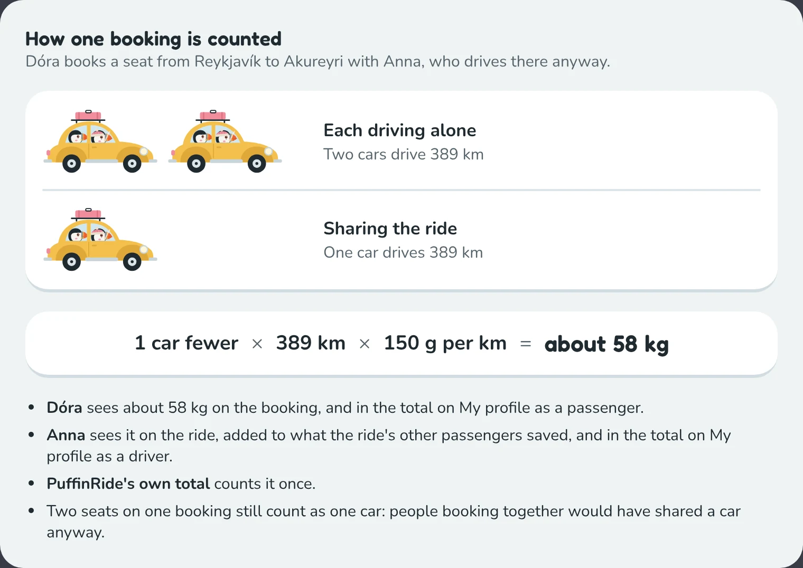
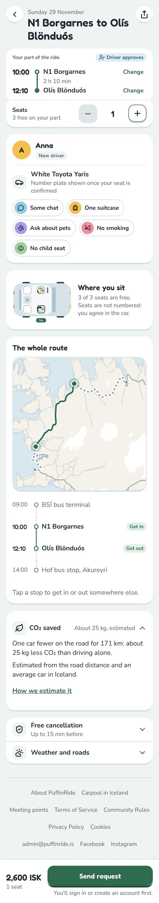
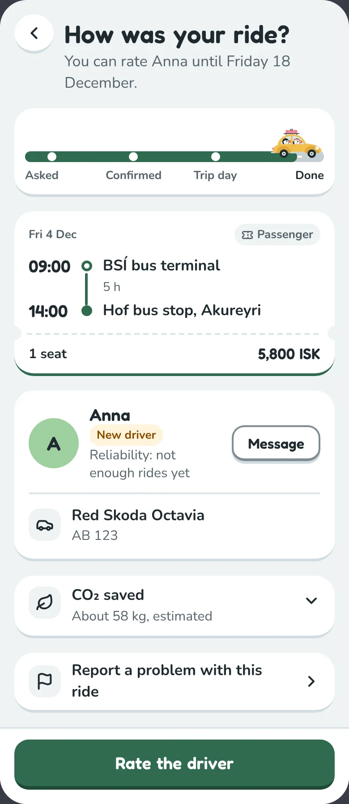
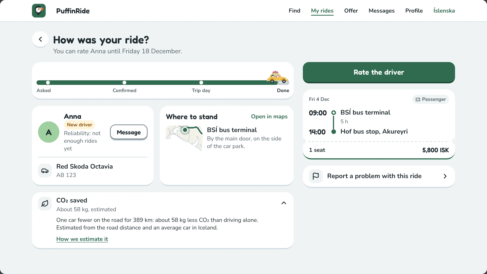
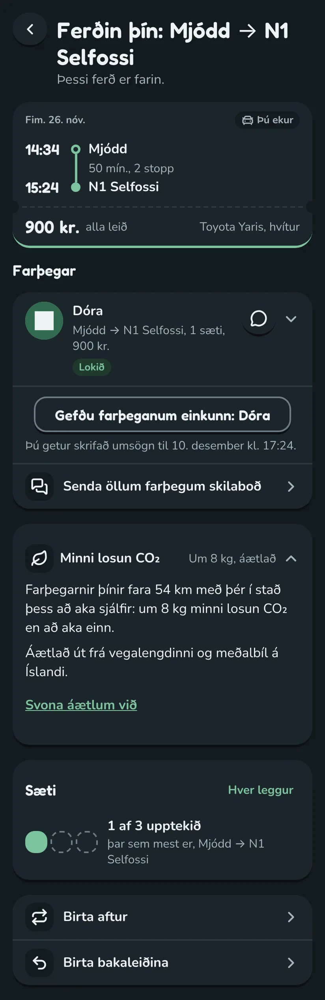
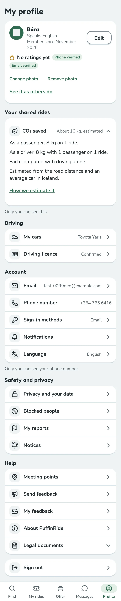
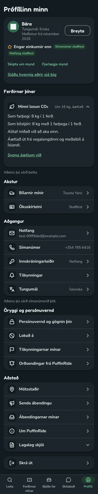
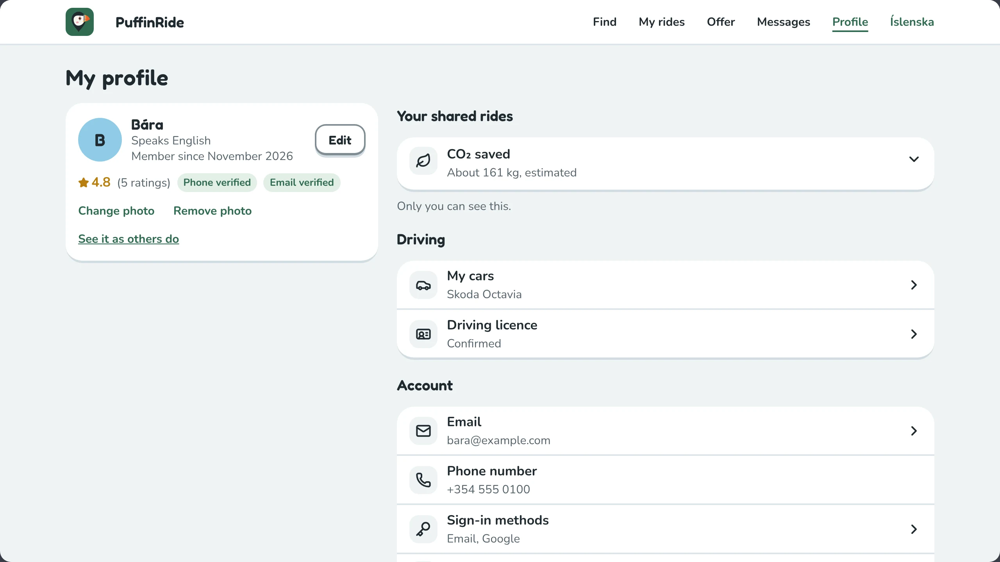
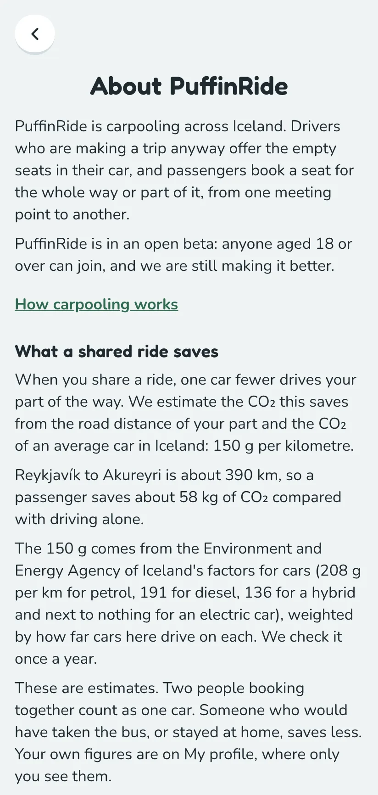

# Spec 34: The CO2 a shared ride saves

**Owner:** Martin · **Date:** 2026-11-28 · **Status:** Proposed
(2026-11-28): Martin asked for a plan; nothing is built until he approves
it. The choices in the Decisions section are working choices he can change.

Amends: [spec 31](2026-11-26-one-ride-one-ticket.md) (3.7 a ride's details,
3.8 a booked seat, 3.12 the driver's ride, 3.14 Profile and 3.16 wide
screens: one more card), [spec 30](2026-11-26-about-page-and-footer.md)
(About: one more section) and [spec 10](2026-11-13-operator-settings-and-metrics.md)
(one more setting, two more weekly figures). Decision:
[ADR 0054](../decisions/0054-estimate-co2-saved-as-one-car-not-driven.md)
(Proposed), as adding a setting needs one (R10.4).

## 1. Problem and goal

Martin, 2026-11-28: "make a plan how to implement co2 saved callculations
(just as small informative feature) It could also keep record for the user
and for the driver (if that makes sense)".

The money report ([2.14](../strategy/2026-11-27-ways-to-make-money.md#214-co2-count-it-do-not-sell-it))
says to count CO2 but not sell it: a Reykjavík to Akureyri ride saves about
60 kg for a passenger who would otherwise drive alone, the figure must say
"estimated" and never "carbon neutral", and PuffinRide's totals can later
go into employers' and municipalities' climate accounts and grant
applications.

**Goal:** a quiet line that says about how much CO2 sharing a ride saves,
on the ride before booking, on the booking after the ride, and as a total
on the member's own profile; one method, public on About; and PuffinRide's
own weekly totals for the operator. Small: no new service, dependency,
question or personal data.

## 2. User stories

- As a passenger choosing a ride, I see about how much CO2 sharing my part
  saves compared with driving alone.
- After the ride, my booking still shows what it saved.
- As a driver, I see what my passengers saved by riding with me.
- On my profile I see my total, as a passenger and as a driver. Nobody
  else sees it.
- Anyone can read how the figure is made.
- As the operator, I see the car kilometres and CO2 saved each week.

## 3. Behaviour

### 3.1 Approaches considered

How to count (ADR 0054 has them in full):

1. One car per **seat**: two people booking together would have shared a
   car, so it overstates.
2. One car per **booking**, compared with driving alone, at the CO2 of an
   average car in Iceland. **Chosen**: simple, no new question, honest
   when every text says what it compares with.
3. **Ask** each passenger after the ride how they would have travelled.
   More defensible for grants, but one more question after every ride and
   more personal data. Left for later (section 10).

Where to show it:

- On **every ticket** (Find, results, My rides): left out. A ticket says
  the same few things everywhere (spec 31, rule 1), and a figure on every
  card of a list is noise.
- **Only on Profile**: the smallest, but then nothing on the ride itself.
- On the ride, the booking, the driver's ride and Profile, as one card
  that is folded until opened: **chosen** (sections 3.4 to 3.8).

### 3.2 How a booking is counted

1. **Car kilometres saved** are the road distance of the passenger's part:
   the `distance_m` of the stretches from where they get in to where they
   get out (legs from our road file, [ADR 0031](../decisions/0031-distances-from-our-own-road-file.md)).
2. **CO2 saved** is those kilometres times the setting "CO2 per car km"
   (3.3), in whole grams.
3. **One booking is one car**, whatever its seats (decision 2).
4. It is **compared with driving alone**, and every text says so. Not
   counted: the driver's own drive (they go anyway), the little extra fuel
   a passenger's weight costs, and detours, since meeting points are on
   the way.
5. **The driver's figure** for a ride is the sum of its bookings'. A
   member who drives and rides sees both in their total. **PuffinRide's
   totals** count each booking once.
6. **What counts:** before the ride, the figure is an estimate for the part
   on screen. A booking adds to totals once it is **completed** (spec 8,
   R8.2). One that stops being completed (a driver's absence that stands
   after the ride, R8.7) stops counting. Requests, declined, expired,
   withdrawn, cancelled and no-show bookings never count.
7. **A booking keeps its grams.** When it becomes completed it stores the
   grams from the setting in force then; a later change of the setting
   changes only bookings completed after it, as a published trip keeps
   its price settings (R10.3).
8. **Rounding:** figures show in whole kilograms, rounded down. Under 1 kg
   nothing shows. A total is rounded once, so its parts may differ from it
   by a kilogram.

Example: BSÍ bus terminal to Hof bus stop, Akureyri is 389 km on our road
file; 389 × 150 g = 58 350 g, shown as "About 58 kg".

### 3.3 The figure per car kilometre: 150 g

From the Environment and Energy Agency of Iceland's factors for companies,
institutions and municipalities ([Losunarstuðlar, 5th edition, 2022](https://ust.is/library/sida/Loft/Losunarstudlar_UST_5.0.1.pdf)),
the same ones their climate accounts use, weighted by Reykjavík's 2025
inventory of how car kilometres split by power
([Reykjavík, 2026](https://reykjavik.is/en/news/2026/energy-transition-delivering-results)):

| Kilometres driven by | Share | Factor (g CO2e per km) | Weighted |
| -------------------- | ----: | ---------------------: | -------: |
| Petrol and diesel cars | 57% | about 200 (petrol 208, diesel 191) | 114 |
| Hybrids and plug-ins, not on electricity | 26% | 136 (full hybrid) | 35 |
| Electricity | 17% | 0 to 1.6 | 0 |
| **All cars** | | | **about 150** |

- It is a **guess good enough for an estimate**: Reykjavík's split is a
  city's, and driving between towns is more often on petrol or diesel;
  plug-ins on petrol emit more than a full hybrid. Both would raise the
  factor, so 150 is not on the high side.
- It is an **operator setting**, `co2_grams_per_car_km`: 150 by default,
  from 0 to 300 in steps of 1, with versions like every setting
  (ADR 0032). **0 hides every figure** in the app and on About, should a
  doubt about a claim ever need it.
- **Once a year**, each autumn, after the agency's and Reykjavík's new
  figures, the operator checks it, and the About text with it (3.9).

### 3.4 The CO2 card

One new use of existing parts (spec 31, 3.3), the same on every screen:

1. A `Card` holding one `ActionRows` row that unfolds (chevron pointing
   down): the Lucide `Leaf` in the row's usual soft square, **"CO₂ saved"**
   as its title, and **"About 58 kg, estimated"** under it.
2. Unfolded, it adds the sentence for that place (3.5 to 3.8) and the link
   **"How we estimate it"**, to About's section (3.9).
3. **It looks like the rows around it**: no green badge, no puffin, no
   colour of its own. It is information, not a reward (rule 6).
4. **The ₂.** Nunito, the text face, has it; Fredoka, the face of titles
   and figures, does not. So "CO₂" only ever stands in Nunito text, and no
   title in Fredoka contains it. Screen readers get "CO2" with a plain 2:
   "CO2 saved, about 58 kilograms, estimated", and the row's expanded or
   collapsed state, as other rows that unfold (spec 31, 3.20).
5. It shows only when its figure is at least 1 kg and the setting is not 0.
6. **On a laptop** it always stands in the main column. The side columns
   keep exactly what they hold, so each stays whole in a window 1280 by
   720 (spec 31, 3.16, items 2 and 3).

### 3.5 A ride's details (spec 31, 3.7)

- The card stands between "The whole route" and the rows, on a phone and
  in a laptop's main column, for everyone who opens the ride, signed in or
  not: it says nothing about any person.
- Its figure is for the part on screen and follows Change on either end.
  The seats stepper does not change it (3.2, item 3).
- Unfolded: "One car fewer on the road for 389 km: about 58 kg less CO₂
  than driving alone. Estimated from the road distance and an average car
  in Iceland."
- A cancelled ride has no card.

### 3.6 A booked seat (spec 31, 3.8 and 3.9)

- From the time the seat is confirmed, on the trip day and after the ride,
  while the booking is confirmed or completed: the same card and sentence,
  right before the rows. On a laptop it stands in the main column under
  the driver and "Where to stand".
- Once completed, it shows the grams the booking kept (3.2, item 7).
- A booking that ended any other way has no card, nor has a driver who
  opens a passenger's booking: theirs is on the ride (3.7).

### 3.7 The driver's ride (spec 31, 3.12)

- With at least one booking confirmed or completed, the card stands right
  after Passengers, on a phone and in a laptop's main column, with the sum
  of those bookings.
- Unfolded: "Your passengers ride 634 km with you instead of driving:
  about 95 kg less CO₂ than driving alone. Estimated from the road
  distance and an average car in Iceland."

### 3.8 My profile (spec 31, 3.14)

- A group **"Your shared rides"** with the card, right under the person's
  card on a phone, and first in the main column on a laptop. It appears
  with the first booking that counts, as a passenger or as a driver;
  before that there is no group.
- The figure is the member's total. Unfolded, one line for each role they
  have, then the comparison and the link:
  - "As a passenger: 66 kg on 2 rides."
  - "As a driver: 95 kg with 2 passengers on 1 ride." (Passengers here are
    bookings counted.)
  - "Each compared with driving alone. Estimated from the road distance
    and an average car in Iceland."
- Under the card, small: **"Only you can see this."**, as under the phone
  number.
- It is not on the person's card, which shows what others see, and not on
  anyone's public profile (decision 5).
- Read again each time Profile comes back into view, as the other rows.

### 3.9 About (spec 30)

A section **"What a shared ride saves"** (`/about#co2`), after the
introduction, in four short paragraphs: what is counted, the Reykjavík to
Akureyri example, where the 150 g comes from, and what the figure is not
(section 8). The heading avoids "CO₂" (3.4, item 4). Its figure and
example come from the setting, which `/v1/config` gives; at 0 the section
is not there.

### 3.10 The operator (spec 10)

- The setting (3.3) is in a new group of the console's Settings, "CO2".
- Two new weekly figures, from the bookings completed in the week, each
  counted once: **Car km saved** and **CO2 saved (kg)**, in the table and
  in the CSV. They count no people, so the "fewer than 5" rule does not
  apply.
- The console shows no one's own figures.

### 3.11 Keeping the record

- **The record is the completed bookings themselves**, each with its
  grams: no table of running totals that could drift from them.
- **Totals do not drop after three years.** Trips and their bookings are
  made anonymous 3 years after the ride (privacy register). Just before,
  the hourly clean-up adds each counted booking to its passenger's and its
  driver's **carried totals**: one small row per member, with grams and
  rides as a passenger, and grams, rides and passengers as a driver.
  A member's total is the carried row plus their live bookings.
- **Download my data** gives the totals and each booking's grams.

### 3.12 The website and the phone apps

One code for the website and both phone apps (Expo): the same card on
every screen above. No native module and no new dependency (Lucide has
`Leaf`), so the phone apps get it with their next update.

## 4. Rules

| #     | Rule |
| ----- | ---- |
| R34.1 | One completed booking is one car not driven for the passenger's part, whatever its seats. PuffinRide's totals count it once. |
| R34.2 | CO2 saved is the part's road distance times the setting in force when the booking completed; the booking keeps it. |
| R34.3 | Only completed bookings count toward totals; a booking that stops being completed stops counting. |
| R34.4 | Every figure says that it is an estimate and what it is compared with, and the method is on About. |
| R34.5 | No text, in the app, emails or marketing, says "carbon neutral", "climate neutral", "zero emissions", "green" or "eco-friendly", or speaks of offsets or credits. CO2 texts never mention money, prices, payments or fees. |
| R34.6 | A member's own figures are shown only to them. The operator sees weekly sums only. |
| R34.7 | Figures show in whole kilograms, rounded down. Under 1 kg, or with the setting at 0, nothing shows. |
| R34.8 | On a laptop the CO2 card is never in a side column. |
| R34.9 | Totals do not drop when rides are made anonymous: their grams are carried. |

## 5. Screens

Drawn with spec 31's kit ([source](images/co2-saved/src/)); the build
retakes them from the app:

0. [How one booking is counted](images/co2-saved/0-how-it-counts.webp)
1. [A ride's details, the card unfolded](images/co2-saved/1-ride-phone-light.webp)
2. [A booked seat after the ride](images/co2-saved/2-booking-after-phone-light.webp)
3. [The driver's ride, dark, Icelandic](images/co2-saved/3-driver-ride-phone-dark-is.webp)
4. [My profile](images/co2-saved/4-profile-phone-light.webp)
5. [My profile, dark, Icelandic](images/co2-saved/5-profile-phone-dark-is.webp)
6. [A booked seat on a laptop](images/co2-saved/6-booking-after-laptop-light.webp)
7. [My profile on a laptop](images/co2-saved/7-profile-laptop-light.webp)
8. [About's new section](images/co2-saved/8-about-phone-light.webp)

## 6. Data and API

- **Domain** (`packages/domain/src/co2/`, no I/O): the car kilometres of a
  part from its stretches; grams from metres and the setting; the
  kilograms to show (null under 1 kg or at 0); a member's totals by role.
- **Setting:** `co2_grams_per_car_km` in the catalogue, group `co2`, unit
  `g_per_km` (ADR 0054).
- **Database:** `bookings.co2_grams` (integer, null until completed, never
  negative); `co2_carried` (member, passenger grams and rides, driver
  grams, rides and passengers), deleted with the account. One migration.
- **Setting the grams:** wherever a booking becomes completed (the trip's
  completion, R8.2, and the operator finding a passenger rode, spec 8,
  3.5).
- **API:** a ride's part gains `distanceM` and `co2Grams` (null when
  hidden); a booking gains the same; the driver's ride gains `co2` (grams
  and distance of its counted bookings, or null); a new
  `GET /v1/me/co2` gives the member's totals by role; `/v1/config` gains
  `co2GramsPerCarKm`; the weekly figures gain `car_km_saved` and
  `co2_saved_grams`.

## 7. Privacy and safety

- **No new data is collected.** The figures are made from bookings we
  already hold, for the service the member uses (contract).
- **Who sees what:** a member, their own totals; a driver, the sum on a
  ride they drove (they already see each passenger's part); a ride's
  figure, anyone who opens the ride, as it names no one; the operator,
  weekly sums. Nothing goes to Google Analytics, emails or notifications.
- **Privacy register** (with the build): "Trips and bookings" gains the
  grams; a new row "CO2 totals carried over" (the member; until the
  account is deleted). On erasure the carried row goes; anonymous bookings
  keep their grams, which then belong to no one.
- **Legal texts:** nothing in the Terms or Privacy Policy needs a new
  version for this alone; a later version may mention it (Martin's call).
- **Claims:** the Marketing Act (44/2026) bans misleading actions (art. 5)
  and makes us prove a factual claim (art. 12): the method on About and
  this spec are that proof. The EU's Directive 2024/825 bans vague green
  claims and neutrality claims based on offsets from 27 September 2026;
  whether it applies in Iceland through the EEA yet is **not checked**.
  R34.4 and R34.5 meet it either way.

## 8. Texts

English and Icelandic, in `packages/i18n` (numbers as our formatting
writes them, ADR 0025, with a no-break space before the unit):

| Key | English | Icelandic |
| --- | ------- | --------- |
| `co2.title` | CO₂ saved | Minni losun CO₂ |
| `co2.value` | About {kg} kg, estimated | Um {kg} kg, áætlað |
| `co2.spoken` | CO2 saved, about {kg} kilograms, estimated | Minni losun CO2, um {kg} kíló, áætlað |
| `co2.part` | One car fewer on the road for {km} km: about {kg} kg less CO₂ than driving alone. | Einum bíl færra á veginum í {km} km: um {kg} kg minni losun CO₂ en að aka einn. |
| `co2.driver` | Your passengers ride {km} km with you instead of driving: about {kg} kg less CO₂ than driving alone. | Farþegarnir þínir fara {km} km með þér í stað þess að aka sjálfir: um {kg} kg minni losun CO₂ en að aka einn. |
| `co2.how` | Estimated from the road distance and an average car in Iceland. | Áætlað út frá vegalengdinni og meðalbíl á Íslandi. |
| `co2.link` | How we estimate it | Svona áætlum við |
| `co2.group` | Your shared rides | Ferðirnar þínar |
| `co2.asPassenger` | As a passenger: {kg} kg on {rides, plural, one {# ride} other {# rides}}. | Sem farþegi: {kg} kg í {rides, plural, one {# ferð} other {# ferðum}}. |
| `co2.asDriver` | As a driver: {kg} kg with {passengers, plural, one {# passenger} other {# passengers}} on {rides, plural, one {# ride} other {# rides}}. | Sem bílstjóri: {kg} kg með {passengers} farþega í {rides, plural, one {# ferð} other {# ferðum}}. |
| `co2.compared` | Each compared with driving alone. | Alltaf miðað við að aka einn. |
| `co2.onlyYou` | Only you can see this. | Aðeins þú sérð þetta. |
| `about.co2Title` | What a shared ride saves | Hvað sparast með samferð |
| `about.co2Method` | When you share a ride, one car fewer drives your part of the way. We estimate the CO₂ this saves from the road distance of your part and the CO₂ of an average car in Iceland: {grams} g per kilometre. | Þegar þú ferð með öðrum er einum bíl færra á veginum þinn hluta leiðarinnar. Við áætlum hve mikil losun CO₂ sparast út frá vegalengd þíns hluta og losun meðalbíls á Íslandi: {grams} g á hvern kílómetra. |
| `about.co2Example` | Reykjavík to Akureyri is about 390 km, so a passenger saves about {kg} kg of CO₂ compared with driving alone. | Frá Reykjavík til Akureyrar eru um 390 km, svo farþegi sparar um {kg} kg af CO₂ miðað við að aka einn. |
| `about.co2Source` | The {grams} g comes from the Environment and Energy Agency of Iceland's factors for cars (208 g per km for petrol, 191 for diesel, 136 for a hybrid and next to nothing for an electric car), weighted by how far cars here drive on each. We check it once a year. | Talan {grams} g byggir á losunarstuðlum Umhverfis- og orkustofnunar fyrir fólksbíla (208 g á km fyrir bensín, 191 fyrir dísil, 136 fyrir tvinnbíl og nánast ekkert fyrir rafbíl), vegnum eftir því hve langt bílar hér aka á hverju. Við förum yfir hana einu sinni á ári. |
| `about.co2Limits` | These are estimates. Two people booking together count as one car. Someone who would have taken the bus, or stayed at home, saves less. Your own figures are on My profile, where only you see them. | Þetta eru áætlanir. Tveir sem bóka saman teljast einn bíll. Sá sem hefði annars tekið strætó, eða setið heima, sparar minna. Þínar eigin tölur eru á prófílnum þínum og aðeins þú sérð þær. |
| console: setting | CO2 per car km (g per km) | CO2 á ekinn km (g á km) |
| console: group | CO2 | CO2 |
| console: figures | Car km saved; CO2 saved (kg) | Eknir km sparaðir; Minni losun CO2 (kg) |

## 9. Testing

- **Domain** (failing tests first): a part's kilometres from its
  stretches; grams for 389 km at 150 g; two seats count as one car;
  rounding down, under 1 kg and the setting at 0; totals by role.
- **API** (integration): completing a trip stores each completed booking's
  grams and leaves no-shows at null; a later change of the setting leaves
  them; a driver's absence after the ride stops the booking counting;
  anonymising a trip moves its grams to both members' carried totals and
  the totals stay the same; `GET /v1/me/co2` is the member's own only; the
  weekly figures.
- **App** (screen tests): the card on each of the four screens, folded
  and unfolded, in both languages; hidden under 1 kg and at 0; the name a
  screen reader hears; not on a public profile.
- **Web journeys:** the pictures retaken; on a laptop, the booked seat's
  and the driver's side columns measure as they do today.

## 10. Out of scope

- **Asking passengers how they would have travelled** (ADR 0054, option 3):
  its own spec, if an employer, a municipality or a grant asks for an
  adjusted figure.
- **Reports for employers and regions** (money report, 2.3 and 2.4): they
  will use these figures, with members' consent, later.
- **A public total** on the website or in marketing: later, with its own
  look at the claim (R34.4, R34.5).
- **Carbon credits:** not now (money report, 2.14).
- A line in emails or notifications, a figure on tickets or on public
  profiles, and the fuel of drivers' cars (the saving is the passenger's
  car, ADR 0054, option 4).

## Decisions

Working choices, for Martin to change ("accept" keeps them all):

1. Count **compared with driving alone**, said in every text; no question
   after the ride for now (3.1).
2. **One car per booking**, whatever its seats (3.2, item 3).
3. **150 g per car km** to start, an operator setting checked each autumn;
   0 hides every figure (3.3).
4. Show it on **a ride's details, a booked seat, the driver's ride and My
   profile**, as one folded card; not on tickets, emails or notifications
   (3.4 to 3.8).
5. **Only the member sees their totals**; not on public profiles (3.8).
   On the decision card.
6. **Keep the record** in the completed bookings, with totals carried past
   the 3-year anonymisation (3.11).
7. **Two weekly figures** for the operator, for grants and later reports
   (3.10).
8. **The method on About**, in its own section (3.9).

Building it is about three pull requests: the counting (domain, setting,
database, API and weekly figures), the screens and About, then the carried
totals with Download my data and the privacy register. The plan follows
once this is approved.
