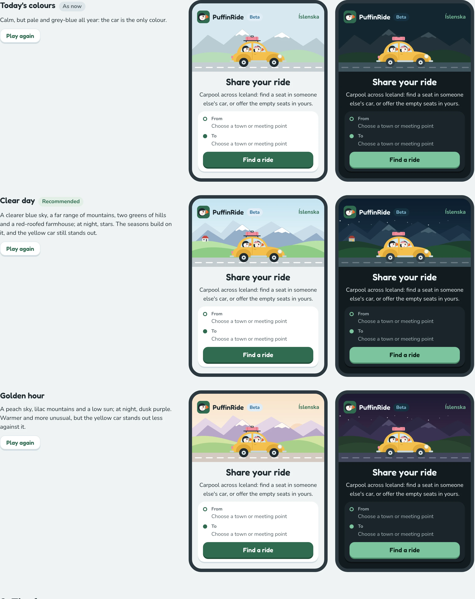
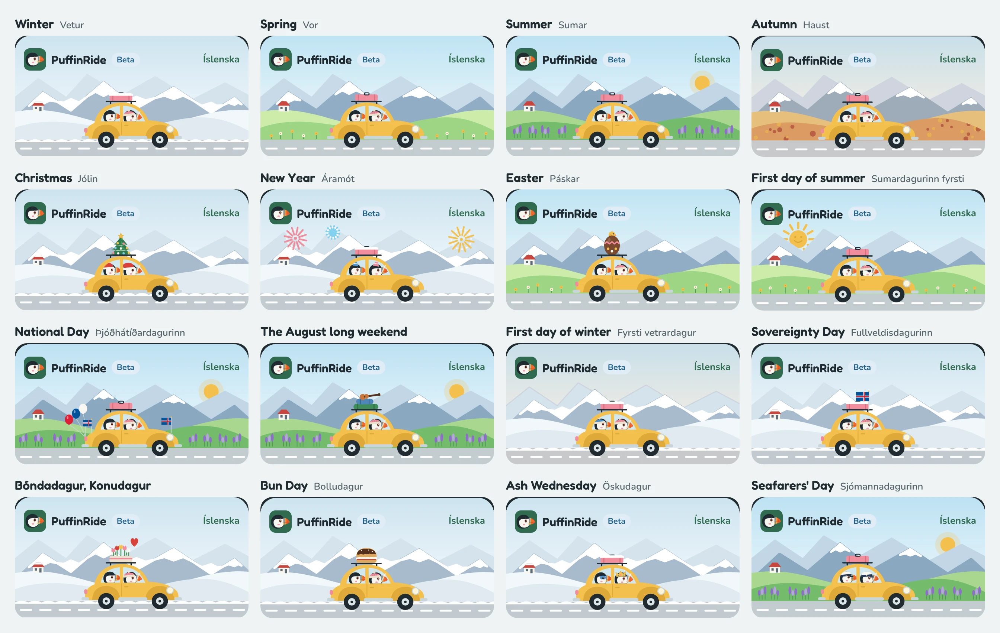
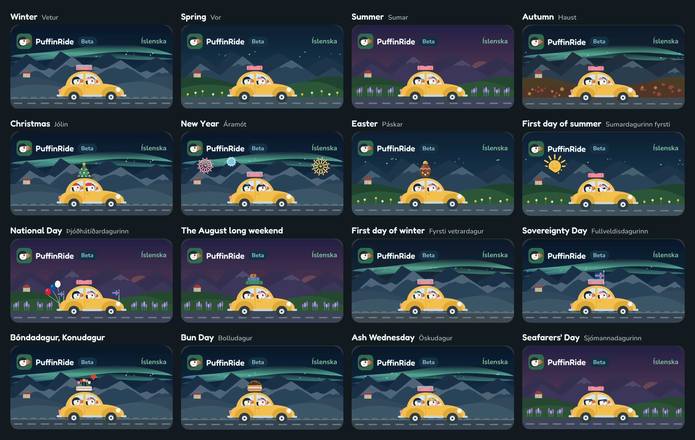
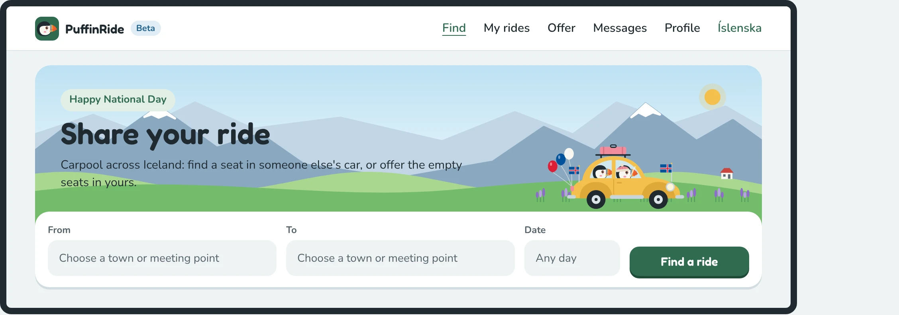
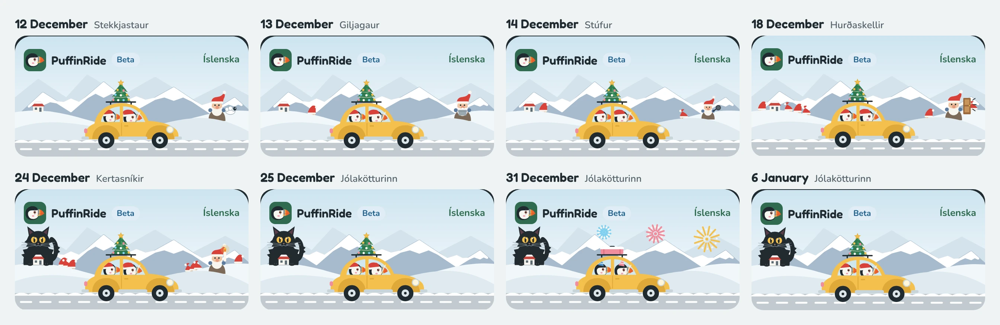
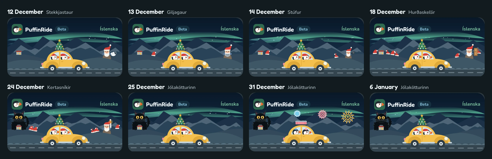
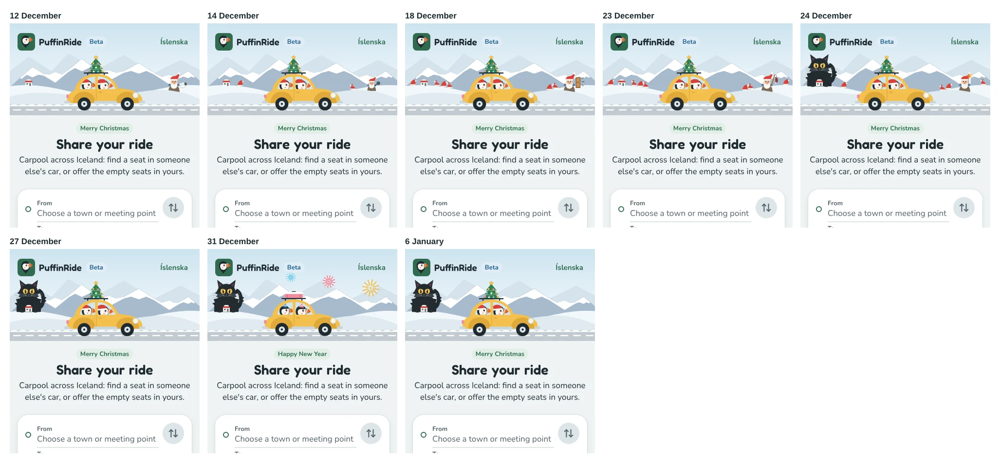
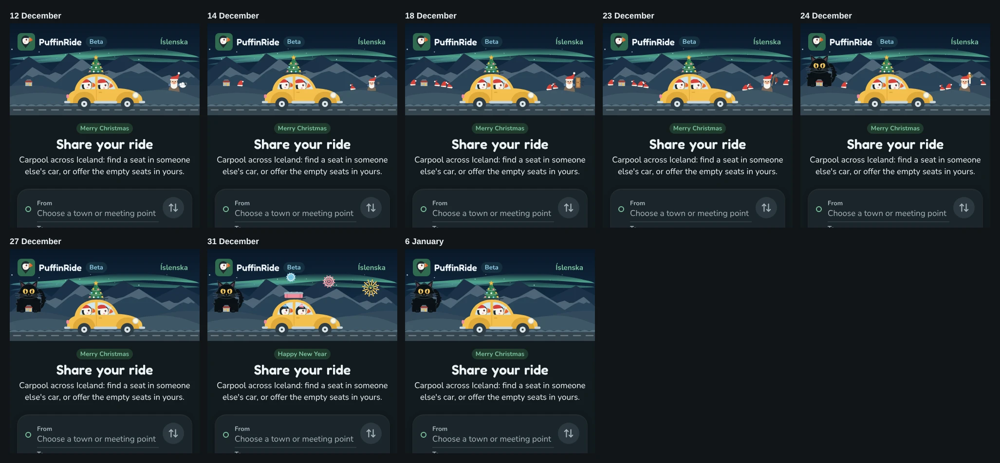
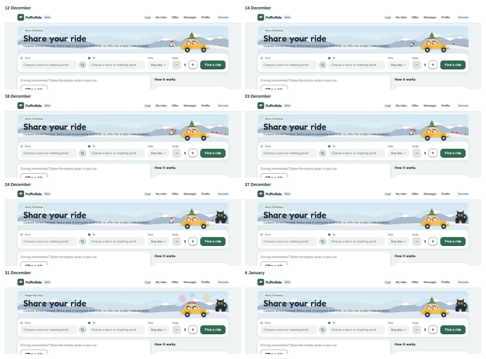
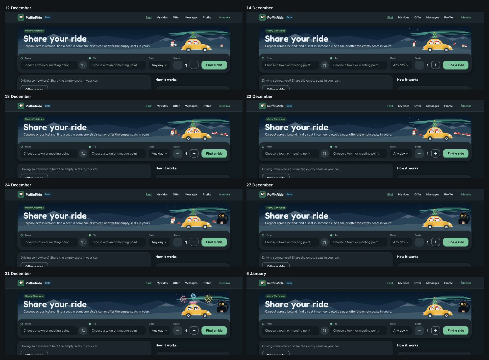

# Spec 36: The front page's banner through the year

**Owner:** Martin · **Date:** 2026-11-28 · **Status:** Accepted (2026-11-28)

Builds on: [spec 33, 3.2](2026-11-27-small-animations.md#32-the-front-pages-banner)
(the car's arrival, which stays as it is) and
[ADR 0052](../decisions/0052-animations-css-on-the-web-reanimated-on-phones.md)
(CSS on the website, Reanimated on phones). Amends:
[spec 15, 5.3](2026-11-13-visual-design-system.md) (the Iceland scene's
colours: Clear day, 3.1). No new dependency, service
or data; the console switch (3.8) is a new setting, so it has
[ADR 0057](../decisions/0057-a-switch-for-the-festive-days-on-the-front-page.md)
(R10.4). Build plan: [docs/plans/2026-11-28-seasonal-banner.md](../plans/2026-11-28-seasonal-banner.md).

## 1. Problem and goal

Martin, 2026-11-28: "Also can u make the banner seasonal and have it
automatically change on time of a year, i think seasons, holidays and
national days could be included all with some animation", and: "Also look
if the banner shouldn't have more interesting colours".

Today the Iceland scene at the top of Find looks the same all year, in pale
grey-blues; the yellow car is its only colour. Since spec 33 the car drives
in and the puffins hop, once a visit.

**Goal:** the scene follows the year in Iceland on its own: four seasons,
and the big days with something of their own on the car and a moment that
moves. Richer colours, with every word on the scene as readable as today.
Nothing that slows a search, and nothing that moves for someone who asked
for less motion.

## 2. User stories

- As someone opening PuffinRide in December, I see snow and a Christmas
  tree on the car's roof, and the page feels alive and Icelandic.
- As someone looking for a ride for the August long weekend, the car
  carries a tent and wishes me a good ride.
- As someone with reduce motion on, I see the day's look, standing still.
- As the operator, I can turn the days off on a sad day.

## 3. Behaviour

The [moving preview](https://claude.ai/artifact/HosEmCjmrUnRptAtNHnipj)
([its source](images/seasonal-banner/preview.html)) shows every season and
day, in light and dark, on a phone and on a laptop, any day of the year,
and what Reduce motion does.

### 3.1 Colours

Three palettes, each in light and dark (the preview's section 2):

| Palette | Light | Dark |
| ------- | ----- | ---- |
| Today's colours | Pale grey-blue sky and mountains, one pale green | Flat night blue |
| **Clear day** (chosen) | A clearer blue sky that pales towards the land, a far range of mountains behind the near one, two greens of hills, a farmhouse with a red roof | A night sky with stars, the farmhouse's window lit |
| Golden hour | A peach sky, lilac mountains, olive hills, a low sun | Dusk purple, stars |

Martin chose Clear day (2026-11-28): it is richer while staying calm, the seasons
change it clearly (white, green, purple, gold), and the yellow car still
stands out, which it does less on Golden hour's warm sky. The seasons and
days below are drawn on Clear day; with another palette they are tuned to
it.

**Contrast (R36.1):** on a phone the name, the Beta label and the language
link stand on the sky; on a laptop the title and its line stand on any of
the scene's colours. Each colour of each season, light and dark, keeps at
least 4.5:1 with the words on it (the lowest is 4.56:1, autumn's light
hills). Decorations never go under words (3.6).

### 3.2 What shows when

The banner shows **the day** if today is one of the days in 3.4 or the smaller
ones in 3.5, and otherwise **the season**:

| Season | From | To |
| ------ | ---- | -- |
| Winter | The first day of winter (the Saturday between 21 and 27 October) | 31 March |
| Spring | 1 April | 31 May |
| Summer | 1 June | 31 August |
| Autumn | 1 September | The day before the first day of winter |

The seasons follow what Iceland looks like rather than the calendar's
quarters: snow comes early and stays into March, and winter begins on
Iceland's own first day of winter.

- **Iceland's date** decides, and it changes at midnight in Reykjavík.
  Iceland keeps UTC all year (no summer time), so the date is the UTC date
  on the device; nothing is asked from the server.
- **Two days together:** a one-day day wins over a longer one, in this
  order: New Year, Sovereignty Day, National Day, First day of summer,
  First day of winter, the smaller days, Easter, the August long weekend,
  Christmas. (Maundy Thursday can be the first day of summer, as in 2038.)
- A day's scene is its season's, except as the table in 3.4 says.

### 3.3 The seasons

Each plays its moment with the car's arrival (3.6).

| Season | Looks | Moves |
| ------ | ----- | ----- |
| Winter | Snow on the hills, on the road's edge and on the roof box; more snow on the peaks. On a dark screen, the northern lights | A little snow falls as the car comes in; on a dark screen the northern lights brighten |
| Spring | Fresh green, small flowers in the grass, the last snow on the peaks | Two puffins fly past, back for the summer, and the flowers open |
| Summer | Deep green hills and purple lupines. The sun high on a light screen; on a dark one, the midnight sun low on the mountains | The lupines sway in the car's wind, and the sun glows |
| Autumn | Heather red and birch gold on the hills, the first snow on the peaks. On a dark screen, the northern lights | A few leaves blow along behind the car |

### 3.4 The big days

| Day | When | Scene | Looks | Moves | Greeting (IS / EN) |
| --- | ---- | ----- | ----- | ----- | ------------------ |
| Christmas (Jólin) | 12 December, when the first Yule Lad comes to town, to 6 January (Þrettándinn), except 31 December and 1 January | Winter | A little tree on the roof; Yule hats; the Yule Lads and Jólakötturinn (3.11) | The tree's lights come on one by one as the car stops, under a little snow | Gleðileg jól / Merry Christmas |
| New Year (Áramót) | 31 December and 1 January | Winter | Party hats | Three fireworks go up and burst, one after another | Gleðilegt nýtt ár / Happy New Year |
| Easter (Páskar) | Maundy Thursday (Skírdagur) to Easter Monday (Annar í páskum) | Spring | A big Easter egg on the roof, its chick on top | The chick pops up out of the egg as the car stops | Gleðilega páska / Happy Easter |
| First day of summer (Sumardagurinn fyrsti) | The Thursday between 19 and 25 April | Spring | The sun over the mountains; the driver in sunglasses, still in the woolly hat | The sun rises over the mountains and its rays come out | Gleðilegt sumar / Happy first day of summer |
| National Day (17. júní) | 17 June | Summer | Icelandic flags on the car's front and back; balloons in blue, white and red | The flags flutter and the balloons swing as the car stops | Gleðilega þjóðhátíð / Happy National Day |
| The August long weekend (Verslunarmannahelgin) | The Wednesday before the first Monday in August, to that Monday | Summer | A tent, a sleeping bag and a guitar on the roof | The load rocks forward as the car stops, and settles | Góða ferð um helgina / Have a good ride this weekend |
| First day of winter (Fyrsti vetrardagur) | The Saturday between 21 and 27 October | Autumn, turning to winter | Both puffins in woolly hats | Snow falls and the autumn hills turn white | Gleðilegan vetur / Happy first day of winter |
| Sovereignty Day (Fullveldisdagurinn) | 1 December | Winter | An Icelandic flag on the roof | The flag flutters as the car stops | Til hamingju með fullveldisdaginn / Happy Sovereignty Day |

The August long weekend starts on the Wednesday because that is when
people look for rides for it.

### 3.5 Smaller days

Well-loved days that are not holidays, one day each, in the winter scene
unless said:

| Day | When | Looks | Moves | Greeting (IS / EN) |
| --- | ---- | ----- | ----- | ------------------ |
| Bóndadagur | The Friday between 19 and 25 January (the first day of Þorri) | Flowers on the roof, a heart over the driver | The flowers rock and the heart rises | Til hamingju með bóndadaginn / Happy Bóndadagur |
| Konudagur | The Sunday between 18 and 24 February (the first day of Góa) | The same, the heart over the passenger | The same | Til hamingju með konudaginn / Happy Konudagur |
| Bolludagur | The Monday before Ash Wednesday (48 days before Easter Sunday) | A cream bun on the roof | The bun wobbles as the car stops | Gleðilegan bolludag / Happy Bun Day |
| Öskudagur | Ash Wednesday (46 days before Easter Sunday) | The puffins dressed up: a mask and a crown | The crown sparkles | Gleðilegan öskudag / Happy Ash Wednesday |
| Sjómannadagurinn (summer scene) | The first Sunday in June, or the second when the first is Whitsunday (Act 20/1987) | Sailor caps | Only the hop | Til hamingju með sjómannadaginn / Happy Seafarers' Day |

Left out for now: Valentine's Day, Halloween, Culture
Night, Pride, 1 May, and the religious days besides Christmas and Easter.

### 3.6 How the moments move

- The car's arrival stays exactly as spec 33, 3.2 says.
- A day's or season's moment starts with the arrival and is over within
  3.5 seconds; nothing loops (R33.3). Only transform and opacity move
  (R33.2).
- When the moment ends, the day's look stays, standing still: the tree lit,
  the flags out, the chick on its egg. Snow, leaves and flying puffins are
  gone.
- **Once a visit**, with the arrival (R33.5). Coming back to Find, the
  scene shows the day's look, still.
- **Reduce motion on:** the day's look, standing still, from the start
  (R33.4).
- **On a laptop**, everything a day adds and everything that moves stays in
  the car's room (spec 33, 3.2) at the right, never under the words; the
  rest of the scene shows only the season's colours.

### 3.7 The greeting

On a day, a short greeting stands above the title in a small rounded label
(the title stays as it is): above "Share your ride" on a phone, above the
title at the left on a laptop, where the scene's panel grows to hold it.
It is real text in the page's language, so screen readers read it; the
drawing stays hidden from them, as today. Seasons have no greeting. Signed
in, it stands above the greeting by name.

### 3.8 Turning the days off

One switch in the console, under Settings, Front page: **"Festive days
on the front page"** (`festive_days`, ADR 0057), on by default. Off, the banner shows only the seasons, for a sad
day when a party would be wrong. The apps read it from `/v1/config`, so it
takes effect within the five minutes the answer may be kept.

### 3.9 Trying any day

On the website, `?day=2027-06-17` (any date) shows that day's banner, for
checking a day before it comes; it changes nothing else and is not linked.
As built (`useBanner`, `apps/mobile/src/banner/use-banner.ts`): only a real
date written `YYYY-MM-DD` from 2000 to 2099 counts; anything else, such as
`2027-02-30`, shows today's banner. A phone ignores it.

### 3.10 Phones, and when

1. **The website first**, with the moments: one pull request after Martin
   approves this spec, live with the next release on his go. Built in a
   few days, it is live well before Christmas begins on 12 December.
2. **Phones:** the seasons' and days' look, standing still, with the first
   app update after the first App Store release; their moments with 1.1,
   with the rest of spec 33 (spec 33, 3.11).

### 3.11 The Yule Lads and Jólakötturinn

Added on Martin's ask (2026-11-28): "Do we have the Icelandic elf's and
Christmas cat?", "Can u have them day by day as the tradition goes", and
on the first sketch, "let's just have it till the Christmas, then only
the cat stays till 6th, also make the cat look more like the Icelandic
version of it (bit disproportional)". The
[sketch](https://claude.ai/artifact/GkYQEBMRcLD8jXs1J3SHA4)
([its source](images/seasonal-banner/yule-preview.html)) shows every day.

**The Yule Lads, 12 to 24 December.** One comes to town each night, in
the order of Jóhannes úr Kötlum's poem *Jólasveinarnir* (1932), so the
Lad of 12 + n December is the (n + 1)th:

| Date | Lad | What he holds |
| ---- | --- | ------------- |
| 12 Dec | Stekkjastaur (Sheep-Cote Clod) | A lamb |
| 13 Dec | Giljagaur (Gully Gawk) | A milk pail with its froth |
| 14 Dec | Stúfur (Stubby) | A frying pan; he is drawn smaller |
| 15 Dec | Þvörusleikir (Spoon-Licker) | A long wooden spoon |
| 16 Dec | Pottaskefill (Pot-Scraper) | A pot |
| 17 Dec | Askasleikir (Bowl-Licker) | An askur, the lidded wooden bowl |
| 18 Dec | Hurðaskellir (Door-Slammer) | A door |
| 19 Dec | Skyrgámur (Skyr-Gobbler) | A tub of skyr |
| 20 Dec | Bjúgnakrækir (Sausage-Swiper) | A string of sausages |
| 21 Dec | Gluggagægir (Window-Peeper) | A window to peek through |
| 22 Dec | Gáttaþefur (Doorway-Sniffer) | His big nose, sniffing laufabrauð |
| 23 Dec | Ketkrókur (Meat-Hook) | A hook with hangikjöt |
| 24 Dec | Kertasníkir (Candle-Stealer) | A candle |

- **The Lad of the day** stands behind the front hill from the chest up,
  in a red cap, with what he is after: on a phone right of the car, on a
  laptop left of it in the car's room (R36.5), which grows a little to the
  left on his nights, the title's line keeping clear of it.
- **The ones who came before** peek over the back hill as small heads in
  red caps, side by side and never one over another, as many as fit clear
  of the car, the Lad of the day and the farmhouse or the cat: so on the
  later days some stay out of sight.
- **No Lads after 24 December.** Their walk home is left out (Martin).

**Jólakötturinn, 24 December to 6 January,** New Year's Eve and Day
included, alone after the 24th. He is drawn as Icelandic pictures show
him, giant and out of proportion: a shaggy black cat standing on the back
hill with the farmhouse between his front paws, his head over its roof,
his tail up behind. Huge yellow eyes and a sly grin, but no teeth. He is
as tall as the room above the farmhouse allows: on a phone up to just
under the name's row, wherever it ends (lower with large text), on a
laptop near the panel's top. All of him stays in the picture, his side on
the narrowest phone and his tail clear of a panel's edge. On New Year's
Eve and Day the fireworks burst clear of him, every ray.

**The moments** (3.6): the Lad of the day pops up over the hill as the
car stops, from low enough that not even his cap shows before; the cat blinks and swishes his tail. Both are over within
3.5 seconds and leave the look standing; with reduce motion on, they
stand still from the start.

**Left out:** the Lads going home after Christmas, and the elves' bonfire
on Þrettándinn (in the first sketch; Martin chose without them).

## 4. Rules

| # | Rule |
| - | ---- |
| R36.1 | Every word on the scene keeps at least 4.5:1 contrast with every colour it can stand on, in light and dark. |
| R36.2 | The day is Iceland's date (UTC); the season and day come from one pure function in `packages/domain`. |
| R36.3 | A moment starts with the arrival, plays once a visit, and is over within 3.5 s; only transform and opacity move. |
| R36.4 | What a moment leaves is the day's look; with reduce motion on it shows at once, still. |
| R36.5 | On a laptop, nothing a day adds goes under the words. |
| R36.6 | Greetings are text through i18n, in Icelandic and English. |
| R36.7 | The console switch turns the days off; the seasons stay. |
| R36.8 | Which Yule Lad shows, and whether Jólakötturinn does, comes from the same pure function as the day (R36.2); the switch off shows neither. |

## 5. Screens

The [preview](https://claude.ai/artifact/HosEmCjmrUnRptAtNHnipj): any day
of the year, the three palettes, the four seasons, the eight big days, the
five smaller ones, a laptop with any of them, the year 2027 day by day, and
a table of every day's next date. The pictures below are the banners as
they stand once their moment is over ([how they were made](images/seasonal-banner/src/README.md)).

The Yule Lads and Jólakötturinn (3.11), from the
[sketch](https://claude.ai/artifact/GkYQEBMRcLD8jXs1J3SHA4):

As built, Find through `?day=` on eight of their days, on a phone and a
laptop:

## 6. Implementation

- **Calendar** in `packages/domain`: `bannerFor(date, { festiveDays })`
  returns `{ season, day }` for a calendar date (`day` is empty with
  `festiveDays` off, 3.8), with Easter worked out by
  the Gregorian rule (the anonymous algorithm) and the Icelandic days from
  their weekday rules. The builder checks the results for 2027 to 2036
  against the University of Iceland's almanac (Almanak Háskóla Íslands).
- **Colours** in `packages/ui/src/tokens.ts`: `icelandScene` gains the
  chosen palette and one set per season, light and dark (sky top and
  horizon, far range, mountains, glacier, back and front hills, road, and
  the drawing's new colours: flag blue and red, Yule red, tree greens,
  lupine, heather, birch, aurora). A unit test checks R36.1 over all of
  them.
- **Drawing:** `IcelandScene` takes the season and draws its layers (sky
  gradient, far range, glaciers by season, back hill, the farmhouse, stars,
  aurora, sun, lupines, flowers, heather, snow banks); `PuffinsInCar` takes
  the day and carries its load, flags, balloons and hats. Sky things on a
  laptop are drawn only in the car's room.
- **Motion** (ADR 0052): the moments are CSS keyframes in the motion sheet
  (`apps/mobile/src/theme/motion-css.ts`), from new `motion.moments` tokens,
  on parts marked with `motionMark`; they play with the car's arrival, so
  once a visit and reduce motion come for free (as built, below).
- **Setting:** a new operator setting, `festive_days` (on), in the console's
  Settings, and `festiveDays` in `/v1/config`.
- **Texts:** `home.greeting.<day>` in `en.ts` and `is.ts`.
- **The Yule Lads and the cat** (3.11): `bannerFor` also returns `yule`,
  the Lad of the date (`yuleLads`, in the poem's order) and whether the
  cat shows, or nothing outside 12 December to 6 January or with the
  festive days off. The drawings are in `apps/mobile/src/banner/yule.tsx`,
  their colours in `bannerYule` (`packages/ui`), their moments in
  `motion.moments`.

As built, in `apps/mobile/src/banner/`:

- **What shows:** `useBanner` (`use-banner.ts`) gives Find the season and
  day of the date in Iceland, from `bannerFor` and the console's switch,
  or of `?day=` on the website (3.9). `season-looks.ts` says what each
  season adds to the scene, `day-looks.ts` what each day dresses the car
  and the scene in (its load, flags, hats, sky and the first snow's
  cover); the scene's layers are in `scene-layers.tsx`, the car's loads in
  `car-loads.tsx`. On a laptop the first snow is masked to the car's room,
  fading in at its left edge.
- **The moments:** the tokens are `motion.moments` in `packages/ui` (each
  part's time, or the earliest and latest for things drawn many times).
  The motion sheet has one rule and keyframes per part, which play under
  `[data-motion="arrive"]` (the car's loads, hats and hearts) or under
  `[data-motion="moment"]`, which marks the scene while Find's `arriving`
  is on (`playing`). Each drawn thing carries its own start, length and
  way in `--d`, `--t`, `--dx`, `--dy` and `--r` (`motionMark`). Snow,
  leaves and the flying puffins (`moment-overlay.tsx`) and the fireworks'
  trails are drawn only while the moment plays, on the website, unseen
  until their animation shows them; a day's snow, or none, replaces its
  season's snow, leaves or flying puffins (`momentOf`), so Easter has no
  flying puffins. The season's own small motions in the scene (the
  northern lights, the sun's glow, the lupines and the flowers) play on
  its days too. Snow, leaves and puffins are drawn in the scene, so behind
  the car, where the preview had snow and leaves in front. A laptop's
  flying puffins set off at the car room's edge, fading in.
- **The look Find opened with:** the moment plays for the season and day
  Find first showed. When the first read of the console's settings turns
  the day off (3.8), the moment stops there, the season's does not start
  late, and the arrival ends with the car.
- **When it ends:** `whenArrived` ends the arrival when a part of the car
  or the moment ends and nothing under either mark still moves
  (`document.getAnimations()`); where the browser cannot list its
  animations, at the driver's hop, as before. The laptop's car room hides
  what of the car is outside it only until the driver's hop ends
  (`whenCarStopped`, `useDriving`), as spec 33 says, while the car's load
  may still move. Every moment ends by 3.3 seconds (checked for every
  season and day in the browser).

## 7. Privacy and safety

No personal data: nothing is stored, sent or counted. The date comes from
the device's clock. Nothing flashes more than three times a second (WCAG
2.3.1): each firework bursts once.

## 8. Texts

Thirteen greetings, in section 3.4 and 3.5, in Icelandic and English. The
Icelandic ones should be read by a native speaker before they go live.

## 9. Testing

- **Unit (domain):** the season and day for every date in 2026 to 2036
  against a table of known dates (Easter Sundays, the first days of summer
  and winter, Bóndadagur, Konudagur, the first Monday in August); the
  edges (31 March, 1 April, the day before the first day of winter,
  11 and 12 December, 30 and 31 December, 6 and 7 January); two days
  together (2038).
- **Unit (domain), Yule:** each date from 12 to 24 December gives its Lad
  in the poem's order; 11 December and 7 January give nothing; the cat
  from 24 December to 6 January, on 31 December and 1 January too; the
  switch off gives nothing.
- **Unit (Jest), Yule:** the Lad of the day, the heads of those before
  him and the cat each show on their days and not on others; the heads
  and the cat keep clear of the car (R36.5); the fireworks keep clear of
  the cat.
- **Unit (Jest):** the scene and the car render each season and day; the
  greeting shows on a day and not in a season; the switch off shows the
  season.
- **Website journeys (Playwright):** with `?day=`, a day shows its
  greeting and look with reduce motion on; one journey with motion on
  checks a day's moment ends within 3.5 s and stands still after.
- **Contrast:** the token test in section 6.
- **By hand:** light and dark, phone and laptop, every day, on the staging
  site with `?day=`.

## 10. Out of scope, later

- Sound; anything that loops; animated emails or ads.
- Days chosen by members, or a member's own birthday.
- Local days of one town (Þjóðhátíð in Vestmannaeyjar is the August long
  weekend already).
- A different drawing per part of Iceland.

## 11. Martin's steps

1. ~~Choose in section 12~~ (done, 2026-11-28).
2. Ask someone Icelandic to read the greetings (section 8).
3. Say when the website may go live with a release.

## 12. Martin's choices

Martin, 2026-11-28: "Ok lets do it I love all the proposals".

| Question | Options | Chosen |
| -------- | ------- | ------ |
| Colours | Today's colours; Clear day; Golden hour | **Clear day** (3.1) |
| Which days | The four seasons and the eight big days; also the five smaller days | **All of them**: the seasons, the big days and the smaller days |
| Greetings | On; off | **On** |

## 13. Decisions

| # | Question | Answer |
| - | -------- | ------ |
| 1 | Seasonal banner at all? | Yes (Martin, 2026-11-28) |
| 2 | Season boundaries | As Iceland looks: winter from the first day of winter to 31 March (my call, 3.2) |
| 3 | Christmas from when? | 12 December, the first Yule Lad (my call) |
| 4 | The Yule Lads and the cat (3.11)? | Yes: the Lads 12 to 24 December, the cat 24 December to 6 January, drawn giant (Martin, 2026-11-28) |
| 5 | The Lads going home, the elves' bonfire? | Left out (Martin, 2026-11-28) |
| 6 | Where the cat shows on New Year's Eve and Day | With the fireworks, which burst clear of him (my call: "the cat stays till 6th") |
| 4 | Moments loop? | No, once with the arrival (my call, from spec 33) |
| 5 | A way to turn the days off? | Yes, one console switch (my call, 3.8) |
| 6 | Phones | Still look with the first update after the App Store release, moments with 1.1 (my call, 3.10) |
| 7 | Colours | Clear day (Martin, 2026-11-28) |
| 8 | Which days | The seasons, the eight big days and the five smaller days (Martin, 2026-11-28) |
| 9 | Greetings | On (Martin, 2026-11-28) |
