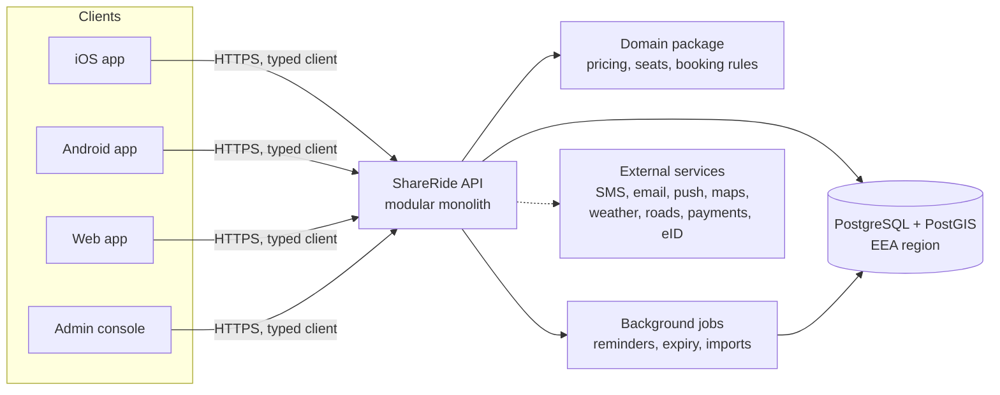

# Development strategy

**Owner:** Martin · **Last reviewed:** 2026-11-13 · **Status:** Draft for review

This is the one-page-per-topic summary of how ShareRide will be built. Each
section links to the detailed document. If you only read one file, read this.

## 1. The product in one paragraph

ShareRide connects drivers who are already making a trip in Iceland with
passengers going the same way. A driver publishes a trip as an ordered list of
curated **meeting points** with a departure time. Each stretch between two
consecutive meeting points is a **segment** with its own price. A passenger can
book seats on any contiguous part of the trip, for example only the middle
three segments, and pays the sum of those segment prices. Seats are tracked per
segment, so one physical seat can carry different passengers on different parts
of the same trip. Details: [product vision](../product/vision.md),
[pricing and seats](../product/pricing-and-seats.md).

## 2. Principles

These principles decide trade-offs when nothing else does.

1. **Safety and trust first.** Fixed, well-chosen public meeting points,
   verified profiles, two-way ratings and weather-aware cancellations come
   before growth features.
2. **Liquidity is the real risk.** A ride-share app fails when searches return
   nothing. We launch on a few busy corridors and make posting a trip take
   under a minute.
3. **The domain is the asset.** Pricing, seat capacity and booking rules live
   in one framework-free, fully tested module. Frameworks and vendors are
   replaceable around it.
4. **One language, one codebase, every platform.** TypeScript end to end;
   one app for iOS, Android and web.
5. **Own the data, rent the commodities.** Our users, trips and bookings live in
   our own PostgreSQL database in the EEA. Maps, SMS, email, push, payments and
   identity checks sit behind small interfaces so providers can be swapped.
6. **Decisions are written down.** Every significant choice is an ADR. Anyone
   can reconstruct *why* the system looks the way it does.
7. **Boring where possible.** Proven technology, a modular monolith, managed
   services. Novelty only where it pays for itself.
8. **Operable by one person.** Martin runs the service. Verification,
   moderation, support and payouts must be automated or one click in the admin
   console, and every managed service is chosen so nobody has to be on call for
   servers.
9. **Open to anyone.** A public product: accessible (WCAG 2.2 AA), usable by
   visitors without an Icelandic ID, and understandable in Icelandic and English.

## 3. Recommended technology stack

The stack (ADRs 0002 to 0005), the trip and pricing model (ADR 0006) and
phased payments (ADR 0008) were **accepted** on 2026-11-13. The other rows
are **Proposed** until the owner accepts their ADRs. The main alternatives
were considered in each ADR.

| Concern                  | Recommendation                                                     | ADR |
| ------------------------ | ------------------------------------------------------------------ | --- |
| Repository               | Monorepo with pnpm workspaces and Turborepo, strict TypeScript     | [0002](../decisions/0002-monorepo-and-typescript.md) |
| iOS, Android, web client | Expo (React Native) with Expo Router; EAS Build, Submit and Update | [0003](../decisions/0003-cross-platform-client-expo.md) |
| Backend                  | TypeScript modular monolith (Hono), framework-free domain package, OpenAPI contract generated from Zod schemas | [0004](../decisions/0004-backend-modular-monolith.md) |
| Database                 | PostgreSQL with PostGIS, Drizzle ORM and SQL migrations            | [0005](../decisions/0005-postgresql-postgis.md) |
| Trip model               | Curated meeting-point network, per-segment prices and per-segment seat capacity | [0006](../decisions/0006-meeting-points-and-segment-pricing.md) |
| Hosting                  | Containers on a managed platform in an EEA region; all personal data stays in the EEA | [0007](../decisions/0007-eea-hosting-and-data-residency.md) |
| Payments                 | Phased: pay the driver directly in the beta, in-app payments later through a provider that supports Icelandic marketplaces | [0008](../decisions/0008-payments-phased.md) |
| Maps and routing         | MapLibre with OpenStreetMap-based tiles; precomputed distances between meeting points | [0009](../decisions/0009-maps-and-routing.md) |
| Sign-in and identity     | Phone number first, plus Apple and Google; optional Auðkenni (Icelandic electronic ID) verification | [0010](../decisions/0010-authentication-and-identity.md) |
| Languages                | Icelandic and English at launch, Polish next; ICU messages         | [0011](../decisions/0011-localization.md) |

**Why this stack is future-proof:** every layer is open source or has more than
one vendor that can replace it. TypeScript runs in the app, the API and the
shared domain package, so a rule is written and tested once. PostgreSQL will
outlive any framework we pick. Expo keeps us on the mainstream React Native
path, with first-party upgrade tooling.

## 4. Architecture at a glance

The API is one deployable service split into modules (`users`,
`meeting-points`, `trips`, `booking`, `pricing`, `messaging`, `notifications`,
`reviews`, `payments`, `admin`). Modules talk through explicit interfaces, so a
module can become its own service later if load ever requires it. Details:
[architecture overview](../architecture/overview.md),
[domain model](../architecture/domain-model.md),
[integrations](../architecture/integrations.md).

## 5. Iceland-specific design

These are the things a generic ride-share clone would get wrong.

- **Weather and roads drive cancellations.** Integrate Icelandic Met Office
  (Veðurstofa Íslands) warnings and Icelandic Road and Coastal Administration
  (Vegagerðin) road status. A trip that crosses a closed road or an orange or
  red warning area is flagged, both sides are notified, and cancellations are
  penalty-free.
- **Meeting points must work in winter.** Lit, plowed, with shelter or an open
  shop nearby, and a legal place to stop. Gas stations, bus hubs and shopping
  centres score well; the shoulder of Route 1 does not. See
  [meeting points](../product/meeting-points.md).
- **Locals and visitors are both users.** Icelandic residents have a kennitala
  (national ID number) and electronic ID; visitors do not. Nothing essential
  may require a kennitala.
- **Language and search.** Icelandic letters (þ, ð, æ, ö, accented vowels) must
  sort correctly and match ASCII input: "Hofn" finds "Höfn", "Thorlakshofn"
  finds "Þorlákshöfn".
- **Currency.** ISK has no minor unit in practice. Prices are whole krónur,
  rounded to a configurable step (default 100 kr).
- **Time.** Iceland is on UTC all year with no daylight saving. We still store
  UTC and show Iceland time explicitly, because visitors' phones are often set
  to another zone.
- **Emergency.** 112 is the emergency number; trip screens link to it and to
  SafeTravel information for remote routes.
- **Seasonality.** Summer brings tourists and highland (F-road) traffic; winter
  brings storms and darkness. Meeting points and vehicle requirements (4x4 for
  F-roads) can be seasonal.

## 6. Legal and regulatory position

Ride-sharing must stay **cost-sharing**, not a taxi service. Iceland's Taxi
Act No. 120/2022 defines taxi service as renting out a passenger car with a
driver for a set fee, and it has no explicit carpooling exemption. Our model
must therefore keep drivers from profiting: prices are capped near the real
cost per passenger, trips are ones the driver makes anyway, and pickups happen
only at published meeting points.

**This needs a written opinion from an Icelandic lawyer and a conversation with
the Icelandic Transport Authority (Samgöngustofa) before public launch.**
Insurance, tax treatment for drivers, consumer law, the EU Digital Services Act
(as it applies through the EEA) and accessibility rules are covered in
[legal and regulatory](../compliance/legal-and-regulatory.md). GDPR applies
through the EEA Agreement and Icelandic Act No. 90/2018; the plan is in
[privacy and GDPR](../compliance/privacy-gdpr.md).

## 7. Payments

Stripe and Adyen's marketplace product do not list Iceland as a supported
country for the platform's own business, so "just use Stripe Connect" is not
available to an Icelandic company. Icelandic acquirers (Rapyd, Teya, Straumur)
are the realistic options, and holding passengers' money before paying drivers
raises payment-services licensing questions.

Recommendation: **launch the beta without in-app payments** (the app shows the
price, the passenger pays the driver through a bank app or in cash), prove
demand, and add in-app payments in Phase 5 once a provider and the legal
structure are settled. The domain model includes payments from day one, so this
is a switch, not a rewrite. See [ADR 0008](../decisions/0008-payments-phased.md).

## 8. Quality strategy

- **Test-driven development** is the default, enforced by the Superpowers
  workflow.
- **The domain package** gets the strictest tests, including property-based
  tests that prove seats are never overbooked and prices always add up.
- **API tests** run against a real PostgreSQL with PostGIS in a container.
- **End-to-end tests:** Maestro for iOS and Android flows, Playwright for the
  web.
- **Accessibility** to WCAG 2.2 AA, checked in review and with automated tools.
- **Load test** search and booking before launch.

Details: [testing strategy](../engineering/testing-strategy.md).

## 9. Delivery

- **Trunk-based:** short branches, squash-merged into a protected `main`.
- **CI on every PR:** lint, type-check, tests, build, docs checks, dependency
  and secret scanning.
- **Environments:** local (Docker Compose), staging, production.
- **API releases:** merge to `main` deploys to staging; production is a
  one-click promotion with database migrations run first.
- **App releases:** EAS Build and Submit for store releases; EAS Update for
  over-the-air JavaScript fixes on matching native runtimes.
- **Observability:** error tracking, structured logs and uptime checks from the
  first deployment.

Details: [CI/CD and releases](../engineering/ci-cd-and-releases.md).

## 10. How we work with Claude Code

The project is set up for AI-assisted development that stays reviewable:

- [CLAUDE.md](../../CLAUDE.md) gives every session the rules and the map.
- **Superpowers** provides the brainstorm → spec → plan → TDD → review loop.
  Specs and plans are committed under `docs/specs/` and `docs/plans/`, so the
  reasoning behind each feature is part of the history.
- **Expo, frontend-design, Context7, TypeScript LSP, security guidance, PR
  review toolkit and CLAUDE.md management** plugins cover the rest.
- A project skill, `write-adr`, keeps decision records consistent.

Install instructions and the reasoning for each plugin are in
[Claude Code setup](../engineering/claude-code-setup.md); the workflow is in
[workflow](../engineering/workflow.md).

## 11. Roadmap summary

The roadmap follows Martin's four phases (design, build, beta, launch) and adds
a fifth for growth. Two tracks run alongside the product work from the start,
because they take calendar time and the beta depends on them:

- **Legal and company track:** lawyer's opinion, company, terms, privacy
  policy and insurance must be in place *before* the beta, not after it.
  Beta testers are real people sharing real cars, so the company is the data
  controller and the app-store publisher from the first public build.
- **Community track:** a waitlist and driver recruitment on the launch
  corridors start during the build, so the beta has trips on day one.

| Phase | Goal                     | Exit criteria                                                                 |
| ----- | ------------------------ | ----------------------------------------------------------------------------- |
| 1     | Design (think it through) | ADRs accepted, MVP specs and clickable prototype tested with 5 to 10 people, legal opinion requested, company form chosen |
| 2     | Build                    | Walking skeleton, then the MVP: post trips, search, book segments, chat, notifications, ratings, admin console |
| 3     | Closed beta              | 50 to 150 testers on 3 to 5 corridors for 6 to 8 weeks; liquidity and safety metrics met; company, terms and privacy policy live |
| 4     | Public launch            | Store releases, website, marketing campaign, support and moderation routines running |
| 5     | Grow and monetise        | In-app payments and service fee, recurring trips, ride alerts, Polish, partnerships |

Full detail: [roadmap](roadmap.md).

## 12. Top risks

| Risk                                                         | Mitigation                                                                 |
| ------------------------------------------------------------ | -------------------------------------------------------------------------- |
| Too few trips for passengers to find a ride (cold start)     | Launch on 3 to 5 corridors; recurring commuter trips; seed with partner drivers; ride alerts |
| Regulators treat drivers as unlicensed taxis                 | Cost-sharing price caps, legal opinion before launch, dialogue with Samgöngustofa |
| Payments provider or licensing blocks in-app payments        | Beta without in-app payments; provider-agnostic payment interface           |
| Safety incident damages trust                                | Verified profiles, public meeting points, trip sharing, fast reporting and response |
| Winter weather makes trips unreliable                        | Weather and road integration, penalty-free weather cancellations           |
| Project knowledge lost over time                             | ADRs, specs and plans in the repo; CLAUDE.md; docs updated in every PR     |

## 13. Key decisions

The open questions, each with a recommendation, are in
[open questions](open-questions.md). The three that shape everything else
were decided on 2026-11-13:

1. **Stack:** Expo with our own TypeScript API.
2. **Payments in the beta:** passengers pay the driver directly; in-app
   payments come after launch.
3. **Who sets segment prices:** the app suggests a cost-based price and the
   driver adjusts it up to a cap.
