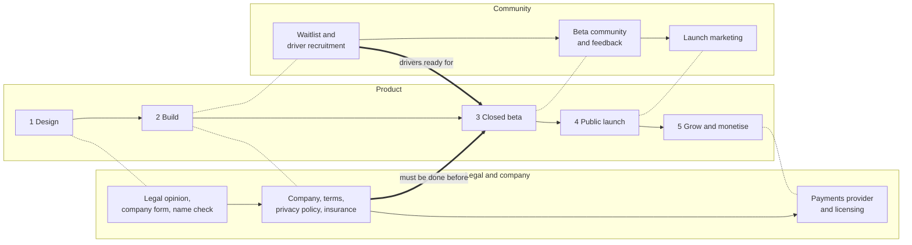

# Roadmap

**Owner:** Martin · **Last reviewed:** 2026-11-13

The roadmap follows the four phases Martin set out, design, build, beta and
launch, plus a fifth phase for growth. Phases end on **exit criteria**, not
dates. Dates are added once the stack is accepted and the build has a measured
pace.

Three tracks run in parallel. The product track is the app itself. The legal
and company track and the community track start early because they take
calendar time and the beta cannot start without them.

Dotted lines show which phase each track runs alongside. Thick arrows are
hard dependencies: the beta cannot start without them.

## Phase 1: Design (think it through)

Goal: every aspect of the product is thought out and written down before code.

Product and design

- [x] Review and accept or amend the strategy and ADRs 0002 to 0011
- [x] Answer the [open questions](open-questions.md) (all answered
      2026-11-13)
- [x] Write MVP feature specs in `docs/specs/` (one per feature in
      [features](../product/features.md)); specs 1 to 13 approved
- [x] Approve spec 14, women-only trips (added and approved 2026-11-13)
- [ ] Draft the meeting point list v1 for the launch corridors
      ([meeting points](../product/meeting-points.md))
- [ ] User flows and wireframes for: post a trip, search, book, manage bookings
      (search, book and post a trip drawn in
      [spec 15](../specs/2026-11-13-visual-design-system.md#54-screens);
      manage bookings to do)
- [ ] Brand direction: name check, logo, colours, tone of voice (colours,
      type and tone of voice in
      [spec 15](../specs/2026-11-13-visual-design-system.md); logo and app
      icon in [section 4.9](../specs/2026-11-13-visual-design-system.md#49-logo-and-app-icon);
      name check to do)
- [ ] Clickable prototype tested with 5 to 10 potential drivers and passengers
- [x] Set the cost-sharing price rates (ISK per km) and rounding: 15 kr
      suggested, 150 kr reference, 100 kr step (2026-11-13; legal opinion to
      confirm)

Legal and company (start now, see [legal and regulatory](../compliance/legal-and-regulatory.md))

- [ ] Written opinion from an Icelandic lawyer on the cost-sharing model under
      the Taxi Act No. 120/2022
- [ ] Informal check with Samgöngustofa (Icelandic Transport Authority)
- [ ] Decide company form (likely an ehf., private limited company)
- [x] Name: keep "ShareRide" for now, with the option to change it later
      (2026-11-13); a trademark and domain check before public launch
- [ ] Ask two insurers how cost-sharing affects drivers' motor insurance
- [ ] Talk to payment providers (Rapyd, Teya, Straumur) about marketplace
      payments, refunds and payouts to individuals, then choose one in an ADR
      ([ADR 0013](../decisions/0013-in-app-payments-only.md))

Exit criteria: ADRs accepted; MVP specs approved; prototype tested; legal
opinion requested; company form chosen.

## Phase 2: Build

Goal: a working, tested MVP on staging.

Walking skeleton, milestone 1: foundation and phone sign-in
([plan](../plans/2026-11-13-milestone-1-phone-sign-in.md))

- [x] Monorepo scaffold, CI, local development with Docker Compose
- [x] Expo app running on iOS, Android and web
- [x] API with health check and structured logging
- [x] Sign-in with phone number

Walking skeleton, milestone 2: hosted and connected
([plan](../plans/2026-11-13-milestone-2-hosted-and-connected.md), approved
2026-11-13; providers in ADRs 0018 to 0022)

- [ ] API deployed to staging in the EEA
- [ ] Real SMS provider for sign-in codes
- [ ] Error tracking and uptime checks connected
- [ ] Meeting points shown on a map and in a list
- [ ] Apple and Google sign-in; profile photo
- [ ] Development builds with EAS and mobile end-to-end tests

Milestone 3: offer and find rides
([plan](../plans/2026-11-14-milestone-3-offer-and-find-rides.md), approved
2026-11-14; before milestone 2's remaining PRs, at Martin's request)

- [ ] Sample meeting points and place search
- [ ] Cars and the licence declaration
- [ ] Post a trip with prices worked out from one price level
- [ ] Search with partial routes, trip details and shared links
- [ ] Maps on the web and phones

MVP features (each one a spec, a plan and a PR series)

- [ ] Profiles, vehicles, phone verification
- [ ] Post a trip from meeting points, with suggested segment prices
- [ ] Search by place and date, including partial routes
- [ ] Book seats on a segment range; instant or approval mode
- [ ] Booking management and cancellations by either side
- [ ] In-app payments, refunds, receipts and driver payouts
- [ ] Chat between driver and booked passengers
- [ ] Push, email and SMS notifications
- [ ] Ratings after the trip
- [ ] Report and block users
- [ ] Admin console: meeting points, users, trips, reports
- [ ] Privacy self-service: data export and account deletion
- [ ] Icelandic and English throughout
- [ ] Accessibility pass to WCAG 2.2 AA

Legal and company (in parallel)

- [ ] Register the company; open a business bank account
- [ ] Sign the payment provider contract
- [ ] Terms of service, privacy policy, community rules (Icelandic and English)
- [ ] Record of processing activities and data protection impact assessment
- [ ] Data processing agreements with every provider
- [ ] Apple and Google developer accounts in the company's name (until then,
      Martin's individual Apple account is used for development builds only,
      [milestone 2 plan](../plans/2026-11-13-milestone-2-hosted-and-connected.md#3-decisions-for-martin))

Community (in parallel)

- [ ] Landing page with a waitlist
- [ ] Recruit drivers on the launch corridors (commuters, students, workplaces)

Exit criteria: MVP features done and tested on staging; terms and privacy
policy approved; company registered.

## Phase 3: Closed beta

Goal: prove that people find rides and that the rules work in real life.

- [ ] 50 to 150 testers on the three commuter corridors (Selfoss, Keflavík
  Airport, Akranes and Borgarnes; Akureyri if the waitlist shows demand), for
  6 to 8 weeks
- [ ] TestFlight and Google Play internal testing, plus the web app
- [ ] In-app feedback and a weekly review of metrics and reports
- [ ] Fix, simplify, repeat

Exit criteria (confirmed 2026-11-13, measured over the last 4 weeks of the
beta on the launch corridors,
[spec 10](../specs/2026-11-13-operator-settings-and-metrics.md#34-metrics-h5)):

- At least half of searches on launch corridors return one or more trips
- At least 1 in 5 searches with results leads to a booking request
- Driver cancellation rate under 10 percent, excluding weather
- Seat fill of at least 30 percent
- At least 30 percent of passengers book again within 60 days
- Every report answered within 24 hours
- No unresolved safety incident
- Legal opinion received and the model adjusted if needed

## Phase 4: Public launch

Goal: anyone in Iceland, residents and visitors, can use ShareRide.

- [ ] App Store and Google Play release; public web app
- [ ] Website with route pages for search engines (for example "Reykjavík to
      Akureyri")
- [ ] Weather warnings and road closures on trips
- [ ] Optional identity verification with Auðkenni
- [ ] Launch marketing: press, social media, partner workplaces and schools,
      tourist channels
- [ ] Support routines: help centre, response times, moderation queue
- [ ] Incident and safety response plan

Exit criteria: public in both stores; support and moderation routines running.

## Phase 5: Grow and monetise

- [ ] Passenger service fee: set the amount from beta data
      ([ADR 0014](../decisions/0014-passenger-service-fee-from-launch.md))
- [ ] Recurring trips for commuters
- [ ] Ride alerts: notify me when a matching trip is posted
- [ ] Passenger ride requests that drivers can answer
- [ ] Polish language
- [ ] Keflavík Airport flows (flight-aware pickups)
- [ ] Live trip sharing with friends and family
- [ ] Partnerships: employers, universities, tourism operators

## How to update this roadmap

Tick items as PRs merge. When scope changes, edit this file in the same PR and
note why in the PR description. Dates are added only once the build pace is
known.
